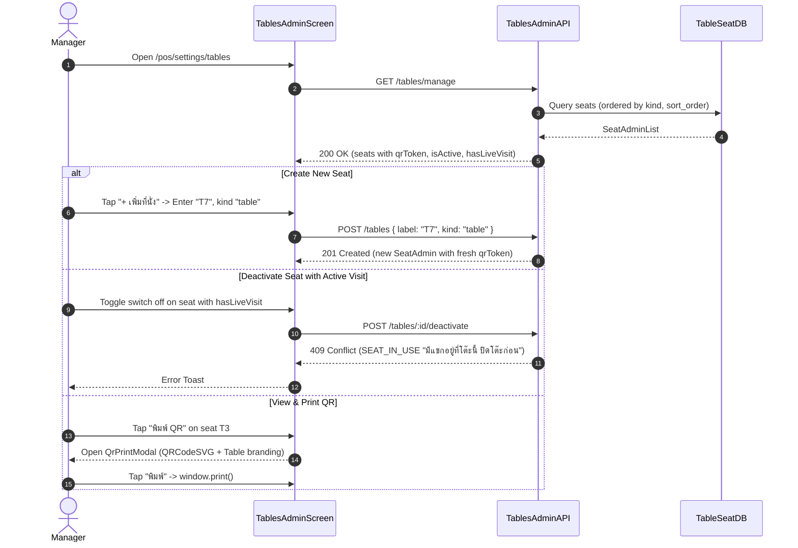

# BRIEF-069 — Web: back-office tables & counter seats management + QR sticker print

| | |
|---|---|
| **Owner** | Field |
| **Implementer** | kj |
| **Assigned auditor** | Cowork (default) |
| **Affected apps** | frontend |
| **Feature** | `standalone — single-slice brief` (CD-13 tables·1–10, print·1–3) |
| **References** | `docs/design/CD-13-handoff.md` (tables·1–10, print·1–3, R5) · BRIEF-066 (`tables:manage` API) · DR-009 (back office tables setup S1) · DR-018 (QR from payload) · DR-028 (customer session scan URL) · DR-029 (settings permissions) · `table_seat` schema |
| **Status** | Ready — Rev 1 approved by Field in session |
| **Revision** | 1 |
| **Depends on** | `BRIEF-066` (`tables-admin-api`) — merged (#115) · **Unblocks** physical table QR deployment & back-office operations |
| **Size** | ACs 6 (≤8) · flows 1 (≤1) · files 7 (≤10) · migrations 0 (≤1) · new patterns 0 (≤1) → OK |
| **Audit depth** | Compact (web admin UI + QR print layout) |

---

## 1. Goal

The bar owner or manager can manage physical seats (tables & counter seats) directly from the POS Settings back office — create seats, rename, reorder within sections, activate/deactivate with guest occupancy protection, and generate/print crisp high-contrast QR code stickers formatted for venue deployment.

## 2. Scope

### In
- **Route & Navigation:**
  - Route `/pos/settings/tables` guarded by permission `tables:manage` in `pos-routes.ts`.
  - Add tab "โต๊ะและ QR" to `SettingsNav.tsx` (visible when user has `tables:manage`).
- **Tables Management Screen (`/pos/settings/tables`):**
  - Grouped into two sections: "เคาน์เตอร์" (`counter`) and "โต๊ะ" (`table`).
  - Lists seats with label, status chip ("ใช้งาน" active, "มีแขก" has live visit, "ปิดอยู่" inactive).
  - Toggle Active/Inactive Switch:
    - Blocked with 409 `SEAT_IN_USE` ("มีแขกอยู่ที่โต๊ะนี้ ปิดโต๊ะก่อน") if `hasLiveVisit` is true.
    - Active toggle calls `POST /api/tables/:id/activate`.
    - Deactivate toggle calls `POST /api/tables/:id/deactivate`.
  - Reorder seats within section: Up / Down arrow buttons (and drag handle) calling `PUT /api/tables/order` `{ kind, ids }`.
- **Create & Edit Seat:**
  - Modal "+ เพิ่มที่นั่ง": Input `label` (1–20 chars, trimmed), RadioGroup `kind` (`table` | `counter`).
  - Validation: 409 `SEAT_LABEL_TAKEN` displays inline error "มีชื่อนี้แล้ว".
  - Edit seat: update label or move section via `PATCH /api/tables/:id`.
- **Table QR Modal & Print Preview:**
  - View QR Modal: renders QR code for the table using `qrcode.react` (`QRCodeSVG`).
  - URL payload: `${origin}/scan/${seat.qrToken}` (resolves to guest scan session per DR-028).
  - High-contrast venue sticker layout:
    - Venue name ("The Loft Bar") + Seat label ("โต๊ะ T3" / "เคาน์เตอร์ C1").
    - Clean QR using tokens `--qr-bg` (#FFFDF7) and `--qr-ink` (#12100C).
    - Clear instructions: "สแกนเพื่อสั่งอาหารและเครื่องดื่ม".
  - Print stylesheet / action: clean `@media print` printing sticker format without UI chrome.
  - "สร้าง QR ใหม่" (Regenerate QR): Confirm dialog ("สร้าง QR ใหม่? QR เดิมจะใช้ไม่ได้ทันที ลูกค้าที่สแกน QR เดิมจะเห็น 'QR ไม่ถูกต้อง'"). Calls `POST /api/tables/:id/qr/regenerate`.
- **MSW Mocks & Client API:**
  - Client API in `src/lib/api/tables-admin.ts` using `@bar/contracts` (`SeatAdminSchema`, `SeatAdminListSchema`, etc.).
  - MSW handlers in `src/mocks/tables-admin.ts` wired into `src/mocks/handlers.ts`.
- **Acceptance Tests:**
  - Locked acceptance test in `app/frontend/e2e/settings-tables.spec.ts`.

### Out
- Floor map drag-and-drop 2D canvas (future milestone; tabular sections with sort order in S1).
- Customer QR ordering flow implementation (already covered in BRIEF-047/BRIEF-049).

---

## 3. Standalone Design & Contract

### Decisions
| Decision | Why | Instead of |
|---|---|---|
| Tab "โต๊ะและ QR" in SettingsNav | Matches CD-13 IA (`/pos/settings/tables`) and sits alongside staff & venue settings | Separate top-level rail item |
| Section-based reordering with Up/Down buttons | Accessible, reliable on touch tablet & desktop (CD-13 tables·1–2) | Canvas-only drag & drop |
| `qrcode.react` SVG with `--qr-bg` / `--qr-ink` tokens | Guaranteed high contrast, vector scaling, crisp print output (DR-018) | Low-res raster canvas images |
| Occupied seat deactivation guard | Protects active guest tabs from abrupt cancellation (CD-13 tables·7, BRIEF-066 AC-4) | Silent deactivation or force-closing visits |

### Flow & Action Map


### Contracts (`@bar/contracts`)
- Uses existing schemas from `packages/contracts/src/schemas/tables-admin.ts`:
  - `SeatAdminSchema` (`id`, `label`, `kind`, `sortOrder`, `isActive`, `qrToken`, `hasLiveVisit`)
  - `SeatAdminListSchema` (`items: SeatAdmin[]`)
  - `CreateSeatRequestSchema` (`label`, `kind`)
  - `UpdateSeatRequestSchema` (`label?`, `kind?`)
  - `ReorderSeatsRequestSchema` (`kind`, `ids: string[]`)
  - `RegenerateQrResponseSchema` (`qrToken: string`)
  - Error codes: `SEAT_IN_USE` (409), `SEAT_LABEL_TAKEN` (409)

### Code Map
| File | Owns |
|---|---|
| `app/frontend/src/lib/permissions/pos-routes.ts` | Route permission gate for `/pos/settings/tables` (`tables:manage`) |
| `app/frontend/src/app/pos/settings/_components/SettingsNav.tsx` | Tab entry "โต๊ะและ QR" |
| `app/frontend/src/lib/api/tables-admin.ts` | Typed API calls for table administration |
| `app/frontend/src/app/pos/settings/tables/page.tsx` | Page composition for tables admin route |
| `app/frontend/src/app/pos/settings/tables/_components/TablesAdminScreen.tsx` | Main screen with sections, seat rows, active switches, reorder triggers |
| `app/frontend/src/app/pos/settings/tables/_components/SeatFormDialog.tsx` | Create / Edit seat dialog with validation |
| `app/frontend/src/app/pos/settings/tables/_components/QrPrintModal.tsx` | QR code sticker preview, printable layout, regenerate trigger |
| `app/frontend/src/mocks/tables-admin.ts` | MSW mock handlers for tables admin endpoints |
| `app/frontend/e2e/settings-tables.spec.ts` | Seeded Playwright acceptance test suite |

---

## 4. Acceptance Criteria

| AC | When | Then |
|---|---|---|
| 1 | Staff with `tables:manage` navigates to `/pos/settings/tables` | Tab "โต๊ะและ QR" is active; displays seats grouped into "เคาน์เตอร์" and "โต๊ะ" with sort order and status chips ("ใช้งาน", "มีแขก", "ปิดอยู่") |
| 2 | Staff adds a new seat (e.g. label "T7", kind "โต๊ะ") | Seat is saved via `POST /tables`, appears at the end of section with fresh QR token; Toast feedback shown |
| 3 | Staff attempts to create or rename to an existing active label (e.g. "T7") | API returns 409 `SEAT_LABEL_TAKEN`; inline error "มีชื่อนี้แล้ว" displays and form remains open |
| 4 | Staff moves a seat up or down in its section | `PUT /tables/order` is called with section seat IDs in the new order; UI immediately reflects new order |
| 5 | Staff toggles deactivate on a seat with `hasLiveVisit = true` | API returns 409 `SEAT_IN_USE`; switch remains active and error toast "มีแขกอยู่ที่โต๊ะนี้ ปิดโต๊ะก่อน" is shown |
| 6 | Staff opens QR modal for a seat | Modal renders SVG QR code with table label and venue title; trigger for "สร้าง QR ใหม่" prompts with confirm dialog before regenerating |

---

## 5. Tests (Planner = e2e · Executor = unit)

| ACs | Kind | Who writes | File |
|---|---|---|---|
| AC-1–AC-6 | e2e / acceptance | **Cowork** (in seed commit, protected) | `app/frontend/e2e/settings-tables.spec.ts` |
| AC-1, AC-3 | unit (`*.test.tsx`) | **Executor** (per build step) | `app/frontend/src/app/pos/settings/tables/_components/SeatFormDialog.test.tsx` |
| AC-4, AC-5 | unit (`*.test.tsx`) | **Executor** (per build step) | `app/frontend/src/app/pos/settings/tables/_components/TablesAdminScreen.test.tsx` |
| AC-6 | unit (`*.test.tsx`) | **Executor** (per build step) | `app/frontend/src/app/pos/settings/tables/_components/QrPrintModal.test.tsx` |

- Seeded `.spec.ts` tests run against MSW dev mocks in Playwright.
- Gate commands:
  ```bash
  pnpm --filter @bar/frontend lint
  pnpm --filter @bar/frontend typecheck
  pnpm --filter @bar/frontend test
  pnpm --filter @bar/frontend test:e2e e2e/settings-tables.spec.ts
  ```
- Run proof:
  ```bash
  pnpm --filter @bar/frontend dev
  # Navigate to http://localhost:3010/pos/settings/tables
  # Verify table list, create seat "T7", check QR preview modal
  ```
- Constraints: HeroUI v3 components, Tailwind DS tokens (`--qr-bg`, `--qr-ink`), no hardcoded colors, Thai UI copy.

---

## 6. Planner Dry Run (completed before Ready)

| Check | Verified against repo (`path:line`) | Result |
|---|---|---|
| Existing schema / entities | `docs/schema.sql:53-64` (`table_seat` schema: `id`, `label`, `kind`, `sort_order`, `qr_token`, `is_active`) | PASS |
| Wiring & protected files | `app/frontend/src/lib/permissions/pos-routes.ts:16` · `app/frontend/src/app/pos/settings/_components/SettingsNav.tsx:13` | PASS (all frontend application files, no protected files) |
| Packages & peer versions | `app/frontend/package.json:23` (`qrcode.react@^4.2.0`), `package.json:11` (`@heroui/react@^3.2.6`), `package.json:19` (`lucide-react@^1.47.0`) | PASS |
| Gate scripts exist | `app/frontend/package.json:11-15` (`lint`, `typecheck`, `test`, `test:e2e`) | PASS |
| E2e harness, imports & isolation | `app/frontend/playwright.config.ts:1-24` · `app/frontend/e2e/settings-staff.spec.ts:1-20` | PASS (Playwright with `NEXT_PUBLIC_API_MOCKING=enabled`) |
| Dependencies merged · parallel overlap | `git log main` verifies BRIEF-066 merged in commit `8b9b167` (PR #115) | PASS |
| UI tokens & components | `app/frontend/src/app/globals.css:130,287-288` (`--qr-bg`, `--qr-ink`, `--color-qr-bg`, `--color-qr-ink`) | PASS |

---

## 7. Unlocked Protected Files & Pre-Decided Items

- **Unlocked protected files:**
  - `none`
- **Pre-decided packages / endpoints:**
  - `qrcode.react` (DR-018, installed `^4.2.0`)
  - Endpoints: `GET /api/tables/manage`, `POST /api/tables`, `PATCH /api/tables/:id`, `PUT /api/tables/order`, `POST /api/tables/:id/deactivate`, `POST /api/tables/:id/activate`, `POST /api/tables/:id/qr/regenerate` (Source: Field, BRIEF-066 Rev 1, 2026-10-31)

---

## 8. Build Steps (inside → out · 1 step = 1 commit)

| # | Step | Done when | AC |
|---|---|---|---|
| 0 | Verify external Assumed rows + confirm seeded `settings-tables.spec.ts` compiles & fails red on assertion | Red assertion output (route not found / unrendered) | — |
| 1 | API Client & MSW mocks: create `src/lib/api/tables-admin.ts` and `src/mocks/tables-admin.ts` wired to `handlers.ts` | MSW returns mocked `SeatAdminList` and handles seat mutation endpoints | — |
| 2 | Route & Nav: add `/pos/settings/tables` permission in `pos-routes.ts` and "โต๊ะและ QR" tab in `SettingsNav.tsx` | Nav displays tab when authorized, route gate allows access | AC-1 |
| 3 | Tables screen & Sections: implement `TablesAdminScreen.tsx` rendering counter and table sections with status chips & active switches | Seat lists render correctly with sorting and status indicators | AC-1, AC-5 |
| 4 | Create & Edit Seat: implement `SeatFormDialog.tsx` for new seat creation and editing, handling 409 `SEAT_LABEL_TAKEN` | Add and edit seats function with duplicate validation error | AC-2, AC-3 |
| 5 | Reorder seats: implement Up/Down sort order actions calling `PUT /tables/order` | Seat sorting updates instantaneously within each section | AC-4 |
| 6 | QR Print Modal: implement `QrPrintModal.tsx` with `qrcode.react` SVG rendering, print styles, and regenerate QR confirm dialog | Modal displays high-contrast sticker and handles QR regeneration | AC-6 |
| 7 | Run proof + gate verification: run all lint, typecheck, unit tests, and Playwright e2e | All 4 gates green, live manual browser verification complete | all |

---

## 9. Tasks (this brief only)

| # | Task | Who |
|---|---|---|
| B1 | Verify MSW mocks return realistic seed seats matching POS floor grid | Executor |

---

## Ready Checklist
- [x] Zero unresolved Open questions blocking this brief
- [x] Every Depends on brief is **merged to `main`** (BRIEF-066 in #115)
- [x] Size within limits (ACs=6, files=7, flows=1, migrations=0, new patterns=0)
- [x] Section 6 Planner Dry Run (7 rows) completed with real `path:line` evidence
- [x] Acceptance `settings-tables.spec.ts` written by Cowork/Planner in checkout
- [x] Plain-language headlines
- [x] Field explicitly approved this revision (in session 2026-11-01)

## Changelog
| Rev | Date | Change |
|---|---|---|
| 1 | 2026-11-01 | Initial draft & Ready approval by Field in session |
