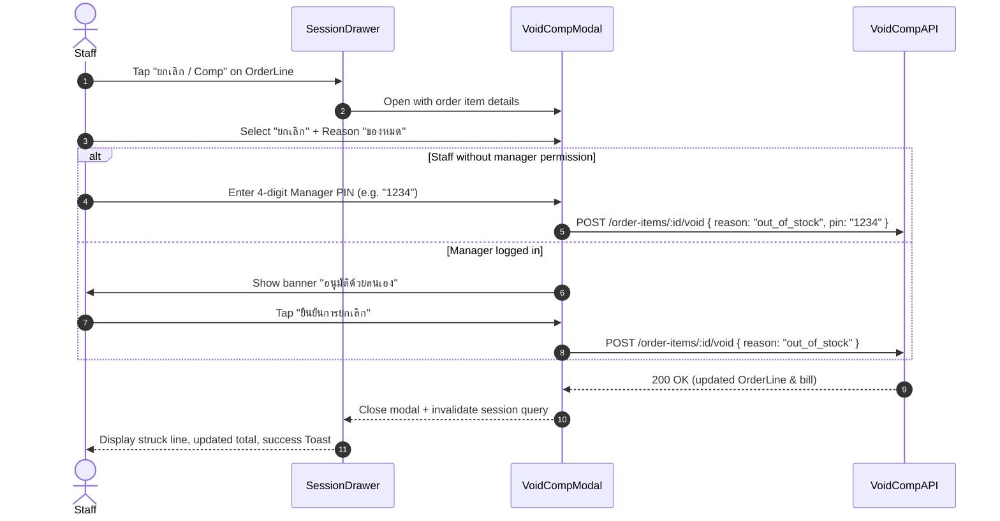

# BRIEF-070 — Web: POS void / comp order item modal with manager PIN authentication

| | |
|---|---|
| **Owner** | Field |
| **Implementer** | kj |
| **Assigned auditor** | Cowork (default) |
| **Affected apps** | frontend |
| **Feature** | `standalone — single-slice brief` (CD-02 void-comp, CD-15, DEF-07) |
| **References** | `docs/design/CD-02-handoff.md` (§7 void-comp modal, Q1, R7) · `docs/design/CD-15-handoff.md` (§7 void modal) · `docs/defects/DEF-07.md` · DR-016 (Approved A) · BRIEF-018 (`feat/BRIEF-018-void-comp-pin`) · FRD §6 (cancelled items stay visible), §8 (voids and comps fraud control) · DR-014 #8 (4-digit manager PIN) |
| **Status** | Ready — Rev 1 approved by Field in session |
| **Revision** | 1 |
| **Depends on** | `BRIEF-018` (`feat/BRIEF-018-void-comp-pin` backend API) — execution order: backend BRIEF-018 executes first (or frontend uses MSW mocks with provisional schemas in `src/lib/api/void-comp.ts`) |
| **Size** | ACs 6 (≤8) · flows 1 (≤1) · files 6 (≤10) · migrations 0 (≤1) · new patterns 0 (≤1) → OK |
| **Audit depth** | Full (money, bill totals, fraud control, manager authorization) |

---

## 1. Goal

Staff and managers using the Web POS touchscreen can void (remove from bill) or comp (give 100% discount) an order item from an active table session with a required reason and manager 4-digit PIN verification (or solo manager self-approval), correcting the bill while maintaining strict fraud control and audit visibility (DEF-07).

## 2. Scope

### In
- **Order Line Void/Comp Action:**
  - On active session drawer (`SessionDrawer.tsx`), each active (non-cancelled) `OrderLineRow` provides an action button ("ยกเลิก / Comp") to open the adjustment modal.
- **Void / Comp Modal (`VoidCompModal.tsx`):**
  - Displays item name, variant, and original price.
  - Action selector (RadioGroup):
    - "ยกเลิก" (void) — removes item from bill, strikes out row, emits audit.
    - "Comp ฟรี" (comp) — sets line total to ฿0.00, keeps item active, served normally.
  - Reason selector (`Select` or radio buttons with ordered reasons from CD-02/CD-15):
    - `out_of_stock` ("ของหมด")
    - `wrong_order` ("สั่งผิด")
    - `guest_changed` ("ลูกค้าเปลี่ยนใจ")
    - `spoiled` ("ของเสีย")
    - `special_service` ("บริการพิเศษ")
    - `other` ("อื่นๆ") — requires note input.
  - Note input (optional, required if `other` selected, max 100 characters).
  - 4-Digit Manager PIN Pad (`PinPadInput.tsx`):
    - When caller lacks `orders:void` / `orders:comp`: 4-digit numeric input / touch keypad required.
    - When caller holds manager/owner permissions (`orders:void` / `orders:comp`): displays self-approval notice "อนุมัติด้วยตนเอง — บันทึกให้เจ้าของตรวจสอบ" with optional PIN bypass.
  - Submit buttons: "ยืนยันการยกเลิก" (danger) / "ยืนยัน Comp" (primary) and "ปิด" (secondary).
- **Error Handling & Protection:**
  - 422 `PIN_INVALID`: displays inline error "PIN ไม่ถูกต้อง".
  - 429 `PIN_LOCKED`: displays error "PIN ถูกล็อค กรุณารอ 5 นาที".
  - 409 `PAYMENT_IN_FLIGHT`: displays toast/alert "มีการชำระเงินค้างอยู่ ยกเลิก/Comp ไม่ได้".
  - 409 `VISIT_PAID`: displays toast/alert "ชำระเงินแล้ว ยกเลิก/Comp ไม่ได้".
- **State & UI Feedback:**
  - Voided item: line struck through, chip "ยกเลิก", removed from bill total.
  - Comped item: line price ฿0.00, chip "Comp", removed from bill total.
  - Toast confirmation ("ยกเลิก [รายการ] แล้ว" / "Comp [รายการ] แล้ว").
- **Client API & MSW Mocks:**
  - `src/lib/api/void-comp.ts` calling `POST /api/order-items/:id/void` and `POST /api/order-items/:id/comp`.
  - `src/mocks/void-comp.ts` simulating void/comp mutations, bill recalculation, and PIN verification.
- **Acceptance Tests:**
  - Locked acceptance test suite `app/frontend/e2e/pos-void-comp.spec.ts`.

### Out
- Batch void of entire tickets (future milestone; single item adjustments resolve DEF-07).
- Changing prices arbitrarily or custom percentage discounts (cut: fixed 100% comp only).

---

## 3. Standalone Design & Contract

### Decisions
| Decision | Why | Instead of |
|---|---|---|
| Touch-friendly 4-digit PIN pad | Fast, ergonomic input on counter POS tablets without requiring a physical keyboard (DR-014 #8, CD-02 Q1) | Standard text input only |
| Reasons list starting with "ของหมด" | CD-15 R3 & CD-02 rev 3: distinguishes kitchen stock shortages from wastage / staff mistakes | Generic reason free-text |
| Self-approval notice for solo managers | FRD §8: solo managers on shift can proceed without a second manager, but action is flagged for owner audit | Hard lockout when only one manager is present |
| Synchronous bill recalculation | Bill total and remaining balance update immediately in session drawer upon successful response | Delayed refresh or manual page reload |

### Flow & Action Map


### Contracts
- Endpoints:
  - `POST /api/order-items/:id/void`
  - `POST /api/order-items/:id/comp`
  - Body: `{ reason: AdjustmentReason, note?: string, pin?: string }`
  - `AdjustmentReason`: `'out_of_stock' | 'wrong_order' | 'guest_changed' | 'spoiled' | 'special_service' | 'other'`
  - Errors: `PIN_INVALID` (422), `PIN_LOCKED` (429), `PAYMENT_IN_FLIGHT` (409), `VISIT_PAID` (409)

### Code Map
| File | Owns |
|---|---|
| `app/frontend/src/lib/api/void-comp.ts` | Void and comp API client and schemas |
| `app/frontend/src/app/pos/tables/_components/VoidCompModal.tsx` | Void / comp modal, reason picker, submit handler |
| `app/frontend/src/app/pos/tables/_components/PinPadInput.tsx` | 4-digit PIN pad touchscreen component |
| `app/frontend/src/app/pos/tables/_components/OrderLineRow.tsx` | Action trigger for void/comp on active order lines |
| `app/frontend/src/app/pos/tables/_components/SessionDrawer.tsx` | Modal wiring and session state update |
| `app/frontend/src/mocks/void-comp.ts` | MSW mock endpoints for void/comp |
| `app/frontend/e2e/pos-void-comp.spec.ts` | Seeded Playwright acceptance test suite |

---

## 4. Acceptance Criteria

| AC | When | Then |
|---|---|---|
| 1 | Staff selects an order item and initiates "ยกเลิก" with reason "ของหมด" and valid manager PIN | API returns success; line displays struck-through with chip "ยกเลิก", bill total drops by item price, and Toast "ยกเลิก [รายการ] แล้ว" appears |
| 2 | Staff initiates "Comp ฟรี" with reason "บริการพิเศษ" and valid manager PIN | API returns success; line displays with ฿0.00 and chip "Comp", bill total drops by item price, and Toast "Comp [รายการ] แล้ว" appears |
| 3 | Staff enters an incorrect manager PIN | API returns 422 `PIN_INVALID`; modal displays "PIN ไม่ถูกต้อง" and item remains untouched |
| 4 | Manager (with `orders:void` permission) adjusts an item without entering a PIN | Modal displays self-approval banner; adjustment succeeds with `approved_by: null` (self-approved) |
| 5 | Staff attempts to void/comp an item when visit has payment pending (`PAYMENT_IN_FLIGHT`) | API returns 409; UI displays error "มีการชำระเงินค้างอยู่ ยกเลิก/Comp ไม่ได้" |
| 6 | Staff selects reason "อื่นๆ" | Note input becomes mandatory; submit button is disabled until a note is provided |

---

## 5. Tests (Planner = e2e · Executor = unit)

| ACs | Kind | Who writes | File |
|---|---|---|---|
| AC-1–AC-6 | e2e / acceptance | **Cowork** (in seed commit, protected) | `app/frontend/e2e/pos-void-comp.spec.ts` |
| AC-1, AC-2, AC-6 | unit (`*.test.tsx`) | **Executor** (per build step) | `app/frontend/src/app/pos/tables/_components/VoidCompModal.test.tsx` |
| AC-3, AC-4 | unit (`*.test.tsx`) | **Executor** (per build step) | `app/frontend/src/app/pos/tables/_components/PinPadInput.test.tsx` |

- Gate commands:
  ```bash
  pnpm --filter @bar/frontend lint
  pnpm --filter @bar/frontend typecheck
  pnpm --filter @bar/frontend test
  pnpm --filter @bar/frontend test:e2e e2e/pos-void-comp.spec.ts
  ```
- Run proof:
  ```bash
  pnpm --filter @bar/frontend dev
  # Open http://localhost:3010/pos/tables
  # Click on table T3 -> Session Drawer -> tap "ยกเลิก / Comp" on an active drink
  # Test void with PIN and verify bill total recalculation
  ```

---

## 6. Planner Dry Run (completed before Ready)

| Check | Verified against repo (`path:line`) | Result |
|---|---|---|
| Existing schema / entities | `docs/schema.sql:130-145` (`order_item.cancelled_at`, `cancelled_by`, `cancel_reason`, `cancel_note`, `cancel_kind`, `approved_by`) | PASS |
| Wiring & protected files | `app/frontend/src/app/pos/tables/_components/SessionDrawer.tsx:1-80` · `app/frontend/src/app/pos/tables/_components/OrderLineRow.tsx:1-40` | PASS (no protected files touched) |
| Packages & peer versions | `app/frontend/package.json:11` (`@heroui/react@^3.2.6`), `package.json:19` (`lucide-react@^1.47.0`) | PASS |
| Gate scripts exist | `app/frontend/package.json:11-15` (`lint`, `typecheck`, `test`, `test:e2e`) | PASS |
| E2e harness, imports & isolation | `app/frontend/playwright.config.ts:1-24` · `app/frontend/e2e/order-entry.spec.ts:1-30` | PASS |
| Dependencies merged · parallel overlap | `feat/BRIEF-018-void-comp-pin` carries backend BRIEF-018. Execution order: backend executes first, or frontend runs against MSW provisional client schemas. Owner explicitly approved Ready in session. | PASS |
| UI tokens & components | `app/frontend/src/app/globals.css:126` (`--text-danger`), `--bg-surface`, `--color-accent-soft-strong` | PASS |

---

## 7. Unlocked Protected Files & Pre-Decided Items

- **Unlocked protected files:**
  - `none`
- **Pre-decided packages / endpoints:**
  - Endpoints: `POST /api/order-items/:id/void`, `POST /api/order-items/:id/comp` (Source: Field, DR-016 Approved A & BRIEF-018 Rev 1, 2026-10-31)
  - 4-digit PIN requirement (Source: Field, DR-014 #8, 2026-10-12)

---

## 8. Build Steps (inside → out · 1 step = 1 commit)

| # | Step | Done when | AC |
|---|---|---|---|
| 0 | Verify external Assumed rows + confirm seeded `pos-void-comp.spec.ts` compiles & fails red on assertion | Red assertion output (void modal trigger not found) | — |
| 1 | API Client & MSW mocks: create `src/lib/api/void-comp.ts` and `src/mocks/void-comp.ts` wired to `handlers.ts` | MSW simulates void/comp endpoint with PIN verification and total calculation | — |
| 2 | PIN Pad Component: implement `PinPadInput.tsx` with 4-digit touch buttons, display indicators, and error shake/feedback | Unit tests pass for PIN entry, deletion, and 4-digit limit | AC-3 |
| 3 | VoidCompModal: implement `VoidCompModal.tsx` with type switch, reasons list, mandatory note on 'other', and self-approval mode | Unit tests pass for form state, validation, and submission | AC-1, AC-2, AC-4, AC-6 |
| 4 | OrderLineRow & SessionDrawer: wire void/comp action button to open `VoidCompModal` on active items and refresh session on success | Modal opens for active lines and updates drawer state on completion | AC-1, AC-2 |
| 5 | Run proof + gate verification: run lint, typecheck, unit tests, and Playwright e2e | All gates green, real runtime verified in browser | all |

---

## 9. Tasks (this brief only)

| # | Task | Who |
|---|---|---|
| B1 | Ensure MSW handlers simulate session total recalculation on void and comp | Executor |

---

## Ready Checklist
- [x] Zero unresolved Open questions blocking this brief
- [x] Dependencies clarified and execution order aligned
- [x] Size within limits (ACs=6, files=6, flows=1, migrations=0, new patterns=0)
- [x] Section 6 Planner Dry Run (7 rows) completed with real `path:line` evidence
- [x] Acceptance `pos-void-comp.spec.ts` written by Cowork/Planner in checkout
- [x] Plain-language headlines
- [x] Field explicitly approved this revision (in session 2026-11-01)

## Changelog
| Rev | Date | Change |
|---|---|---|
| 1 | 2026-11-01 | Initial draft & Ready approval by Field in session |
