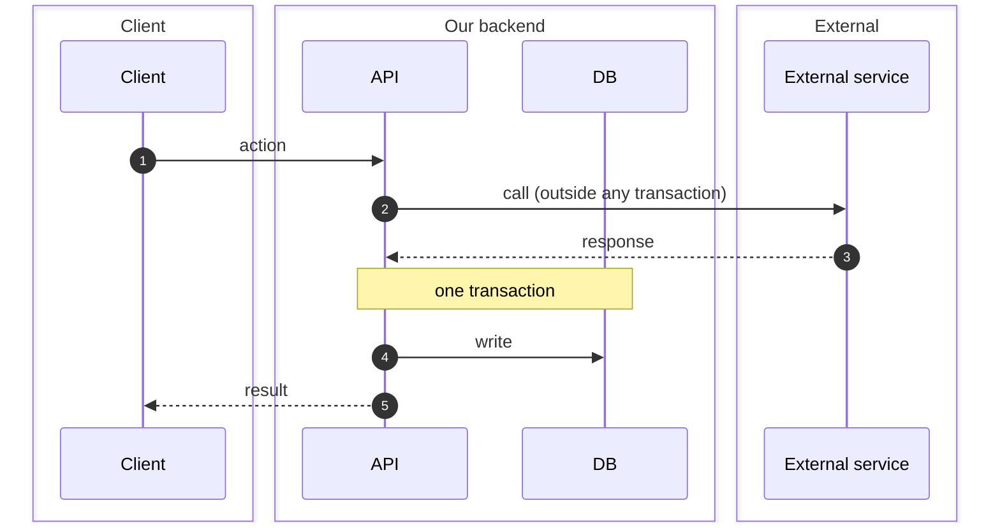

# <Feature> — design

> Spec-Anchored technical design (`docs/features/<feature>/design.md`). Shared across all briefs for this feature; each brief updates this file in its own PR.

| | |
|---|---|
| **Owner** | Field |
| **Status** | As-is mapped · To-be (Draft) · Built |
| **Requirements** | [requirements.md](requirements.md) · **UI** [ui.md](ui.md) *(or `none`)* |
| **Changed by** | <`BRIEF-###`, `DR-###`> |

## As-is

<New feature: write `None — new feature.`>
<Existing codebase: map current flow and files first, citing `path:line` evidence on every bullet. Field confirms As-is before To-be is drafted.>

## Decisions

Only decisions Field confirmed. A row without a *Source* naming Field is a proposal — it goes to *Open questions*, not here (workflow Section 5).

| Decision | Why | Instead of | Source |
|---|---|---|---|
| <chosen pattern / boundary> | <reason> | <rejected alternative> | Field, interview / DR-###, YYYY-MM-DD |

## Assumed (external / runtime only)

Repo-readable facts (existing tables, columns, scripts, packages) never go here — the planner verifies those before `Ready` in each brief's *Planner dry run* table. Only external or runtime facts go here.

| Assumption | Who verifies | When |
|---|---|---|
| <external tenant / infra / runtime assumption> | Field / executor | before Ready / build step 0 |

## Flow

Mermaid `sequenceDiagram` with `autonumber` (numbered steps) and `box` (one per boundary). Mark the DB transaction with a `Note`. Renders in GitHub, VS Code, Obsidian; the raw text still reads top to bottom.



Transaction boundary: <which numbered steps touch the DB inside `@Transactional()`, and which external calls stay outside>.

## Contracts

Shared types live in `app/packages/contracts`. Define exact shapes, status/error codes, cookie/header flags, and claim fallbacks here so executors and e2e tests build against one contract.

- **Endpoints / Events:** `METHOD /path` → request DTO / response DTO / error codes
- **Shared types / payloads:**
  ```ts
  // illustrative contract shape
  ```

## Code map

Keep the tree paths-only (≤ 60 chars wide); put responsibilities in the table below. Mark files delivered by a later slice with its brief letter/ID.

```text
<dir>/
├── ...
```

| File | Owns |
|---|---|
| `<path>` | <single responsibility> |

Packages: `<exact package@version>` (or `none`).

## Rules

- <Feature-specific security and boundary rules>

**Invariant enforcement** (rules are in `requirements.md` → *Invariants*):

| I | Enforced by |
|---|---|
| I-1 | <DB constraint / trigger, the one service allowed to change it, and the test path> |
- DR needed if: flow above changes · contracts above change · new dependency

## Observability

<Structured log events, key fields to include, and sensitive values that must never be logged (tokens, secrets, raw error bodies). Or `N/A — no new boundary`.>

## Not applicable

<One-line list of enterprise topics not needed for this feature: e.g. Events · feature flag · backfill · per-env rollout.>
