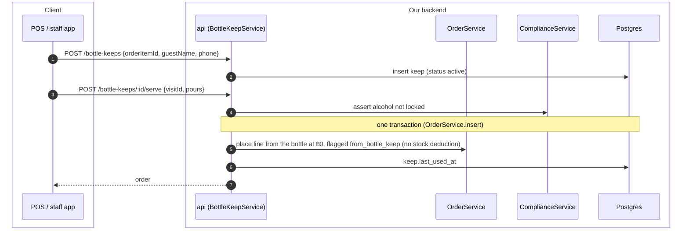

# Bottle keep — design

> Spec-Anchored technical design (`docs/features/bottle-keep/design.md`). Shared across all briefs for this feature; each brief updates this file in its own PR.
> **Draft 2026-11-15 (Cowork).** *As-is* and *Decisions* are evidence / approved sources only. Everything under *Contracts*, *Code map* and the schema tables is a **proposal** — each `P#` in *Open questions* needs Field's OK (DR-031 lock: exact columns per feature need Field's OK) before a brief cites it.

| | |
|---|---|
| **Owner** | Field |
| **Status** | As-is mapped · To-be (Draft — proposals) |
| **Requirements** | [requirements.md](requirements.md) · **UI** not yet — CD in the design plan |
| **Changed by** | DR-031 (#7) · DR-014 #9 |

## As-is

- `bottle_keep` in schema only (`docs/schema.sql:500-518`): `customer_id NULL`, `guest_label`, `inventory_item_id NOT NULL`, `quantity_registered`, `remaining_quantity`, `remaining_note`, `opened_at`, `last_used_at`, `location_note`, `status bottle_keep_status ('active','finished')` (`:21`), check owner-or-label. Not migrated; no module.
- Checkout lives in the POS checkout modal (`app/frontend/src/app/pos/tables/_components/checkout/`) and `PaymentService` (`payment.service.ts:71-119`).
- It points at `inventory_item` (stock) — but Topic 7 links the keep to the **order line** that sold the bottle.

## Decisions

| Decision | Why | Instead of | Source |
|---|---|---|---|
| Created at checkout from the bottle's order line ("ฝากขวด?") | One tap, ties to the sale | separate form | Topic 7 B1 |
| No level tracking; free-text note | Post-it stays the truth | ml tracking | Topic 7 B2 · DR-014 |
| Serving from the bottle = ฿0 line, no stock deduction, mixers charged, compliance lock applies | Already sold | normal sale | Topic 7 B3 |
| No expiry; "ไม่ได้แตะนาน" filter; owner marks finished with reason | Case by case | auto-expire | Topic 7 B4 |

## Assumed (external / runtime only)

None.

## Flow

Transaction boundary: serving = one order placement with the keep update.

## Contracts (proposed — P1–P3)

- **P1 schema:** migrate `bottle_keep` with `order_item_id` (source line) + `guest_phone VARCHAR(20) NULL` + `finished_reason`; drop `quantity_registered` / `remaining_quantity` (no level tracking, DR-014) or keep unused — **choose**; `order_item.bottle_keep_id NULL` (pour from a keep → ฿0, skip deduction).
- **P2 endpoints:** `POST /bottle-keeps` · `GET /bottle-keeps?q&idleDays` · `POST /bottle-keeps/:id/serve` · `POST /bottle-keeps/:id/finish {reason}` · `PATCH /bottle-keeps/:id` (note). Permissions: `bottle_keep:write` (staff default), finish = `bottle_keep:manage` (owner / manager).
- **P3 contracts:** `CheckoutSummary` lines get `canKeep: boolean` (bottle items).

## Code map (proposed)

| File | Owns |
|---|---|
| `modules/bottle-keep/application/bottle-keep.service.ts` | create, serve, finish |
| `modules/order/application/order-lines.ts` (edit) | ฿0 line from a keep, no deduction |
| `app/frontend/src/app/pos/tables/_components/checkout/` (edit) | "ฝากขวด?" |
| `app/mobile/src/app/bottle-keep/**` | staff-side serving (CD-23) |

Packages: none.

## Rules

- A keep line never calls the stock deduction port.

**Invariant enforcement**

| I | Enforced by |
|---|---|
| I-1 | `order_item.bottle_keep_id` set → price 0 and deduction skipped in one place (`order-lines.ts`) — test: serving creates no `inventory_transaction` |

## Observability

Log `bottle_keep.created/served/finished` (id). Guest phone never logged.

## Open questions (proposals to approve)

| # | Proposal | Recommended | Blocks |
|---|---|---|---|
| P1 | Schema change incl. dropping quantity columns | drop them (no level tracking) | bottle-keep brief |
| P2 | Endpoints + permissions | approve | bottle-keep brief |
| P3 | `canKeep` on checkout lines | approve | bottle-keep brief |

## Not applicable

Guest self-order from bottle (S2) · expiry reminders.
