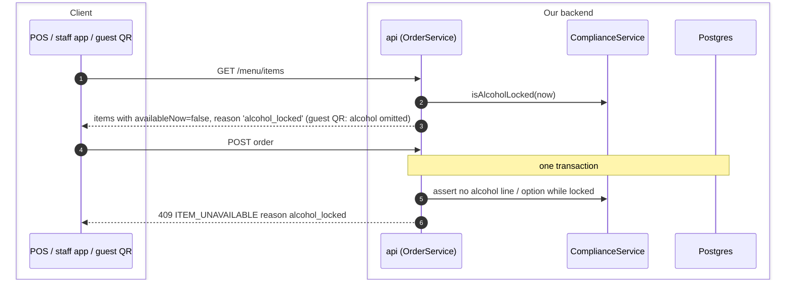

# Compliance lock + no-alcohol day mode — design

> Spec-Anchored technical design (`docs/features/compliance-lock/design.md`). Shared across all briefs for this feature; each brief updates this file in its own PR.
> **Draft 2026-11-15 (Cowork).** *As-is* and *Decisions* are evidence / approved sources only. Everything under *Contracts*, *Code map* and the schema tables is a **proposal** — each `P#` in *Open questions* needs Field's OK (DR-031 lock: exact columns per feature need Field's OK) before a brief cites it.

| | |
|---|---|
| **Owner** | Field |
| **Status** | As-is mapped · To-be (Draft — proposals) |
| **Requirements** | [requirements.md](requirements.md) · **UI** not yet — CD in the design plan |
| **Changed by** | DR-031 (#5) |

## As-is

- Menu availability today: `is_available` + promo time windows `menu_item_availability` (`docs/schema.sql:258, :270-283`, DR-010); server decides at submit (`OrderService.insert()` → `lockMenu`, `order.service.ts:49-53`) and rejects with `409 ITEM_UNAVAILABLE reason out_of_window`.
- No alcohol flag: `menu_item` (`docs/schema.sql:249-266`) and `modifier_option` (`:310-318`) have none.
- Venue settings exist (`venue-settings.service.ts:43-59`); no sale-hours or no-sale-day fields on `venue` (`docs/schema.sql:37-52`).

## Decisions

| Decision | Why | Instead of | Source |
|---|---|---|---|
| Sale hours = venue setting, default current law; no-sale calendar = yearly preset + owner edits | Licences differ | hard-coded law | Topic 6 K1 |
| Lock hides alcohol on guest QR, greys on POS / staff app; **no override** | Legal | manager override | Topic 6 K2 · DR-031 |
| Lock never cancels orders placed before it | Fairness to guests | cancel at lock time | Topic 6 K2 · DR-031 |
| Required alcohol flag on items **and** modifier options | "+ shot" must lock too | item only | Topic 6 K4 |

## Assumed (external / runtime only)

| Assumption | Who verifies | When |
|---|---|---|
| Current legal sale hours and ban days (K1) | Field → advisor | before the first compliance brief |

## Flow

Transaction boundary: the check runs inside `OrderService.insert()` (server clock decides, like DR-010).

## Contracts (proposed — P1–P3)

- **P1 schema:** `menu_item.is_alcohol BOOLEAN NOT NULL DEFAULT FALSE` · `modifier_option.is_alcohol BOOLEAN NOT NULL DEFAULT FALSE` · `venue.alcohol_sale_start TIME DEFAULT '11:00'`, `venue.alcohol_sale_end TIME DEFAULT '24:00'` · `no_sale_day (id, date, name, source 'preset'|'owner', active BOOLEAN)` · `menu_category.no_sale_day_only BOOLEAN DEFAULT FALSE`.
- **P2 contracts:** `unavailableReason` + `'alcohol_locked'`; `GET /compliance/today` → `{ locked, reason: 'outside_hours'|'no_sale_day', until }`; `GET/POST/PATCH /compliance/no-sale-days` + `PATCH /venue/settings` sale hours (`venue:update`); `GET /menu/alcohol-review` (one-time list).
- **P3 event:** `compliance.changed` at lock / unlock boundaries (worker schedules it) so open screens refresh.

## Code map (proposed)

| File | Owns |
|---|---|
| `modules/venue/application/compliance.service.ts` | hours + calendar → locked? |
| `modules/order/application/order-lines.ts` (edit) | reject locked lines |
| `modules/menu/...` (edit) | `is_alcohol` on item / option DTOs |
| `contracts/src/schemas/compliance.ts` | DTOs |

Packages: none.

## Rules

- Checked server-side on every order path (staff, guest, bottle-keep serving); the client only displays.

**Invariant enforcement**

| I | Enforced by |
|---|---|
| I-1 | `ComplianceService` check inside `OrderService.insert()` / `insertForGuest()` and bottle-keep serve — e2e: alcohol line at 00:05 → 409 on all three paths |

## Observability

Log `compliance.blocked` (path, itemId). 

## Open questions (proposals to approve)

| # | Proposal | Recommended | Blocks |
|---|---|---|---|
| P1 | Schema above | approve after K1 | compliance brief |
| P2 | `alcohol_locked` reason + endpoints | approve | compliance brief |
| P3 | `compliance.changed` event from `worker` | approve | compliance brief |
| K1 | Legal rules from the advisor | ask first | all compliance briefs |

## Not applicable

Feature flag (venue settings cover it) · backfill (review list instead).
