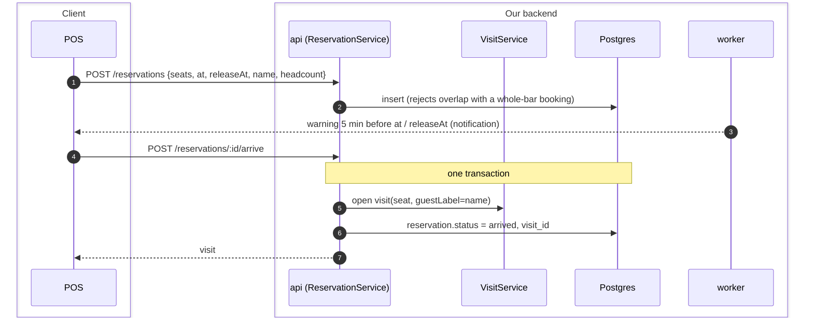

# Events + reservations — design

> Spec-Anchored technical design (`docs/features/events-reservations/design.md`). Shared across all briefs for this feature; each brief updates this file in its own PR.
> **Draft 2026-11-15 (Cowork).** *As-is* and *Decisions* are evidence / approved sources only. Everything under *Contracts*, *Code map* and the schema tables is a **proposal** — each `P#` in *Open questions* needs Field's OK (DR-031 lock: exact columns per feature need Field's OK) before a brief cites it.

| | |
|---|---|
| **Owner** | Field |
| **Status** | As-is mapped · To-be (Draft — proposals) |
| **Requirements** | [requirements.md](requirements.md) · **UI** not yet — CD in the design plan |
| **Changed by** | DR-031 (#6) |

## As-is

- None — new feature. No event / reservation tables in `docs/schema.sql`.
- Seats and visits exist: `table_seat` (`docs/schema.sql:54`), `visit` with `guest_label`, `opened_by`, `opened_via` (`:95-109`); opening a seat = `POST /visits` (`app/backend/src/modules/venue/infrastructure/http/visits.controller.ts`).
- Amount-locked PromptPay + slip verify already exist for bills (`PaymentService.create()` / `verifySlip()`, `payment.service.ts:71, :119`) — tied to a visit today.
- Promo items (type ② nights) = DR-010 menu items.
- Public pages: guest pages live under `app/frontend/src/app/customer/` behind the guest session (DR-028); no public, session-less page yet.

## Decisions

| Decision | Why | Instead of | Source |
|---|---|---|---|
| Event types ① ticketed · ② live / DJ · ③ private (from whole-bar booking) | Real bar nights | one type | Topic 5 |
| Form-based CMS + fixed template public page, no login | Cheap, safe | page builder | Topic 5 C1, V2 |
| Table bookings: no deposit, no minimum spend, release time, **no auto-release** | Bars use release times; staff check with the guest | deposit / auto-release | Topic 5 · DR-031 |
| Whole-bar booking fee via amount-locked PromptPay + slip; separate revenue | Covers the night | minimum spend | Topic 5 F1 |
| Event attribution = business date + event time window; orders are not tagged | No extra step for staff | tag orders | DR-031 locks |
| No per-guest no-show count | Behaviour judgment | no-show score | Topic 5 Privacy |

## Assumed (external / runtime only)

None.

## Flow

Transaction boundary: arrival opens the visit and marks the reservation together.

## Contracts (proposed — P1–P4)

- **P1 schema:** `event (id, type 'ticketed'|'live'|'private', title, poster_key, description, starts_at, ends_at, performer, performer_fee, ticket_price NULL, capacity NULL, early_bird_price NULL, early_bird_until NULL, status 'draft'|'published'|'cancelled')` · `venue_profile (name, address, map_url, hours_text, socials JSONB)` (single row) · `reservation (id, scope 'seats'|'whole_bar', at, release_at, guest_name, guest_phone NULL, headcount, note, status 'booked'|'arrived'|'released'|'cancelled', visit_id NULL, event_id NULL)` + `reservation_seat (reservation_id, table_seat_id)` · `booking_fee (reservation_id, amount, payment_id NULL, status 'pending'|'paid'|'refunded'|'forfeited', refund_note)`.
- **P2 endpoints:** `GET/POST/PATCH /events` + `POST /events/:id/publish` (`event:manage`) · `GET /public/events` · `GET /public/venue` (no auth, cached) · `GET/POST/PATCH /reservations` · `POST /reservations/:id/{arrive|extend|cancel}` (`reservation:write`) · whole-bar: `POST /reservations/:id/fee` → amount-locked QR (`event:manage`) · `GET /events/:id/report`.
- **P3 payments:** booking fee reuses the PromptPay + slip path with a new payment owner (`reservation`) instead of a visit — payment table change, needs its own check against `payment` (`docs/schema.sql:455`).
- **P4 permissions:** `event:manage` (owner / manager) · `reservation:write` (staff default).

## Code map (proposed)

| File | Owns |
|---|---|
| `modules/events/application/event.service.ts` | events, CMS, report |
| `modules/events/application/reservation.service.ts` | bookings, arrive, warnings |
| `modules/events/infrastructure/http/public.controller.ts` | session-less public endpoints |
| `modules/events/infrastructure/queue/reservation-warning.processor.ts` | 5-min warnings (`worker`) |
| `app/frontend/src/app/(public)/events/**` | public page |
| `app/frontend/src/app/pos/reservations/**` | bookings on the POS |

Packages: none.

## Rules

- Public endpoints return no guest data and are rate-limited.

**Invariant enforcement**

| I | Enforced by |
|---|---|
| I-1 | overlap check in `ReservationService` inside one transaction with a row lock on the night's whole-bar booking — test: seat booking overlapping a whole-bar booking → 409 `RESERVATION_CONFLICT` |

## Observability

Log `reservation.created/arrived/cancelled` (id, scope). Guest phone never logged.

## Open questions (proposals to approve)

| # | Proposal | Recommended | Blocks |
|---|---|---|---|
| P1 | Tables above | approve | events brief |
| P2 | Endpoints (incl. session-less public endpoints) | approve | events brief |
| P3 | Payment owned by a reservation (not a visit) | approve with a DR — touches the payment model | booking-fee brief |
| P4 | Permissions `event:manage`, `reservation:write` | approve (DR-031 already names them) | events brief |

## Not applicable

Guest self-booking (later) · zones (rejected).
