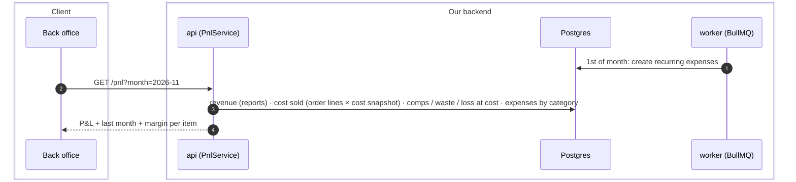

# Expenses + P&L — design

> Spec-Anchored technical design (`docs/features/expenses-pnl/design.md`). Shared across all briefs for this feature; each brief updates this file in its own PR.
> **Draft 2026-11-15 (Cowork).** *As-is* and *Decisions* are evidence / approved sources only. Everything under *Contracts*, *Code map* and the schema tables is a **proposal** — each `P#` in *Open questions* needs Field's OK (DR-031 lock: exact columns per feature need Field's OK) before a brief cites it.

| | |
|---|---|
| **Owner** | Field |
| **Status** | As-is mapped · To-be (Draft — proposals) |
| **Requirements** | [requirements.md](requirements.md) · **UI** not yet — CD in the design plan |
| **Changed by** | DR-031 (#4) |

## As-is

- None for expenses — no expense table in `docs/schema.sql`.
- Revenue already computed: `ReportsService.summary()` / `daily()` / `items()` (`app/backend/src/modules/reports/application/reports.service.ts:33-62`), periods by business day (`report-period.ts`).
- Voids / comps on the line: `order_item.cancel_kind ('void'|'comp')` (`docs/schema.sql:430-432`, DR-016).
- Cost inputs come from `stock` (average cost, waste, loss) and `purchasing` (bills) — both proposals, not built.

## Decisions

| Decision | Why | Instead of | Source |
|---|---|---|---|
| P&L = revenue (after voids) − cost sold − comps at cost − waste at cost − loss at cost = gross − expenses = net | Owner sees real profit | revenue-only report | Topic 4 E3 · DR-031 |
| Cost sold = recipe × weighted average cost; untracked purchases = expense in the month bought | Works without full tracking | ignore untracked | Topic 4 E2 |
| Editable categories; recurring costs auto-created monthly; performer fees + supplier bills flow in | Little manual entry | manual only | Topic 4 E1 |
| No VAT, no general ledger | Scope | accounting module | DR-031 cut |

## Assumed (external / runtime only)

None.

## Flow

Transaction boundary: read-only; the recurring job inserts in one transaction per month (idempotent on `(recurring_id, month)`).

## Contracts (proposed — P1–P3)

- **P1 schema:** `expense_category (id, name, sort_order, is_active)` · `expense (id, category_id, amount, incurred_on, note, source 'manual'|'recurring'|'receipt'|'event'|'payroll', source_id NULL, created_by)` · `recurring_expense (id, category_id, amount, day_of_month, active_from, active_until NULL)` · `order_item.unit_cost_snapshot NUMERIC(12,4) NULL` (cost frozen at order time — needed for cost sold; set by stock deduction).
- **P2 endpoints** (`pnl:read` owner): `GET/POST/PATCH /expenses` · `GET/POST/PATCH /expense-categories` · `GET/POST/PATCH /recurring-expenses` · `GET /pnl?month` · `GET /pnl/items?month`.
- **P3 job:** `expenses-recurring` BullMQ repeatable job (monthly, venue time).

## Code map (proposed)

| File | Owns |
|---|---|
| `modules/finance/application/expense.service.ts` | expenses, categories, recurring |
| `modules/finance/application/pnl.service.ts` | P&L math (reads reports, stock, expenses) |
| `modules/finance/infrastructure/queue/recurring-expense.processor.ts` | monthly job (`worker`) |
| `contracts/src/schemas/finance.ts` | DTOs |
| `app/frontend/src/app/pos/reports/pnl/**` | P&L screens |

Packages: none.

## Rules

- P&L never reads live `average_cost` for past sales — only the snapshot on the line.

**Invariant enforcement**

| I | Enforced by |
|---|---|
| I-1 | loss query excludes lines with `cancel_kind`; waste and loss are separate tx types — test: a comped line appears once (comps), never in loss |

## Observability

Log `expenses.recurring.created` (month, count).

## Open questions (proposals to approve)

| # | Proposal | Recommended | Blocks |
|---|---|---|---|
| P1 | Tables + `order_item.unit_cost_snapshot` | approve (snapshot is the only way to keep past P&L stable) | P&L brief |
| P2 | Endpoints + `pnl:read` (owner) | approve | P&L brief |
| P3 | Monthly recurring job on `worker` | approve | P&L brief |

## Not applicable

VAT · ledger · multi-branch.
