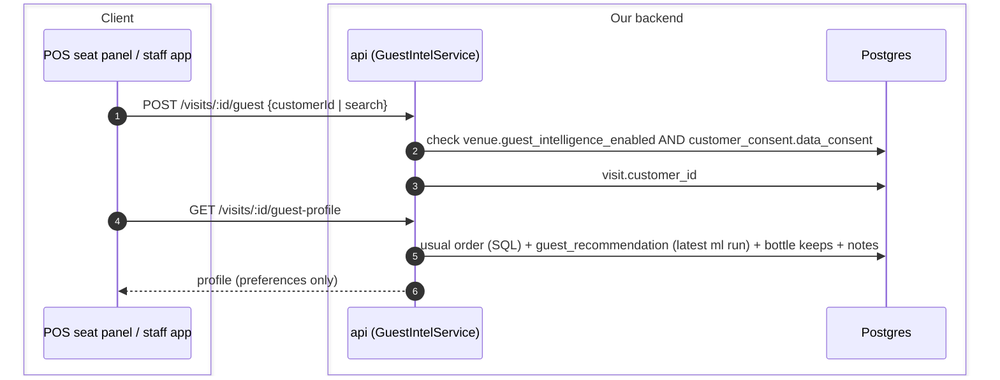

# Guest intelligence — design

> Spec-Anchored technical design (`docs/features/guest-intelligence/design.md`). Shared across all briefs for this feature; each brief updates this file in its own PR.
> **Draft 2026-11-15 (Cowork).** *As-is* and *Decisions* are evidence / approved sources only. Everything under *Contracts*, *Code map* and the schema tables is a **proposal** — each `P#` in *Open questions* needs Field's OK (DR-031 lock: exact columns per feature need Field's OK) before a brief cites it.

| | |
|---|---|
| **Owner** | Field |
| **Status** | As-is mapped · To-be (Draft — proposals) |
| **Requirements** | [requirements.md](requirements.md) · **UI** not yet — CD in the design plan |
| **Changed by** | DR-032 (M3) |

## As-is

- Guest data today: `customer` (`docs/schema.sql:74-82`: `display_name`, `notes`, `avatar_url`, `anonymized_at`), `customer_identity` (`:84-93`, LINE), `customer_consent` (`:124-132`: `data_consent`, `marketing_consent`), `visit.customer_id NULL` (`:98`).
- Guest QR session exists (`guest_session`, `:111-121`, DR-028) but does not link a `customer` yet (no LINE connect flow built — FRD §4 is Planned).
- No venue setting for guest intelligence (`venue`, `:37-52`).
- Order history per visit exists (`order_record`, `order_item`), so "usual order" is a SQL query once visits link to customers.

## Decisions

| Decision | Why | Instead of | Source |
|---|---|---|---|
| Two-layer opt-in: venue setting (default off) + guest data consent | PDPA | venue only | DR-032 |
| Shown: usual order (SQL top 3 + modifiers), recommendations (item-based CF), flags, active bottle keep, notes | Preferences help service | AI summary | DR-032 · Topic 8 M3 |
| Never shown: spend, behaviour judgments | Non-creepy | spend tiers | DR-032 |
| Cold start → venue popular items | Works day one | empty panel | DR-032 |
| Attach points: QR login, staff attach at seat open, reservation arrival | Coverage | QR only | DR-032 |

## Assumed (external / runtime only)

None.

## Flow

Transaction boundary: attach is one update; reads are read-only.

## Contracts (proposed — P1–P3)

- **P1 schema:** `venue.guest_intelligence_enabled BOOLEAN DEFAULT FALSE` · `guest_recommendation (run_id, customer_id, menu_item_id, rank)` · `customer_flag (customer_id, kind 'allergy'|'vip', note)`.
- **P2 endpoints:** `GET /customers/search?q` (name / phone) · `POST /visits/:id/guest` · `DELETE /visits/:id/guest` · `GET /visits/:id/guest-profile` · `PATCH /customers/:id/notes` · `PATCH /venue/settings { guestIntelligenceEnabled }`. Permission `guests:read` / `guests:write` (staff default read, write notes).
- **P3 contract shape:** `GuestProfile { usual: Item[3], recommended: Item[], flags, bottleKeeps, notes }` — no amounts.

## Code map (proposed)

| File | Owns |
|---|---|
| `modules/customer/application/guest-intel.service.ts` | attach, profile |
| `app/ml/models/recommendation.py` | item-based CF (`ml` task) |
| `app/frontend/src/app/pos/tables/_components/GuestPanel.tsx` | seat panel |
| `app/mobile/src/components/guest/**` | staff app (CD-23) |

Packages: none (Python side per DR-032).

## Rules

- Either opt-in off → endpoints return `GUEST_INTEL_DISABLED 409` and the job skips that customer.
- "Forget me" anonymisation removes recommendations and flags for that customer.

**Invariant enforcement**

| I | Enforced by |
|---|---|
| I-1 | single guard in `GuestIntelService` (venue flag AND consent) on every read / write — e2e: consent off → no profile, no collection |

## Observability

Log `guest.attached` (visitId, via). Never log names, phones or notes.

## Open questions (proposals to approve)

| # | Proposal | Recommended | Blocks |
|---|---|---|---|
| P1 | Schema above | approve | guest-intel brief |
| P2 | Endpoints + permissions | approve | guest-intel brief |
| P3 | `GuestProfile` shape (no amounts) | approve | guest-intel brief |
| Q | LINE connect / consent flow (FRD §4) must ship first — order? | build consent + attach before recommendations | guest-intel brief |

## Not applicable

LLM summaries (cut).
