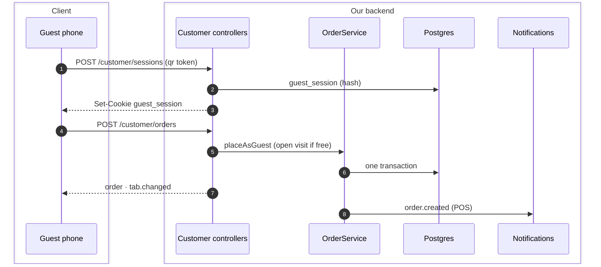

# Guest QR ordering & pay — design

> Spec-Anchored technical design (`docs/features/guest-qr/design.md`). Shared across all briefs for this feature; each brief updates this file in its own PR.
> **As-built (2026-11-15).** *As-is* = the shipped code with `path:line` evidence (backend paths under `app/backend/src/`). Field confirms it once; the next brief that changes the feature drafts its To-be here.

| | |
|---|---|
| **Owner** | Field |
| **Status** | Built (As-is mapped) |
| **Requirements** | [requirements.md](requirements.md) · **UI** [ui.md](ui.md) |
| **Changed by** | BRIEF-047, BRIEF-048, BRIEF-049, BRIEF-050, BRIEF-051, BRIEF-052 · DR-028, DR-010, DR-018 |

## As-is

- Guest session: `GuestSessionService` (`modules/customer/application/guest-session.service.ts`), `guest-token.ts`, guard `customer/infrastructure/http/guest-session.guard.ts`, cookie `guest-cookie.ts`; scan `POST /customer/sessions` throttled 30 / min per IP (`customer-qr.controller.ts:34-39`).
- Orders / tab / bell: `customer-order.service.ts` (throttle `:26`), `customer-tab.service.ts`, `customer-call.service.ts`; routes `customer-order.controller.ts:38, :58, :70`.
- Pay: `customer-payment.service.ts`; routes `customer-payment.controller.ts:33-73`.
- Tables `guest_session` (`docs/schema.sql:111-121`), `table_seat.staff_call_*`; migrations `GuestSession`, `CustomerOrderCallStaff`, `CustomerPayment`.
- Web: `app/frontend/src/app/scan/[qrToken]`, `app/frontend/src/app/customer/{menu,cart,tab,pay}`.

## Decisions

| Decision | Why | Instead of | Source |
|---|---|---|---|
| Opaque cookie session, only its hash stored | No login for guests | JWT for guests | DR-028 |
| Promo display without crossed-out price on alcohol | Thai alcohol law | "was" price | DR-014 · FRD §9 |
| QR from payload | No image round-trip | PNG | DR-018 |

## Assumed (external / runtime only)

None.

## Flow

Transaction boundary: guest order uses `OrderService.insertForGuest()` (`modules/order/application/order.service.ts:59`).

## Contracts

Built and published in `docs/api/openapi.json` (generated, checked in CI). Shared shapes in `app/packages/contracts/src/`.

| Route / event | Permission | Where |
|---|---|---|
| POST /customer/sessions | public (throttled) | `customer/infrastructure/http/customer-qr.controller.ts:34` |
| GET/PATCH /customer/session | guest session | `customer-session.controller.ts:32, :42` |
| GET /customer/menu | guest session | `customer-menu.controller.ts:17` |
| POST /customer/orders · GET /customer/tab · POST /customer/call-staff | guest session | `customer-order.controller.ts:38, :58, :70` |
| GET /customer/payment · POST /customer/payments · …/cancel · …/notify-transfer | guest session | `customer-payment.controller.ts:33-73` |
| WS `tab.changed` | guest tab room | `packages/contracts/src/events/customer.ts:5` |

## Code map

| File | Owns |
|---|---|
| `modules/customer/application/guest-session.service.ts` | guest sessions |
| `modules/customer/application/customer-order.service.ts` | guest orders |
| `modules/customer/application/customer-tab.service.ts` | running tab |
| `modules/customer/application/customer-payment.service.ts` | guest pay |
| `app/frontend/src/app/customer/` | guest screens |

Packages: as in the app `package.json` files (no feature-specific additions).

## Rules

- Guest endpoints never accept staff tokens and never return other sessions' data.
- Throttle every guest write.

**Invariant enforcement**

| I | Enforced by |
|---|---|
| I-1 | `guest_session.token_hash CHAR(64) UNIQUE` (`providers/database/migrations/1762900000000-GuestSession.ts:13`) + `guest-token.ts` |

- DR needed if: flow above changes · contracts above change · new dependency

## Observability

Structured logs per request; no secrets, tokens or guest personal data.

## Not applicable

Feature flag · backfill.
