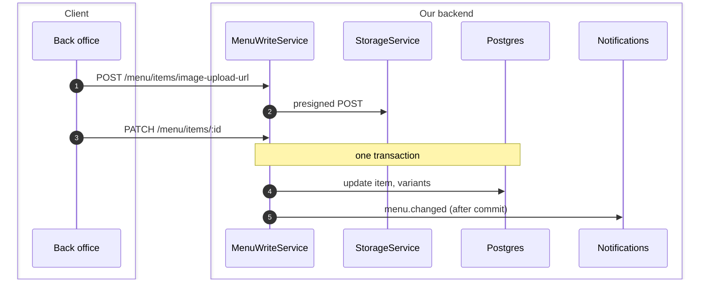

# Menu & sold-out — design

> Spec-Anchored technical design (`docs/features/menu/design.md`). Shared across all briefs for this feature; each brief updates this file in its own PR.
> **As-built (2026-11-15).** *As-is* = the shipped code with `path:line` evidence (backend paths under `app/backend/src/`). Field confirms it once; the next brief that changes the feature drafts its To-be here.

| | |
|---|---|
| **Owner** | Field |
| **Status** | Built (As-is mapped) |
| **Requirements** | [requirements.md](requirements.md) · **UI** [ui.md](ui.md) |
| **Changed by** | BRIEF-016, BRIEF-038, BRIEF-039, BRIEF-040, BRIEF-041, BRIEF-044, BRIEF-045 · DR-010, DR-020, DR-021, DR-024, DR-025 |

## As-is

- Read: `MenuCatalogService` (`modules/menu/application/menu-catalog.service.ts`) behind `GET /menu/categories|items|items/:id` (`menu.controller.ts:36, :53, :86`); availability rules `menu-availability.ts`.
- Write: `MenuWriteService` (`menu-write.service.ts`, emits `menu.changed` at `:211`), categories CRUD + order (`menu.controller.ts:98-132`), items (`menu-item-write.controller.ts:48, :71`), modifier groups (`modifier-group.controller.ts:27-65`, `modifier-group.service.ts`).
- Photos: `MenuPhotoService` → `common/storage/storage.service.ts` (DR-020), `POST /menu/items/image-upload-url` (`menu-item-write.controller.ts:33`).
- Tables: `menu_category`, `menu_item`, `menu_item_availability`, `menu_item_variant`, `modifier_group`, `modifier_option`, `menu_variant_modifier_group` (`docs/schema.sql:238-325`); migrations `VenueAndMenu`, `ModifierGroupArchive`, `CategoryNameUnique`.
- Web: `app/frontend/src/app/pos/menu/` (list, `[id]`, `new`, `modifiers`).

## Decisions

| Decision | Why | Instead of | Source |
|---|---|---|---|
| Promo as its own item with time windows | Matches bar promo menus | price rules engine | DR-010 |
| Photos through one S3 storage service | One place for presigned URLs | per-module S3 calls | DR-020 |
| Archive modifier groups | History stays valid | hard delete | DR-024 |
| Unique category names | Clarity | duplicates allowed | DR-025 |

## Assumed (external / runtime only)

None.

## Flow

Transaction boundary: writes in one transaction per request; `menu.changed` after commit.

## Contracts

Built and published in `docs/api/openapi.json` (generated, checked in CI). Shared shapes in `app/packages/contracts/src/`.

| Route / event | Permission | Where |
|---|---|---|
| GET /menu/categories · /menu/items · /menu/items/:id | menu:read | `menu/infrastructure/http/menu.controller.ts:36, :53, :86` |
| POST/PUT/PATCH/DELETE /menu/categories… | menu:write | `menu.controller.ts:98-132` |
| POST /menu/items · PATCH /menu/items/:id · POST /menu/items/image-upload-url | menu:write | `menu-item-write.controller.ts:33-71` |
| GET/POST/PATCH/DELETE /menu/modifier-groups | menu:read / menu:write | `modifier-group.controller.ts:27-65` |
| WS `menu.changed` · `menu.availability_changed` | staff room | `packages/contracts/src/events/menu.ts:5, :18` |

## Code map

| File | Owns |
|---|---|
| `modules/menu/application/menu-catalog.service.ts` | menu read |
| `modules/menu/application/menu-write.service.ts` | menu write + events |
| `modules/menu/application/modifier-group.service.ts` | modifier groups |
| `modules/menu/application/menu-photo.service.ts` | photos (S3) |
| `app/frontend/src/app/pos/menu/` | back-office menu |

Packages: as in the app `package.json` files (no feature-specific additions).

## Rules

- S3 only through `StorageService` (DR-020).

**Invariant enforcement**

| I | Enforced by |
|---|---|
| I-1 | `uq_menu_category_name` on `lower(trim(name))` (`providers/database/migrations/1762700000000-CategoryNameUnique.ts:15`) |

- DR needed if: flow above changes · contracts above change · new dependency

## Observability

Structured logs per request; no secrets, tokens or guest personal data.

## Not applicable

Feature flag · backfill.
