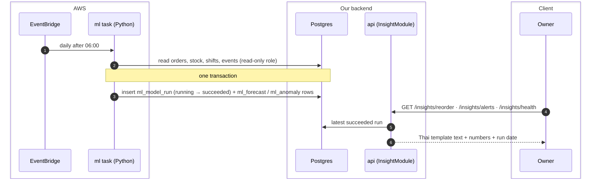

# ML insight — design

> Spec-Anchored technical design (`docs/features/ml-insight/design.md`). Shared across all briefs for this feature; each brief updates this file in its own PR.
> **Draft 2026-11-15 (Cowork).** *As-is* and *Decisions* are evidence / approved sources only. Everything under *Contracts*, *Code map* and the schema tables is a **proposal** — each `P#` in *Open questions* needs Field's OK (DR-031 lock: exact columns per feature need Field's OK) before a brief cites it.

| | |
|---|---|
| **Owner** | Field |
| **Status** | As-is mapped · To-be (Draft — proposals) |
| **Requirements** | [requirements.md](requirements.md) · **UI** not yet — CD in the design plan |
| **Changed by** | DR-032 · DR-033 (`ml` task) |

## As-is

- `ai_insight` + `ai_insight_kind` in schema only (`docs/schema.sql:560-571, :25`) for the dropped LLM design (DR-014 #11) — not migrated, no code. DR-032 removes them.
- Reports already exist as SQL: `ReportsService` (`app/backend/src/modules/reports/application/reports.service.ts:33-62`) — the sales summary stays SQL + Thai template.
- No `app/ml/` folder; no Python in the repo.
- Anomaly inputs exist partly: voids / comps with approver (`order_item.cancel_kind`, `approved_by`, `docs/schema.sql:431-432`), payment confirmation (`payment_confirmed_via`, `:24`); loss / overrides / shift cash / tickets come from new modules.

## Decisions

| Decision | Why | Instead of | Source |
|---|---|---|---|
| Daily Python batch job → Postgres; NestJS reads the latest successful run | Fits daily models, NestJS stays the only API | FastAPI service · ONNX in Node | DR-032 Option A |
| Models: M1 LightGBM forecast vs seasonal-naive · M2 anomaly · M4 health page | Advisor: own ML | LLM | DR-032 |
| Data: synthetic generator + public dataset; metrics stored per run | No real data | wait for pilot data | DR-032 Data plan |
| Explanations = Thai templates; alerts never accuse, never rank staff | PDPA / fairness | free text | DR-032 · FRD cut |
| Runs as ECS scheduled task after the 06:00 cut-off; DB role read app / write `ml_*` | Next to the data, cheap | always-on service | DR-033 |

## Assumed (external / runtime only)

| Assumption | Who verifies | When |
|---|---|---|
| A public bar / restaurant sales dataset with daily item sales exists under a usable licence | Field | before the forecast brief |

## Flow



Transaction boundary: one job = one transaction; failure → `ml_model_run.status = failed`, API keeps serving the previous run.

## Contracts (proposed — P1–P4)

- **P1 schema:** drop `ai_insight`, `ai_insight_kind` · `ml_model_run (id, model 'forecast'|'anomaly'|'recommendation', version, status, started_at, finished_at, period_start, period_end, metrics JSONB, baseline_metrics JSONB, error)` · `ml_forecast (run_id, inventory_item_id, for_date, qty, lower, upper)` + `ml_busy_level (run_id, for_date, level 1–5)` · `ml_anomaly (run_id, shift_id NULL, kind, staff_id NULL, facts JSONB, score, status 'new'|'seen')`.
- **P2 endpoints** (owner — `insights:read`): `GET /insights/sales-summary?period` · `GET /insights/reorder` · `GET /insights/alerts` + `POST /insights/alerts/:id/seen` · `GET /insights/health` · `GET /insights/busy?week`.
- **P3 repo:** `app/ml/` Python 3.12 (`pandas`, `scikit-learn`, `lightgbm`, `psycopg`) with its own lint (`ruff`) + tests (`pytest`) in CI — **new language / dependencies** (DR-032 approved the stack; exact versions pinned in the first ML brief).
- **P4 infra:** ECR repo `ml`, EventBridge rule, ECS task def, DB role `ml_writer` (DR-033).

## Code map (proposed)

```text
app/ml/
├── generator/
├── models/
├── jobs/
└── tests/
```

| File | Owns |
|---|---|
| `app/ml/generator/` | synthetic bar data + injected fraud labels |
| `app/ml/models/{forecast,anomaly}.py` | train / predict + baseline |
| `app/ml/jobs/daily.py` | entrypoint: read → predict → write one run |
| `modules/insight/application/insight.service.ts` | reads latest run, fills Thai templates |
| `app/frontend/src/app/pos/reports/insights/**` | reorder hint, alerts, health |

Packages: Python stack per DR-032 (versions pinned in the first ML brief).

## Rules

- `ml` writes only `ml_*` tables (DB role). NestJS never trains or predicts.
- Alerts show facts + "ควรตรวจสอบ"; no ranking or score per staff anywhere.

**Invariant enforcement**

| I | Enforced by |
|---|---|
| I-1 | no endpoint or query aggregates per-staff scores; anomaly rows are per event, not per person — review rule + test on `GET /insights/alerts` shape |

## Observability

`ml_model_run` is the log (status, metrics, error). Job stdout → CloudWatch.

## Open questions (proposals to approve)

| # | Proposal | Recommended | Blocks |
|---|---|---|---|
| P1 | Schema (drop `ai_insight`, add `ml_*`) | approve | first ML brief |
| P2 | Endpoints + `insights:read` | approve | insight UI brief |
| P3 | `app/ml/` stack + CI lint / test | approve versions in the brief | first ML brief |
| P4 | Infra rows | approve with the DR-033 rollout | AWS ml task brief |
| Q | Public dataset choice | Field picks | forecast brief |

## Not applicable

On-demand prediction · LLM.
