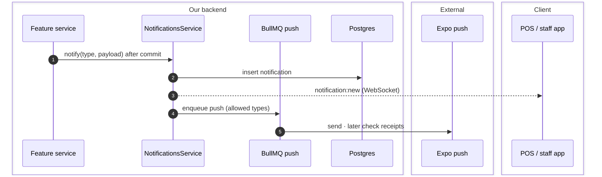

# Notifications & push — design

> Spec-Anchored technical design (`docs/features/notifications/design.md`). Shared across all briefs for this feature; each brief updates this file in its own PR.
> **As-built (2026-11-15).** *As-is* = the shipped code with `path:line` evidence (backend paths under `app/backend/src/`). Field confirms it once; the next brief that changes the feature drafts its To-be here.

| | |
|---|---|
| **Owner** | Field |
| **Status** | Built (As-is mapped) |
| **Requirements** | [requirements.md](requirements.md) · **UI** [ui.md](ui.md) |
| **Changed by** | BRIEF-061, BRIEF-063, BRIEF-064 · DR-003, DR-009, DR-014 |

## As-is

- `NotificationsService` (`modules/notifications/notifications.service.ts:22-86`): `emitToStaff()` `:37`, `notify()` `:64`, `feed()` `:78`, `unreadCount()` `:86`; gateway `notifications.gateway.ts:14-30` (socket.io + Redis adapter).
- Push: `PushDeliveryService` (`modules/notifications/application/push-delivery.service.ts:34-57`: `enqueue` `:43`, `deliver` `:48`, `checkReceipts` `:57`) on the BullMQ queue registered at `notifications.module.ts:30`; tokens `push-token.service.ts`; recipients `notification-recipients.ts`.
- Tables `notification`, `staff_push_token` (`docs/schema.sql:579-600`); migrations `NotificationFeed`, `StaffPushToken`.
- Web: POS alerts hook `app/frontend/src/hooks/usePosAlerts.ts`.

## Decisions

| Decision | Why | Instead of | Source |
|---|---|---|---|
| Expo push as the only background channel for the staff app | No PWA (DR-002) | web push | DR-002 · DR-003 |
| Only three push types | Avoid noise | push everything | DR-014 |

## Assumed (external / runtime only)

None.

## Flow

Transaction boundary: notifications are written after the feature's commit; push runs from the queue.

## Contracts

Built and published in `docs/api/openapi.json` (generated, checked in CI). Shared shapes in `app/packages/contracts/src/`.

| Route / event | Permission | Where |
|---|---|---|
| GET /notifications · GET /notifications/unread-count · PATCH /notifications/:id/read · PATCH /notifications/read-all | signed in | `notifications/infrastructure/http/notifications.controller.ts:37-82` |
| PUT /notifications/push-tokens · DELETE /notifications/push-tokens/:token | signed in | `notifications.controller.ts:96, :111` |
| WS `notification:new` | per staff | `packages/contracts/src/events/notifications.ts:1` |

## Code map

| File | Owns |
|---|---|
| `modules/notifications/notifications.service.ts` | feed + emit |
| `modules/notifications/notifications.gateway.ts` | WebSocket |
| `modules/notifications/application/push-delivery.service.ts` | Expo push |
| `app/frontend/src/hooks/usePosAlerts.ts` | POS sound / toast |

Packages: as in the app `package.json` files (no feature-specific additions).

## Rules

- Feature modules inject `NotificationsService`; never the gateway directly.
- Guest notes never go into push / feed bodies.

**Invariant enforcement**

None of its own.

- DR needed if: flow above changes · contracts above change · new dependency

## Observability

Structured logs per request; no secrets, tokens or guest personal data.

## Not applicable

Feature flag · backfill.
