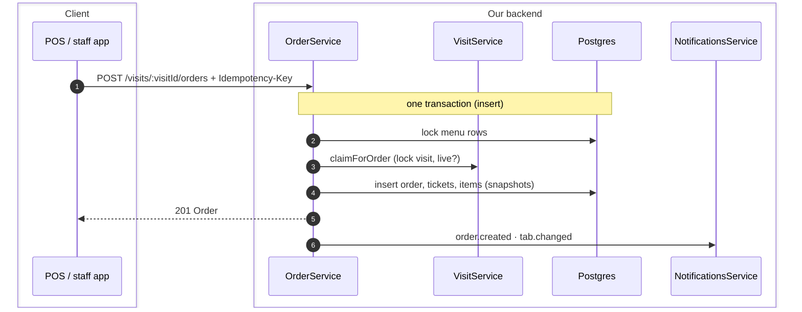

# Ordering & tickets — design

> Spec-Anchored technical design (`docs/features/ordering/design.md`). Shared across all briefs for this feature; each brief updates this file in its own PR.
> **As-built (2026-11-15).** *As-is* = the shipped code with `path:line` evidence (backend paths under `app/backend/src/`). Field confirms it once; the next brief that changes the feature drafts its To-be here.

| | |
|---|---|
| **Owner** | Field |
| **Status** | Built (As-is mapped) |
| **Requirements** | [requirements.md](requirements.md) · **UI** [ui.md](ui.md) |
| **Changed by** | BRIEF-012, BRIEF-017, BRIEF-018, BRIEF-027, BRIEF-031, BRIEF-032, BRIEF-034, BRIEF-042, BRIEF-070, BRIEF-010 · DR-011, DR-012, DR-013, DR-016, DR-017, DR-022 |

## As-is

- `OrderService.place()` / `placeAsGuest()` (`modules/order/application/order.service.ts:34, :42`) → `@Transactional insert()` (`:49-57`): lock menu → `VisitService.claimForOrder()` (`modules/venue/application/visit.service.ts:61-66`, 404 / `INVALID_STATE_TRANSITION`) → price lines (`order-lines.ts:12-19, :55-65`) → insert; after commit emits `order.created` + tab change (`order.service.ts:105-107`).
- Unavailable lines → `409 ITEM_UNAVAILABLE` with `details` (`order-lines.ts:135-141`).
- Tickets: `TicketService` transitions in transactions (`ticket.service.ts:74, :83, :99, :113`), rules in `ticket-transition.ts`; queries `ticket-query.ts`.
- Manual 86: `SoldOutService.markUnavailable()/markAvailable()` (`sold-out.service.ts:39, :43`, transaction `:53`) → emits `menu.availability_changed` + `ticket.status_changed` (`:135-144`).
- Void / comp: `OrderAdjustmentService` (`order-adjustment.service.ts:43`) + manager PIN via `ApprovalService` (`approval.service.ts`), PIN throttle (`modules/iam/application/pin-throttle.service.ts:19` → `PIN_LOCKED 429`).
- Tables: `order_record`, `order_ticket`, `order_item`, `order_item_modifier` (`docs/schema.sql:382-449`; migrations `Orders`, `OrderLineSnapshots`, `OrderItemAdjustment`).
- Web: POS order entry `app/frontend/src/app/pos/tables/[visitId]/order/`, orders board `app/frontend/src/app/pos/orders/` (`board.ts`), void/comp modal `pos/tables/_components/VoidCompModal.tsx`. Staff app queue: `app/mobile/src/app/(tabs)/orders.tsx`, `hooks/useTicketQueue.ts`.

## Decisions

| Decision | Why | Instead of | Source |
|---|---|---|---|
| Status per station ticket, never per item | One tap per ticket | per-item status | DR-012 |
| Order → tickets split by `kitchen_tag` at placement | Beer never waits for fries | one ticket always | DR-013 |
| Counter seats skip READY | Bartender hands the drink over | READY for all | DR-011 |
| Idempotency key + request hash | Safe retry | key only | DR-017 |
| Name + price snapshots on the line | Past bills never change | join to live menu | DR-022 |
| Void / comp columns on `order_item`, approver nullable = self-approved | Audit in place | separate adjustment table | DR-016 A |

## Assumed (external / runtime only)

None.

## Flow

Transaction boundary: steps 2–5 inside `OrderService.insert()` (`order.service.ts:49`); events after commit.

## Contracts

Built and published in `docs/api/openapi.json` (generated, checked in CI). Shared shapes in `app/packages/contracts/src/`.

| Route / event | Permission | Where |
|---|---|---|
| POST /visits/:visitId/orders | orders:create | `order/infrastructure/http/orders.controller.ts:30` |
| GET /orders/:id | orders:read | `orders.controller.ts:45` |
| GET /tickets | orders:read | `tickets.controller.ts:29` |
| POST /tickets/:id/{accept\|ready\|send\|flag-issue\|resolve} | orders:update_status | `tickets.controller.ts:43-93` |
| POST /order-items/:id/{void\|comp} | orders:update_status (+ manager PIN) | `order-items.controller.ts:24, :44` |
| POST /menu/items/:id/{mark-unavailable\|mark-available} | menu:toggle_availability | `order/infrastructure/http/menu-availability.controller.ts:17, :33` |
| WS `order.created` · `ticket.status_changed` · `ticket.issue_escalated` | staff room | `packages/contracts/src/events/order.ts:6-8` |

## Code map

| File | Owns |
|---|---|
| `modules/order/application/order.service.ts` | place order (staff / guest) |
| `modules/order/application/order-lines.ts` | pricing, snapshots, unavailable lines |
| `modules/order/application/ticket.service.ts` · `ticket-transition.ts` | ticket status |
| `modules/order/application/sold-out.service.ts` | manual 86 + auto-void |
| `modules/order/application/order-adjustment.service.ts` · `approval.service.ts` | void / comp + PIN |
| `common/idempotency/` | idempotency |
| `app/frontend/src/app/pos/tables/[visitId]/order/` | POS order entry |
| `app/frontend/src/app/pos/orders/` | orders board |
| `app/mobile/src/app/(tabs)/orders.tsx` | staff app queue |

Packages: as in the app `package.json` files (no feature-specific additions).

## Rules

- Controllers never check permissions inline — `PermissionsGuard` + `@RequirePermissions`.
- Events are emitted only after commit.

**Invariant enforcement**

| I | Enforced by |
|---|---|
| I-1 | columns `unit_price_snapshot`, `item_name_snapshot`, `variant_name_snapshot`, `order_item_modifier.option_name_snapshot` written only at placement (`modules/order/application/order-lines.ts:55-65`); no update path; DR-022 backfill `providers/database/migrations/1762400000000-OrderLineSnapshots.ts` |
| I-2 | `common/idempotency/idempotency.service.ts:15` (request hash; `IDEMPOTENCY_KEY_REUSED` / `CONFLICT` at `:90-98`) used by `POST /visits/:visitId/orders` (`orders.controller.ts:64`) |
| I-3 | `uq_order_number_per_day`, `uq_ticket_station_per_order` (`providers/database/migrations/1762100000000-Orders.ts:39, :59`) |
| I-4 | `chk_order_item_adjustment` (`docs/schema.sql:441`, migration `1763600000000-OrderItemAdjustment.ts`) + `OrderAdjustmentService` (`order-adjustment.service.ts:43`, `@Transactional`) |

- DR needed if: flow above changes · contracts above change · new dependency

## Observability

Structured logs per request; no secrets, tokens or guest personal data.

## Not applicable

Feature flag · backfill.
