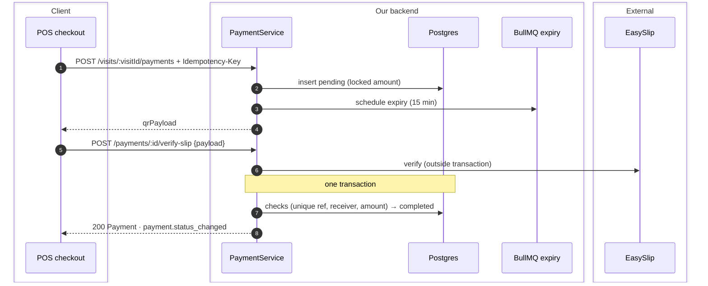

# Payments — design

> Spec-Anchored technical design (`docs/features/payments/design.md`). Shared across all briefs for this feature; each brief updates this file in its own PR.
> **As-built (2026-11-15).** *As-is* = the shipped code with `path:line` evidence (backend paths under `app/backend/src/`). Field confirms it once; the next brief that changes the feature drafts its To-be here.

| | |
|---|---|
| **Owner** | Field |
| **Status** | Built (As-is mapped) |
| **Requirements** | [requirements.md](requirements.md) · **UI** [ui.md](ui.md) |
| **Changed by** | BRIEF-013, BRIEF-024, BRIEF-025, BRIEF-033 · DR-014, DR-017, DR-018, DR-019, DR-027 |

## As-is

- `PaymentService` (`modules/payment/application/payment.service.ts`): `create()` `:71`, `getToday()` `:88`, `cancel()` `:105`, `markPaid()` `:112`, `verifySlip()` `:119`, `expire()` `:143`; transactional steps `:149-215`; emits `payment.status_changed` after commit.
- Bill math: `bill.service.ts`; in-flight guard: `payment-guard.ts`; QR payload: `promptpay-payload.ts`.
- Expiry job: BullMQ queue registered `payment.module.ts:29`.
- EasySlip adapter config: `providers/config/easyslip/`.
- Table `payment` (+ `payment_order`, `payment_charge_item`) `docs/schema.sql:455-494`; migrations `Payments`, `CustomerPayment`.
- Web checkout: `app/frontend/src/app/pos/tables/_components/checkout/` (`useCheckout.ts`, `useSlipScanner.ts`); settings `app/frontend/src/app/pos/settings/`.

## Decisions

| Decision | Why | Instead of | Source |
|---|---|---|---|
| Own PromptPay with server-built amount-locked QR as the default mode | No gateway fee for small bars | gateway only | DR-014 #6 |
| Idempotency key on create | Safe retry | none | DR-017 |
| QR rendered from payload on the client | No image round-trip | base64 PNG | DR-018 |
| Defer split-equal | Core slice first | build now | DR-019 |
| Slip verify also on the staff app (QR only, no manual confirm) | Waiter at the table | POS only | DR-027 |

## Assumed (external / runtime only)

| Assumption | Who verifies | When |
|---|---|---|
| EasySlip API availability and quota | Field | before a real-bar pilot |

## Flow

Transaction boundary: EasySlip call outside the transaction; status change + checks inside (`payment.service.ts:149-215`).

## Contracts

Built and published in `docs/api/openapi.json` (generated, checked in CI). Shared shapes in `app/packages/contracts/src/`.

| Route / event | Permission | Where |
|---|---|---|
| POST /visits/:visitId/payments | payments:create | `payment/infrastructure/http/payments.controller.ts:35` |
| GET /payments/today · GET /payments/:id | payments:read | `payments.controller.ts:58, :69` |
| POST /payments/:id/cancel | payments:create | `:78` |
| POST /payments/:id/mark-paid | payments:mark_paid | `:88` |
| POST /payments/:id/verify-slip | payments:create | `:102` |
| GET/PATCH /venue/payment-settings | venue:read_payment / venue:update_payment | `venue/infrastructure/http/venue.controller.ts:45, :56` |
| WS `payment.status_changed` | staff room + guest tab | `packages/contracts/src/events/payment.ts:9` |

## Code map

| File | Owns |
|---|---|
| `modules/payment/application/payment.service.ts` | payment lifecycle |
| `modules/payment/application/bill.service.ts` | bill totals |
| `modules/payment/application/payment-guard.ts` | in-flight lock |
| `modules/payment/application/promptpay-payload.ts` | EMVCo payload |
| `app/frontend/src/app/pos/tables/_components/checkout/` | POS checkout |

Packages: as in the app `package.json` files (no feature-specific additions).

## Rules

- External calls (EasySlip, gateway) never inside a DB transaction.
- Never log slip payloads or account numbers in full.

**Invariant enforcement**

| I | Enforced by |
|---|---|
| I-1 | `payment.gateway_tx_id UNIQUE` (`providers/database/migrations/1762200000000-Payments.ts:36`) |
| I-2 | `payment.slip_trans_ref UNIQUE` (`1762200000000-Payments.ts:39`) + `PaymentService.verifySlip()` (`modules/payment/application/payment.service.ts:119`) |
| I-3 | `modules/payment/application/payment-guard.ts:15` and `modules/order/application/order-adjustment.service.ts:98` → `409 PAYMENT_IN_FLIGHT` |

- DR needed if: flow above changes · contracts above change · new dependency

## Observability

Structured logs per request; no secrets, tokens or guest personal data.

## Not applicable

Feature flag · backfill.
