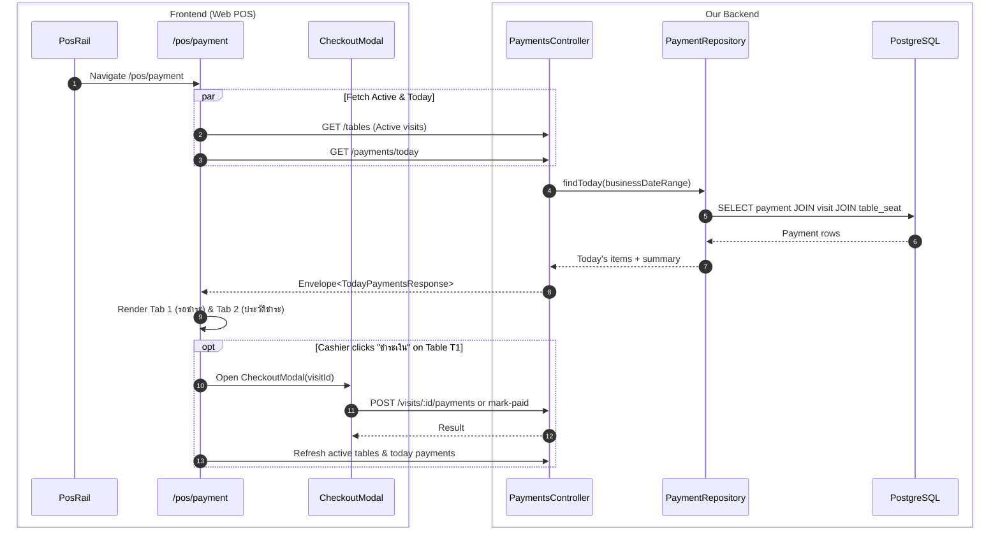

# POS Payment Page (ศูนย์การชำระเงิน) — design

> Spec-Anchored technical design (`docs/features/pos-payment-page/design.md`). Shared across BRIEF-072 and BRIEF-073.

| | |
|---|---|
| **Owner** | Field |
| **Status** | To-be (Draft) |
| **Requirements** | [requirements.md](requirements.md) · **UI** [ui.md](ui.md) |
| **Changed by** | `BRIEF-072`, `BRIEF-073` |

## As-is

- Currently, `PosRail.tsx` (`app/frontend/src/app/pos/_components/PosRail.tsx:33`) defines `{ key: "pay", label: "ชำระเงิน", icon: Banknote }` with no `href`, rendering as disabled text "เร็ว ๆ นี้".
- Cashiers must go to `/pos/tables`, find an occupied table card, tap it to open `SessionDrawer.tsx`, and tap "ชำระเงิน" inside the drawer to trigger `CheckoutModal.tsx`.
- There is no single screen showing all unpaid bills or all pending PromptPay QRs at a glance.
- Backend has `GET /payments/:id` (`PaymentsController.ts:56`) for single payment lookup, but no list endpoint for today's transactions.

## Decisions

| Decision | Why | Instead of | Source |
|---|---|---|---|
| Slicing: 2 thin briefs (BRIEF-072 Backend + BRIEF-073 Frontend) | Keeps each brief ≤ 10 files and under 8 ACs per workflow limits. | 1 combined mega-brief. | Field, interview, 2026-11-02 |
| Business date scoping for `GET /payments/today` | Uses `businessDate(now, cutoff)` from `src/common/business-date.ts`, matching venue's business day cut-off (e.g. 06:00 Bangkok). | Using calendar UTC date. | Field, interview, 2026-11-02 |
| Reusing `CheckoutModal.tsx` on the `/pos/payment` page | Keeps payment logic (PromptPay QR, slip verification, cash helper, manual confirmation) unified in one tested component. | Duplicating payment modal or creating new forms. | Field, interview, 2026-11-02 |
| Permission gate `payments:read` | Grants cashiers and managers access while keeping unauthorized roles blocked. | `tables:read` (too broad) or `payments:create` (too narrow). | Field, interview, 2026-11-02 |

## Assumed (external / runtime only)

| Assumption | Who verifies | When |
|---|---|---|
| Venue cut-off configuration exists in `venue` table (defaults to '06:00') | Planner dry run / e2e | Seed / test run |

## Flow



## Contracts

Shared types live in `app/packages/contracts/src/schemas/payments.ts`:

```ts
export const TodayPaymentItemSchema = z.object({
  id: UuidSchema,
  visitId: UuidSchema,
  seatLabel: z.string(),
  partNo: z.number().int().positive(),
  partCount: z.number().int().positive(),
  amount: MoneySchema,
  method: PaymentMethodSchema,
  status: PaymentStatusSchema,
  confirmedVia: PaymentConfirmedViaSchema.nullable(),
  slipTransRef: z.string().nullable(),
  statusReason: PaymentStatusReasonSchema.nullable(),
  paidAt: IsoDateTimeSchema.nullable(),
  createdAt: IsoDateTimeSchema,
});
export type TodayPaymentItem = z.infer<typeof TodayPaymentItemSchema>;

export const TodayPaymentsSummarySchema = z.object({
  totalRevenue: MoneySchema,
  promptpayTotal: MoneySchema,
  cashTotal: MoneySchema,
  completedCount: z.number().int().nonnegative(),
  pendingCount: z.number().int().nonnegative(),
  cancelledCount: z.number().int().nonnegative(),
});
export type TodayPaymentsSummary = z.infer<typeof TodayPaymentsSummarySchema>;

export const TodayPaymentsResponseSchema = z.object({
  businessDate: z.string(),
  summary: TodayPaymentsSummarySchema,
  items: z.array(TodayPaymentItemSchema),
});
export type TodayPaymentsResponse = z.infer<typeof TodayPaymentsResponseSchema>;
```

### Endpoints

- `GET /payments/today`
  - Requires: `payments:read`
  - Returns: `Envelope<TodayPaymentsResponse>`
  - Errors: `401 Unauthorized`, `403 Forbidden`

## Code map

### BRIEF-072 (Backend API & Contracts)
```text
app/packages/contracts/src/schemas/payments.ts
app/backend/src/modules/payment/
├── domain/ports/payment.repository.port.ts
├── infrastructure/persistence/
│   ├── payment.typeorm-repository.ts
│   └── payments-today.sql.ts (or repository query)
├── application/
│   ├── payment.service.ts
│   └── payment.types.ts
└── infrastructure/http/
    ├── payments.controller.ts
    └── payments.openapi.ts
app/backend/test/payment-today.e2e-spec.ts
```

### BRIEF-073 (Frontend Web POS UI)
```text
app/frontend/src/
├── lib/
│   ├── api/payments.ts (add getTodayPayments)
│   └── permissions/pos-routes.ts (add /pos/payment -> payments:read)
└── app/pos/
    ├── _components/PosRail.tsx (enable href: "/pos/payment")
    └── payment/
        ├── page.tsx
        └── _components/
            ├── PayHeader.tsx
            ├── PayMetrics.tsx
            ├── ActiveBillsTab.tsx
            ├── PendingQrCard.tsx
            ├── PaymentHistoryTab.tsx
            └── PayFilter.tsx
```

## Rules

- No raw update on audited entities; queries use parameterized SQL or TypeORM repository.
- `GET /payments/today` must calculate the Bangkok business day bounds using the venue's cut-off hour.
- `CheckoutModal` reuse must maintain proper cleanup of idempotency keys upon modal close.

## Observability

- Log `GET /payments/today` requests with staff ID and business date.
- No sensitive customer or payment details logged.
