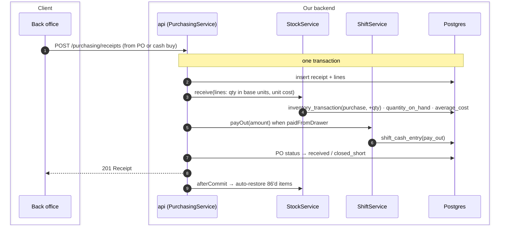

# Purchasing — design

> Spec-Anchored technical design (`docs/features/purchasing/design.md`). Shared across all briefs for this feature; each brief updates this file in its own PR.
> **Draft 2026-11-15 (Cowork).** *As-is* and *Decisions* are evidence / approved sources only. Everything under *Contracts*, *Code map* and the schema tables is a **proposal** — each `P#` in *Open questions* needs Field's OK (DR-031 lock: exact columns per feature need Field's OK) before a brief cites it.

| | |
|---|---|
| **Owner** | Field |
| **Status** | As-is mapped · To-be (Draft — proposals) |
| **Requirements** | [requirements.md](requirements.md) · **UI** [ui.md](ui.md) |
| **Changed by** | DR-031 (#2, #11) · CD-18 |

## As-is

- None — new feature. No supplier / PO / receipt tables in `docs/schema.sql` (domains 1–11, `:33-600`); no purchasing module under `app/backend/src/modules/`.
- Stock side it writes to: `inventory_item.quantity_on_hand`, `cost_per_unit` (`docs/schema.sql:330-344`), `inventory_transaction` with `tx_type 'purchase'` (`:27, :353-363`) — schema only, not migrated (see `stock`).
- Shift table exists in schema only (`docs/schema.sql:539-558`) — the "paid from drawer" pay-out needs `shift-cash-close`.
- Photos: S3 is reached only through `common/storage/StorageService` (DR-020; `app/backend/src/common/storage/`).
- IAM: no `purchasing` permission in `IamCore.ts:57-76`.

## Decisions

| Decision | Why | Instead of | Source |
|---|---|---|---|
| Two intake paths: PO (order → receive) and cash buy without PO | Matches how bars buy | PO only | Topic 3 P1 |
| No approval step; `purchasing` permission + audit log | Small team | approval flow | Topic 3 P2 |
| Receive what arrived; PO closes with shortfall; no backorder | Simple | backorder tracking | Topic 3 P3 |
| Weighted average cost updated on every receipt line | One cost method | FIFO | DR-031 locks · Topic 3 P7 |
| Purchase unit + conversion per stock item | Order in cases, stock in bottles | single unit | Topic 3 P8 |
| PO sent by copy / share text now; LINE OA later on the same builder | No dependency now | LINE OA now | Topic 3 P6 · DR-031 |

## Assumed (external / runtime only)

| Assumption | Who verifies | When |
|---|---|---|
| `navigator.share` works on the POS tablet / owner phone browsers (copy fallback otherwise) | executor | PO brief run proof |

## Flow



Transaction boundary: steps 2–8 in one transaction; 10 after commit. `paidFromDrawer` with no open shift → `409 NO_OPEN_SHIFT` (CD-18 cash-buy·4).

## Contracts (proposed — P1–P3)

- **P1 schema:** `supplier (id, name, contact, line_id, phone, note, is_active)` · `purchase_order (id, supplier_id, po_no, status 'draft'|'sent'|'received'|'closed_short'|'cancelled', sent_at, note)` + `purchase_order_line (po_id, inventory_item_id, qty_purchase_units, expected_unit_cost)` · `stock_receipt (id, source 'po'|'cash_buy', po_id NULL, supplier_id NULL, received_at, total, paid BOOLEAN, due_date NULL, paid_at, photo_key NULL, paid_from_drawer BOOLEAN)` + `stock_receipt_line (receipt_id, inventory_item_id NULL, description, qty_purchase_units, qty_base_units, unit_cost, is_expense BOOLEAN)` (untracked lines → expense, `expenses-pnl`).
- **P2 endpoints** (`purchasing`): `GET/POST/PATCH /purchasing/suppliers` · `GET /purchasing/reorder` · `POST /purchasing/reorder/po` (one draft PO per supplier) · `GET/POST/PATCH /purchasing/orders` · `POST /purchasing/orders/:id/send` (returns message text) · `POST /purchasing/receipts` · `POST /purchasing/receipts/:id/mark-paid` · photo upload via presigned POST (DR-020). Errors: `PO_NOT_SENT 409` · `NO_OPEN_SHIFT 409` · `VALIDATION_ERROR 400`.
- **P3 permission:** `purchasing` (owner / manager).

## Code map (proposed)

```text
app/backend/src/modules/purchasing/
├── application/
├── infrastructure/http/
└── infrastructure/persistence/
app/packages/contracts/src/schemas/purchasing.ts
app/frontend/src/app/pos/stock/purchasing/
```

| File | Owns |
|---|---|
| `modules/purchasing/application/supplier.service.ts` | suppliers |
| `modules/purchasing/application/purchase-order.service.ts` | drafts, send text, reorder → PO |
| `modules/purchasing/application/receipt.service.ts` | receive / cash buy; calls stock + shift ports |
| `modules/purchasing/application/po-message.ts` | Thai PO message builder (later reused by LINE OA) |
| `contracts/src/schemas/purchasing.ts` | DTOs |
| `app/frontend/src/app/pos/stock/purchasing/**` | CD-18 screens |

Packages: none.

## Rules

- Purchasing writes stock only through the stock port (`receive()`); never updates `inventory_item` directly.
- Receipts are immutable after save except `paid` / `paid_at` (mark paid).

**Invariant enforcement**

| I | Enforced by |
|---|---|
| I-1 | only `ReceiptService` calls `StockService.receive()`; no PATCH of `quantity_on_hand` exists — test: stock changes only with a receipt |

- DR needed if: flow above changes · contracts above change · new dependency

## Observability

Log `receipt.saved` (receiptId, source, lineCount, total), `po.sent` (poId, supplierId). Never log supplier phone numbers in full.

## Open questions (proposals to approve)

| # | Proposal | Recommended | Blocks |
|---|---|---|---|
| P1 | Tables above | approve | purchasing brief |
| P2 | Endpoints above | approve | purchasing brief |
| P3 | Permission `purchasing` (owner / manager) | approve | purchasing brief |
| — | CD-18 R1–R7 | answer in the purchasing brief session | purchasing UI brief |

## Not applicable

Feature flag · backfill · LINE OA (later).
