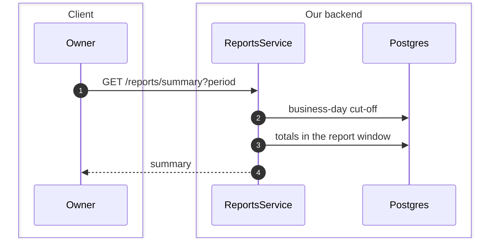

# Reports & dashboard — design

> Spec-Anchored technical design (`docs/features/reports-dashboard/design.md`). Shared across all briefs for this feature; each brief updates this file in its own PR.
> **As-built (2026-11-15).** *As-is* = the shipped code with `path:line` evidence (backend paths under `app/backend/src/`). Field confirms it once; the next brief that changes the feature drafts its To-be here.

| | |
|---|---|
| **Owner** | Field |
| **Status** | Built (As-is mapped) |
| **Requirements** | [requirements.md](requirements.md) · **UI** [ui.md](ui.md) |
| **Changed by** | BRIEF-036, BRIEF-037 · DR-014, DR-015 |

## As-is

- `ReportsService` (`modules/reports/application/reports.service.ts:27-62`): `summary()` `:33` (cut-off from venue `:34`), `daily()` `:48`, `items()` `:54`, `today()` `:62`; periods `report-period.ts`.
- Web: `app/frontend/src/app/pos/reports/` (`period.ts`, `hourly.ts`).

## Decisions

| Decision | Why | Instead of | Source |
|---|---|---|---|
| Business day cut-off for every report | A 01:30 sale belongs to the night before | calendar day | DR-014 #4 |
| Chart library per DR-015 | Consistent charts | hand-rolled | DR-015 |

## Assumed (external / runtime only)

None.

## Flow

Transaction boundary: read-only.

## Contracts

Built and published in `docs/api/openapi.json` (generated, checked in CI). Shared shapes in `app/packages/contracts/src/`.

| Route / event | Permission | Where |
|---|---|---|
| GET /reports/{summary\|daily\|items\|today} | reports:read | `reports/infrastructure/http/reports.controller.ts:26-62` |

## Code map

| File | Owns |
|---|---|
| `modules/reports/application/reports.service.ts` | report queries |
| `modules/reports/application/report-period.ts` | period → window |
| `app/frontend/src/app/pos/reports/` | dashboard |

Packages: as in the app `package.json` files (no feature-specific additions).

## Rules

- Reports never expose guest personal data.

**Invariant enforcement**

None of its own.

- DR needed if: flow above changes · contracts above change · new dependency

## Observability

Structured logs per request; no secrets, tokens or guest personal data.

## Not applicable

Feature flag · backfill.
