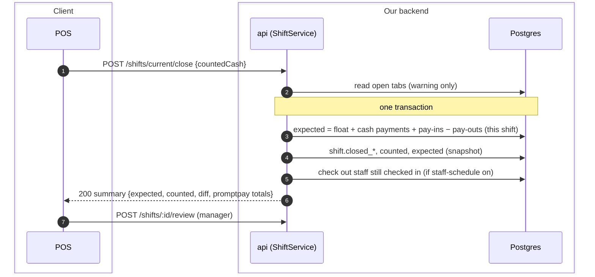

# Shift & cash close — design

> Spec-Anchored technical design (`docs/features/shift-cash-close/design.md`). Shared across all briefs for this feature; each brief updates this file in its own PR.
> **Draft 2026-11-15 (Cowork).** *As-is* and *Decisions* are evidence / approved sources only. Everything under *Contracts*, *Code map* and the schema tables is a **proposal** — each `P#` in *Open questions* needs Field's OK (DR-031 lock: exact columns per feature need Field's OK) before a brief cites it.

| | |
|---|---|
| **Owner** | Field |
| **Status** | As-is mapped · To-be (Draft — proposals) |
| **Requirements** | [requirements.md](requirements.md) · **UI** not yet — CD in the design plan |
| **Changed by** | DR-031 (#3) · DR-014 #7 |

## As-is

- `shift` table in schema only (`docs/schema.sql:539-558`): `business_date`, `opened_by/at`, `opening_float`, `closed_by/at`, `counted_cash`, `expected_cash`, `reviewed_by/at`, `note`. Not migrated (no shift migration in `providers/database/migrations/`).
- `venue.shift_close_enabled BOOLEAN DEFAULT FALSE` (`docs/schema.sql:47`, DR-014 #7) — not migrated either (`VenueAndMenu` migration predates it; verify in the brief Dry Run).
- Payments carry method + confirmation (`payment_method`, `payment_confirmed_via` enums `docs/schema.sql:19, :24`); `PaymentService.getToday()` already sums today's payments by business day (`app/backend/src/modules/payment/application/payment.service.ts:88`).
- Business day rule: `VenueSettingsService.businessDayRule()` (`app/backend/src/modules/venue/application/venue-settings.service.ts:54`).

## Decisions

| Decision | Why | Instead of | Source |
|---|---|---|---|
| One open shift per venue, sequential | One drawer | parallel shifts | Topic 2 S1 |
| Pay-in / pay-out with reason adjust expected cash; cash buy "paid from drawer" creates the pay-out | Drawer reconciles | free-form adjustments | Topic 2 S2 |
| Close = open-tab warning → blind count → PromptPay totals → low-stock checklist → summary → manager review | One flow | separate screens | Topic 2 S3 |
| Close allowed with open tabs; payment counts in the shift that takes the money | Bars run late tabs | block close | Topic 2 S4 |
| Three separate cut-offs (business day, sale hours, shift) | Different purposes | one cut-off | Topic 2 |

## Assumed (external / runtime only)

None.

## Flow

Transaction boundary: steps 3–5. Payments landing during close count in the next shift (by `completed_at` > `closed_at`).

## Contracts (proposed — P1–P3)

- **P1 schema:** migrate `shift` as in `docs/schema.sql:539-558` + `venue_id`-less (single venue) + unique partial index "one open shift" (`WHERE closed_at IS NULL`); new `shift_cash_entry (id, shift_id, kind 'pay_in'|'pay_out', amount, reason, staff_id NULL (advance), receipt_id NULL, created_by, created_at)`; `payment.shift_id` (set when completed).
- **P2 endpoints:** `POST /shifts` (open, `shift:manage`) · `GET /shifts/current` · `POST /shifts/current/cash-entries` · `POST /shifts/current/close` · `POST /shifts/:id/review` (`shift:manage`) · `GET /shifts?from&to`. Errors: `SHIFT_ALREADY_OPEN 409` · `NO_OPEN_SHIFT 409`.
- **P3 permissions:** `shift:manage` (owner / manager: open, review) · `shift:cash` (staff default: pay-in / out, count).

## Code map (proposed)

| File | Owns |
|---|---|
| `modules/shift/application/shift.service.ts` | open, close, review, expected cash |
| `modules/shift/application/cash-entry.service.ts` | pay-in / out (port used by purchasing, payroll advances) |
| `contracts/src/schemas/shift.ts` | DTOs |
| `app/frontend/src/app/pos/shift/**` | close flow |

Packages: none.

## Rules

- Expected cash is a snapshot at close; later edits never change a closed shift.

**Invariant enforcement**

| I | Enforced by |
|---|---|
| I-1 | partial unique index on `shift (closed_at IS NULL)` + `SHIFT_ALREADY_OPEN` — test: second open returns 409 |

## Observability

Log `shift.closed` (shiftId, expected, counted, diff). No staff ranking views.

## Open questions (proposals to approve)

| # | Proposal | Recommended | Blocks |
|---|---|---|---|
| P1 | Schema above (`shift` migrate + `shift_cash_entry` + `payment.shift_id`) | approve | shift brief |
| P2 | Endpoints | approve | shift brief |
| P3 | Permissions `shift:manage`, `shift:cash` | approve | shift brief |
| Q | Is `venue.shift_close_enabled` still needed (DR-014 #7 "optional per venue")? | keep — default off | shift brief |

## Not applicable

Multi-drawer · backfill.
