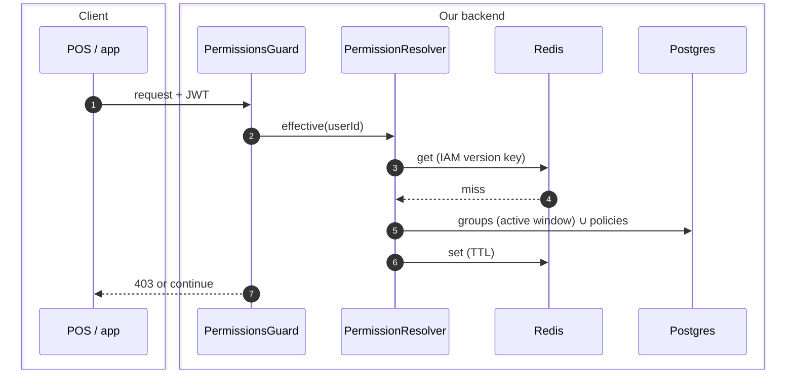

# Staff access (auth + IAM) — design

> Spec-Anchored technical design (`docs/features/staff-access/design.md`). Shared across all briefs for this feature; each brief updates this file in its own PR.
> **As-built (2026-11-15).** *As-is* = the shipped code with `path:line` evidence (backend paths under `app/backend/src/`). Field confirms it once; the next brief that changes the feature drafts its To-be here.

| | |
|---|---|
| **Owner** | Field |
| **Status** | Built (As-is mapped) |
| **Requirements** | [requirements.md](requirements.md) · **UI** [ui.md](ui.md) |
| **Changed by** | BRIEF-007, BRIEF-015, BRIEF-021, BRIEF-028, BRIEF-053, BRIEF-054, BRIEF-055, BRIEF-056, BRIEF-057, BRIEF-058, BRIEF-068 · DR-005, DR-014, DR-029 |

## As-is

- Auth: `AuthService` (`modules/auth/application/auth.service.ts:54-119`), `token.service.ts`, PKCE `pkce.ts`, mobile `mobile-login.ts`, demo login `demo-user.service.ts` (dev); routes `auth.controller.ts:61-183`.
- IAM: `PermissionResolver` cached in Redis under the global IAM version (`modules/iam/application/permission-resolver.service.ts:3-21`, `iam-version.service.ts`), enforcement `iam-enforcement.service.ts`, admin `iam-admin.service.ts`, `staff-admin.service.ts`, `access-request.service.ts`, PIN `staff-pin.service.ts` + `pin-throttle.service.ts:19`.
- Guards: `common/guards/jwt-auth.guard.ts:12`, `common/guards/permissions.guard.ts:24`.
- Seed: permission codes + groups `providers/database/migrations/1763200000000-IamCore.ts:57-109`.
- Tables `staff_user` … `staff_access_request` (`docs/schema.sql:138-232`), `audit_log` (`:524-532`).
- Web: `app/frontend/src/app/login`, `pos/settings/{staff,groups,policies}`; staff app login `app/mobile/src/app/login.tsx`.

## Decisions

| Decision | Why | Instead of | Source |
|---|---|---|---|
| Provider-agnostic identity (`staff_user_identity`) | Phone OTP later | LINE id on the user | CLAUDE.md |
| Mobile auth: PKCE + Bearer | No cookies in the app | web cookies on mobile | DR-005 |
| Seeded groups + PIN switch on shared POS | Small bars | per-device login | DR-014 |
| Payment settings owner-only | Money destination | manager can edit | DR-029 |

## Assumed (external / runtime only)

None.

## Flow

Transaction boundary: IAM writes bump the global IAM version in the same transaction, so cached permissions are dropped.

## Contracts

Built and published in `docs/api/openapi.json` (generated, checked in CI). Shared shapes in `app/packages/contracts/src/`.

| Route / event | Permission | Where |
|---|---|---|
| GET /auth/line/login · /auth/line/callback · POST /auth/refresh · /auth/logout · /auth/mobile/{token,refresh} · /auth/demo-login | public | `auth/infrastructure/http/auth.controller.ts:61-183` |
| GET /me/permissions · PUT /me/pin | signed in | `iam/infrastructure/http/me.controller.ts:21, :32` |
| /staff… · /staff-groups… · /policies… · /staff/access-requests… · GET /permissions/catalog | staff:manage | `staff.controller.ts:33-117`, `staff-groups.controller.ts:31-102`, `policies.controller.ts:29-84`, `access-requests.controller.ts:29-72`, `iam-admin.controller.ts:19` |
| GET /venue · PATCH /venue/settings | venue:read / venue:update | `venue.controller.ts:22, :33` |

## Code map

| File | Owns |
|---|---|
| `modules/auth/` | LINE SSO, tokens, mobile auth |
| `modules/iam/application/permission-resolver.service.ts` | effective permissions + cache |
| `common/guards/permissions.guard.ts` | enforcement |
| `common/audit/` · `providers/database/subscribers/audit.subscriber.ts` | audit log |
| `app/frontend/src/app/pos/settings/` | staff, groups, policies |

Packages: as in the app `package.json` files (no feature-specific additions).

## Rules

- Never inline permission checks in controllers.
- Never log tokens, PINs or LINE ids.

**Invariant enforcement**

| I | Enforced by |
|---|---|
| I-1 | `common/audit/audit-log.service.ts:7-9` (insert-only service) + `providers/database/subscribers/audit.subscriber.ts` (global); no update / delete path |
| I-2 | `common/guards/permissions.guard.ts:24` + `@RequirePermissions` on every staff route (see each feature's Contracts) |

- DR needed if: flow above changes · contracts above change · new dependency

## Observability

Structured logs per request; no secrets, tokens or guest personal data.

## Not applicable

Feature flag · backfill.
