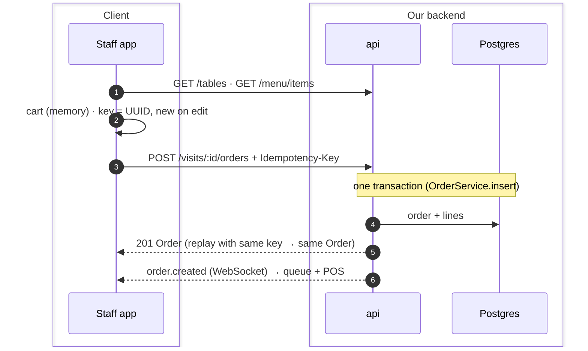

# Staff app — take order — design

> Spec-Anchored technical design (`docs/features/staff-order-entry/design.md`). Shared across all briefs for this feature; each brief updates this file in its own PR.
> **Draft 2026-11-15 (Cowork).** *As-is* and *Decisions* are evidence / approved sources only. Everything under *Contracts*, *Code map* and the schema tables is a **proposal** — each `P#` in *Open questions* needs Field's OK (DR-031 lock: exact columns per feature need Field's OK) before a brief cites it.

| | |
|---|---|
| **Owner** | Field |
| **Status** | As-is mapped · To-be (Draft — proposals) |
| **Requirements** | [requirements.md](requirements.md) · **UI** [ui.md](ui.md) — CD-14 rev 5 |
| **Changed by** | BRIEF-074–077 (Draft) · DR-009 · DR-010 · DR-027 |

## As-is

Backend and contracts are built; only the mobile screens are new.

- `GET /tables` (`tables:read`) — `app/backend/src/modules/venue/infrastructure/http/tables.controller.ts:34-35`; `TableList` / `currentVisit` — `app/packages/contracts/src/schemas/visits.ts:12-52`.
- `GET /menu/categories`, `GET /menu/items` (`menu:read`) — `app/backend/src/modules/menu/infrastructure/http/menu.controller.ts:36-54`; shapes `app/packages/contracts/src/schemas/menu.ts:15-62` (`availableNow`, `unavailableReason`).
- `POST /visits/:visitId/orders` + `Idempotency-Key` (`orders:create`) — `app/backend/src/modules/order/infrastructure/http/orders.controller.ts:30-42, :64`; key must be a UUID (`app/backend/src/common/idempotency/idempotency-key.ts:4-9`); `ITEM_UNAVAILABLE` + `details` (`modules/order/application/order-lines.ts:135-141`); closed visit → `409 INVALID_STATE_TRANSITION` (`modules/venue/application/visit.service.ts:61-66`).
- `POST /visits` open / attach (`visits:open`) — `visits.controller.ts:47-63`; `OpenVisitResponse { visit, attached }`, `visit.openedBy` nullable (`contracts/src/schemas/visits.ts:54-105`).
- `POST /payments/:id/verify-slip` (`payments:create`) — `modules/payment/infrastructure/http/payments.controller.ts:102-119`; `PaymentService.verifySlip()` (`payment.service.ts:119`).
- Menu events to the staff room — `sold-out.service.ts:135`, `menu-write.service.ts:211`; payloads `contracts/src/events/menu.ts:5-25`.
- Staff (พนักงาน) group has `menu:read`, `orders:create`, `tables:read`, `visits:open`, `payments:create` — `IamCore.ts:79-92`.
- Mobile today: tabs `orders`, `more` (`app/mobile/src/app/(tabs)/`), API `lib/api/tickets.ts`; login + queue from BRIEF-010 (merged #129); LINE login client = BRIEF-022 (open branch).

## Decisions

| Decision | Why | Instead of | Source |
|---|---|---|---|
| Same backend API as the web — no mobile-only endpoint | One contract | mobile BFF | DR-009 |
| No quick add on the phone — every item opens the item sheet | Avoid wrong adds one-handed | quick add | Field 2026-10-10 (CD-14 §9) |
| Idempotency key per cart, new key on any edit; retry reuses it | Never a double order | key per tap | CD-14 §4 (approved 2026-10-10) |
| Attach (`200 attached:true`) needs a confirm dialog — never joins silently | Wrong-table orders | silent join | Field 2026-10-10 (CD-14 R9) |
| Cart in memory per visit; no offline ordering | Scope (offline cut) | persisted drafts | CD-14 R6 |
| Slip scan sends the QR payload only; manual confirm never on the phone | DR-027 | photo upload / manual confirm | DR-027 (Approved B) |

## Assumed (external / runtime only)

| Assumption | Who verifies | When |
|---|---|---|
| Dev backend reachable from the phone over the tunnel | executor | each brief step 0 |
| EasySlip key + venue PromptPay mode set on dev | Field | BRIEF-077 Ready |

## Flow

Transaction boundary: server side only (existing `OrderService.insert()`); the phone never retries with a new key unless the cart changed.

## Contracts

Consumed as-is — **no contract change** (BRIEF-074–077 §2). Error map: `ITEM_UNAVAILABLE` (void lines) · `INVALID_STATE_TRANSITION` / `NOT_FOUND` (visit closed) · `403` (permission revoked → refetch `/me/permissions`) · `IDEMPOTENCY_KEY_REUSED` / `CONFLICT` (network row) · slip codes per BRIEF-077 §2.

## Code map

From BRIEF-074–077 (all under `app/mobile/`):

| File | Owns | Brief |
|---|---|---|
| `src/app/order/[visitId].tsx` | menu route + cart lifetime | 074 |
| `src/components/order-entry/{SeatSheet,MenuList,ItemSheet,OptionGroup,CartSheet}.tsx` | order screens | 074 |
| `src/lib/order/{item-draft,cart}.ts` | pure cart logic (satang math, key rotation, void marks) | 074, 075 |
| `src/lib/api/{menu,tables,orders,visits,payments}.ts` | API calls | 074–077 |
| `src/hooks/usePlaceOrder.ts` · `src/hooks/useMenuLive.ts` | send · live menu | 075, 076 |
| `src/components/order-entry/{LeaveDialog,JoinDialog}.tsx` | dialogs | 075, 076 |
| `src/app/slip/[paymentId].tsx` · `src/lib/payments/{pending-parts,slip-copy}.ts` | slip scan | 077 |

Packages: `expo-camera ~57.0.6` (BRIEF-077 Pre-decided, pending approval); `expo-crypto` from BRIEF-022.

## Rules

- Money math in satang integers (`MoneySchema` strings in, never floats).
- Screens branch on `error.code` only.

**Invariant enforcement**

None of its own — relies on the order idempotency (`idempotency.service.ts:90-98`) and price snapshots (DR-022) already enforced server-side.

## Observability

N/A — no new backend boundary.

## Open questions

| # | Question | Recommended | Blocks |
|---|---|---|---|
| Q-lock | Lock mobile component tests as the acceptance set (`e2e` on) | yes | BRIEF-074–077 Ready |
| Q-076 | Split BRIEF-076 (two flows) | split live menu out | BRIEF-076 Ready |

## Not applicable

Schema · backend changes · feature flag.
