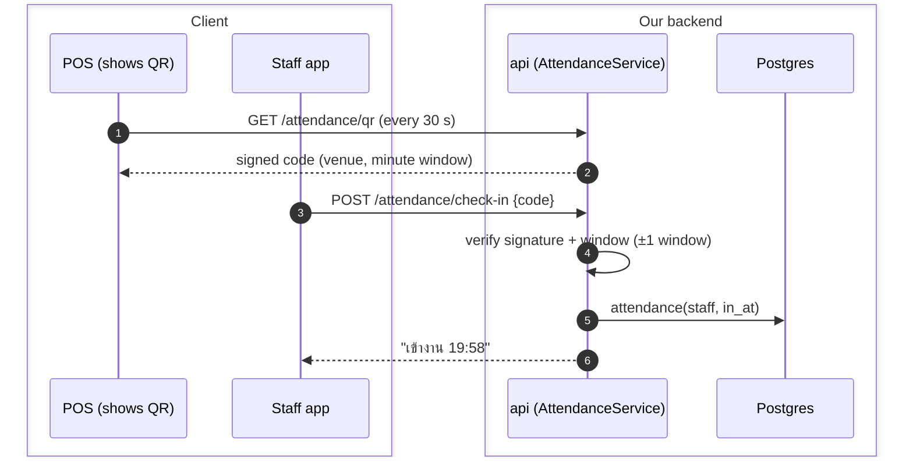

# Staff schedule + check-in + payroll lite — design

> Spec-Anchored technical design (`docs/features/staff-schedule/design.md`). Shared across all briefs for this feature; each brief updates this file in its own PR.
> **Draft 2026-11-15 (Cowork).** *As-is* and *Decisions* are evidence / approved sources only. Everything under *Contracts*, *Code map* and the schema tables is a **proposal** — each `P#` in *Open questions* needs Field's OK (DR-031 lock: exact columns per feature need Field's OK) before a brief cites it.

| | |
|---|---|
| **Owner** | Field |
| **Status** | As-is mapped · To-be (Draft — proposals) |
| **Requirements** | [requirements.md](requirements.md) · **UI** not yet — CD in the design plan (+ staff app CD-23) |
| **Changed by** | DR-031 (#10) |

## As-is

- None — new feature (Should tier). Staff exist: `staff_user` (`docs/schema.sql:138-152`), identities (`:154`), groups / policies (`:165-219`).
- Push to staff phones exists: `staff_push_token` (`docs/schema.sql:593`) + push queue (`app/backend/src/modules/notifications/notifications.module.ts:30`).
- Drawer pay-outs come from `shift-cash-close` (proposal); wages expense goes to `expenses-pnl` (proposal).
- Mobile app tabs today: `orders`, `more` (`app/mobile/src/app/(tabs)/`).

## Decisions

| Decision | Why | Instead of | Source |
|---|---|---|---|
| Attendance for pay only — no scores, no ranking | FRD cut | performance view | Topic 4b Boundary |
| Check-in = staff app scans a rotating QR (~30 s) on the POS; manager fallback logged | A photo of the QR stops working | GPS / PIN only | Topic 4b A1 |
| Weekly roster + push reminder; no swap workflow | Small team | swap requests | Topic 4b A2 |
| Missing check-out closed at shift close | Replaces the manual tick | auto at midnight | Topic 4b A4 |
| Payroll lite: rate or salary + attendance + advances (drawer pay-out) → pay run → wages expense; owner only | Enough for small bars | tax / SSO / OT | Topic 4 E4 · DR-031 cut |

## Assumed (external / runtime only)

None.

## Flow

Transaction boundary: one insert per check-in / out. Pay run = one transaction (lines + expense row).

## Contracts (proposed — P1–P3)

- **P1 schema:** `roster_shift (id, staff_id, date, start_time, end_time, note)` · `attendance (id, staff_id, business_date, in_at, out_at NULL, in_via 'qr'|'manager', out_via 'qr'|'manager'|'shift_close', recorded_by NULL)` · `pay_profile (staff_id, kind 'daily'|'monthly', rate, period 'weekly'|'biweekly'|'monthly')` · `pay_run (id, period_start, period_end, status 'draft'|'paid', paid_at)` + `pay_run_line (run_id, staff_id, days, base, bonus, advances, net)`; advances = `shift_cash_entry.staff_id` (shift-cash-close P1).
- **P2 endpoints:** `GET/PUT /roster?week` (`staff:schedule`) · `GET /roster/me` · `GET /attendance/qr` (POS) · `POST /attendance/check-in|check-out` · `POST /attendance/manual` (manager) · `GET /attendance?from&to` (owner) · `GET/POST /pay-runs` · `POST /pay-runs/:id/paid` (`payroll`). Errors: `QR_EXPIRED 409` · `ALREADY_CHECKED_IN 409`.
- **P3 permissions:** `staff:schedule` (owner / manager) · `payroll` (owner).

## Code map (proposed)

| File | Owns |
|---|---|
| `modules/staff-time/application/roster.service.ts` | roster + reminder job |
| `modules/staff-time/application/attendance.service.ts` | QR code, check-in / out |
| `modules/staff-time/application/payroll.service.ts` | pay run → expense |
| `app/mobile/src/app/check-in.tsx` | scan (CD-23) |
| `app/frontend/src/app/pos/staff-time/**` | roster, attendance, pay runs |

Packages: none (QR scan reuses `expo-camera` from BRIEF-077 once approved there).

## Rules

- The QR code is an HMAC over (venue, 30-s window) with a server secret — never a stored token.

**Invariant enforcement**

| I | Enforced by |
|---|---|
| I-1 | no endpoint returns per-staff aggregates beyond attendance facts for pay — review + response-shape test |

## Observability

Log `attendance.check_in/out` (staffId, via). No location data.

## Open questions (proposals to approve)

| # | Proposal | Recommended | Blocks |
|---|---|---|---|
| P1 | Tables above | approve | staff-time brief |
| P2 | Endpoints | approve | staff-time brief |
| P3 | Permissions `staff:schedule`, `payroll` | approve | staff-time brief |

## Not applicable

GPS · tax / SSO / OT / payslips (cut).
