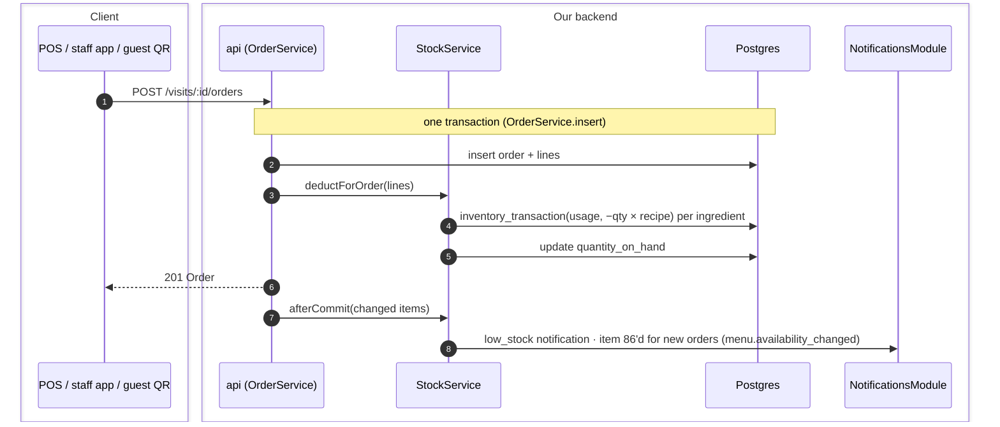

# Stock — design

> Spec-Anchored technical design (`docs/features/stock/design.md`). Shared across all briefs for this feature; each brief updates this file in its own PR.
> **Draft 2026-11-15 (Cowork).** *As-is* and *Decisions* are evidence / approved sources only. Everything under *Contracts*, *Code map* and the schema tables is a **proposal** — each `P#` in *Open questions* needs Field's OK (DR-031 lock: exact columns per feature need Field's OK) before a brief cites it.

| | |
|---|---|
| **Owner** | Field |
| **Status** | As-is mapped · To-be (Draft — proposals) |
| **Requirements** | [requirements.md](requirements.md) · **UI** [ui.md](ui.md) |
| **Changed by** | DR-031 (#1) · CD-16, CD-17 |

## As-is

- Inventory tables exist **only in the schema file**, never migrated: `inventory_item` (`docs/schema.sql:330-344` — name, `category` A/B/C, `unit_type`, `quantity_on_hand NUMERIC(12,3)`, `unit`, `low_stock_threshold`, `cost_per_unit`), `menu_variant_ingredient` (`:346-351` — variant → item, `quantity_used`), `inventory_transaction` (`:353-363` — `tx_type`, `delta_quantity`, `reference_type/id`), `restock_request` (`:365-374`).
- Enums: `inv_category ('A','B','C')` (`docs/schema.sql:26`), `inv_tx_type ('purchase','usage','adjustment','void')` (`:27`) — no `waste`, `count`, `container_open`, `cancel`.
- No migration creates them: `app/backend/src/providers/database/migrations/` ends at `OrderItemAdjustment` (20 migrations, none for inventory). No `inventory` module under `app/backend/src/modules/` (auth, customer, health, iam, menu, notifications, order, payment, reports, venue).
- Order placement is one transaction: `OrderService.insert()` is `@Transactional()` (`app/backend/src/modules/order/application/order.service.ts:49-57`) — lock menu → claim visit → draft → insert. This is where a deduction would join.
- Manual 86 already exists: `SoldOutService.markUnavailable()` (`app/backend/src/modules/order/application/sold-out.service.ts:39`) auto-voids waiting lines and emits `menu.availability_changed` (`:135`) — stock-driven 86 must **not** reuse the auto-void path (R4: never cancels waiting orders).
- `menu_item.item_type` has `'recipe'` (`docs/schema.sql:16, :256`) — CD-16 R3 notes it may be obsolete (any item can have a recipe).
- IAM: seeded permission codes have no inventory permission (`app/backend/src/providers/database/migrations/*-IamCore.ts:57-76`); CD-16 assumes `inventory:manage`.
- Contracts: no stock schema in `app/packages/contracts/src/schemas/`.

## Decisions

| Decision | Why | Instead of | Source |
|---|---|---|---|
| Deduct stock on **order placed**, same DB transaction as the order line | Stock and sales never drift | deduct on served / nightly batch | DR-031 under the hood · notes Topic 1 Q4 |
| Cancelled before made → reversing transaction; void after served → no reversal, a waste record | Matches what physically happened | always reverse | DR-031 · Topic 1 Q4 |
| Stock may go negative (override path) — shown as loss, never blocks | Service never stops on a wrong count | block sale at 0 | DR-031 locks (superseded rule) |
| Stock-driven 86 for **new** orders only; one-tap override, logged | Never cancels sent / waiting orders | auto-void like manual 86 | DR-031 locks · Topic 1 Q3 |
| Auto-86 event + low-stock notification **after commit** | No event for a rolled-back order | emit inside the transaction | DR-031 transaction boundary |
| Cost method = weighted average cost | Simple, standard | FIFO | DR-031 locks · Topic 3 P7 |
| Receiving only through Purchasing | One path for cost | interim form | Topic 1 Q6 |

## Assumed (external / runtime only)

| Assumption | Who verifies | When |
|---|---|---|
| POS tablet can show the 5-s undo Toast for "เปิดของใหม่" without blocking service | executor (run proof on the bar tablet) | loss brief build step N |

## Flow



Transaction boundary: steps 2–5 inside `OrderService.insert()`'s `@Transactional()`; steps 7–8 after commit. Failure: transaction fails → no order, no stock change. Lost auto-86 event → the next order re-checks stock on read.

## Contracts (proposed — P1–P4)

- **P1 schema** (migration with the stock-items brief):
  - `inventory_item` + `container_name`, `container_size NUMERIC(12,3)`, `yield_per_container NUMERIC(12,3)`, `auto_86_enabled BOOLEAN` (default true for unit / container, false for B), `default_supplier_id` (FK, from `purchasing`), `purchase_unit`, `units_per_purchase NUMERIC(12,3)`, `average_cost NUMERIC(12,4)` (replaces `cost_per_unit`), `is_active BOOLEAN`.
  - `inv_tx_type` + `'cancel'`, `'waste'`, `'count'`, `'loss'`; `inventory_transaction` + `reason VARCHAR(50)`, `unit_cost_snapshot NUMERIC(12,4)`.
  - New `container_open (id, inventory_item_id, opened_by, opened_at, sold_since_previous NUMERIC, expected_yield NUMERIC, missing NUMERIC, flagged BOOLEAN, undone_at)`.
  - New `stock_override (id, inventory_item_id, staff_id, created_at, system_qty, claimed_qty NULL, status 'open'|'met'|'unmet', reviewed_by, reviewed_at)`.
  - New `stock_count (id, counted_by, counted_at, confirmed_by)` + `stock_count_line (count_id, inventory_item_id, system_qty, counted_qty)`.
- **P2 endpoints** (`inventory:manage` unless noted):
  - `GET/POST/PATCH /stock/items` · `POST /stock/items/:id/archive`
  - `PUT /menu/variants/:id/recipe` (`menu:write`) — lines `{ inventoryItemId, quantity }`
  - `POST /stock/items/:id/open-container` (`stock:open_container` — staff default) · `POST /stock/container-opens/:id/undo` (5 s)
  - `POST /menu/items/:id/stock-override` (`menu:toggle_availability`) → `{ claimedQty? }`
  - `GET /stock/loss?from&to` · `POST /stock/adjustments` `{ itemId, delta, reason }` · `POST /stock/counts` + `POST /stock/counts/:id/confirm`
  - Errors: `STOCK_ITEM_NAME_TAKEN 409` · `STOCK_ITEM_ARCHIVED 409` · `VALIDATION_ERROR 400` (reason required)
- **P3 events:** `stock.low` (staff room) · reuse `menu.availability_changed` with `reason: 'out_of_stock'` (new `unavailableReason` value in `@bar/contracts`).
- **P4 permissions:** `inventory:manage` (owner / manager) · `stock:open_container` (staff default).

## Code map (proposed)

```text
app/backend/src/modules/inventory/
├── domain/ports/
├── application/
├── infrastructure/http/
└── infrastructure/persistence/
app/packages/contracts/src/schemas/stock.ts
app/frontend/src/app/pos/stock/
```

| File | Owns |
|---|---|
| `modules/inventory/application/stock-item.service.ts` | CRUD, archive, average cost read |
| `modules/inventory/application/stock-deduction.service.ts` | recipe × qty → transactions; called inside `OrderService.insert()` |
| `modules/inventory/application/stock-availability.service.ts` | after-commit low-stock / auto-86 / override |
| `modules/inventory/application/container-open.service.ts` | open, undo, loss math |
| `modules/inventory/application/stock-count.service.ts` | blind count, variance, confirm |
| `modules/inventory/infrastructure/http/*.controller.ts` | stock, recipe, loss, count routes |
| `contracts/src/schemas/stock.ts` | DTOs + `StockLoss`, `ContainerOpen` |
| `app/frontend/src/app/pos/stock/**` | CD-16 / CD-17 screens |

Packages: none.

## Rules

- `OrderModule` calls an exported `StockDeductionService` (port) — never the inventory repositories (module boundary).
- `inventory_transaction` is append-only (same as `audit_log`); corrections are new rows.
- Untracked items (no recipe, category C) never create transactions.

**Invariant enforcement**

| I | Enforced by |
|---|---|
| I-1 | auto-86 sets availability only for new orders; `SoldOutService` auto-void path is not called — test: deduction to 0 leaves waiting tickets intact |
| I-2 | deduction inside `OrderService.insert()` transaction — test: failing deduction rolls back the order |

- DR needed if: flow above changes · contracts above change · new dependency

## Observability

Log `stock.deducted` (orderId, itemIds, deltas), `stock.override` (itemId, staffId, systemQty, claimedQty), `container.open` (itemId, missingPct). No guest data.

## Open questions (proposals to approve)

| # | Proposal | Recommended | Blocks |
|---|---|---|---|
| P1 | Schema additions above (columns, enum values, 3 new tables) | approve as listed; `item_type='recipe'` left as is (no migration of existing rows) | stock-items brief |
| P2 | Endpoints above | approve | stock briefs |
| P3 | `menu.availability_changed` gets `reason: 'out_of_stock'` | approve (one event, no second socket path) | sale-deduction brief |
| P4 | Permissions `inventory:manage`, `stock:open_container` | approve; staff group gets `stock:open_container` | stock-items brief |
| Q1 | CD-16 overview says "deducts on every **sent** order"; DR-031 locks deduction on order **placed** | follow DR-031 (placed); fix the CD-16 wording at the next canvas revision | sale-deduction brief |

## Not applicable

Feature flag · backfill (no stock data yet) · per-env rollout.
