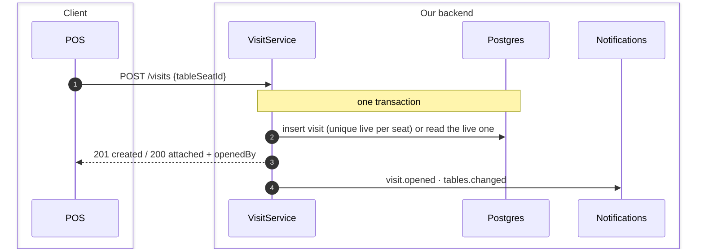

# Tables, seats & visits — design

> Spec-Anchored technical design (`docs/features/tables-visits/design.md`). Shared across all briefs for this feature; each brief updates this file in its own PR.
> **As-built (2026-11-15).** *As-is* = the shipped code with `path:line` evidence (backend paths under `app/backend/src/`). Field confirms it once; the next brief that changes the feature drafts its To-be here.

| | |
|---|---|
| **Owner** | Field |
| **Status** | Built (As-is mapped) |
| **Requirements** | [requirements.md](requirements.md) · **UI** [ui.md](ui.md) |
| **Changed by** | BRIEF-011, BRIEF-029, BRIEF-030, BRIEF-066, BRIEF-069 · DR-011, DR-014 |

## As-is

- `VisitService` (`modules/venue/application/visit.service.ts`): `claimForOrder()` `:61-66`, transactional open / attach `:92`; `TableSeatService`, `TableAdminService` (`table-admin.service.ts`), `table-summary.ts`, QR tokens `qr-token.ts`.
- Tables `table_seat`, `visit` (`docs/schema.sql:54-109`); migrations `VenueTables`, `TableSeatLabelUnique`.
- Web: floor + session panel `app/frontend/src/app/pos/tables/`; table admin `app/frontend/src/app/pos/settings/tables/`.

## Decisions

| Decision | Why | Instead of | Source |
|---|---|---|---|
| Visit ≠ customer; visit on open / first order, customer linked later | Identity is optional | customer first | FRD §3–4 · CLAUDE.md |
| Close always manual | Guests step out | auto-close | DR-014 |
| Counter seats skip READY | Direct hand-over | READY everywhere | DR-011 |

## Assumed (external / runtime only)

None.

## Flow

Transaction boundary: open / attach in one transaction (`visit.service.ts:92`); the unique index resolves races.

## Contracts

Built and published in `docs/api/openapi.json` (generated, checked in CI). Shared shapes in `app/packages/contracts/src/`.

| Route / event | Permission | Where |
|---|---|---|
| POST /visits · GET /visits/:id · POST /visits/:id/close | visits:open / visits:read / visits:close | `venue/infrastructure/http/visits.controller.ts:47, :65, :88` |
| GET /tables | tables:read | `tables.controller.ts:34` |
| GET /tables/manage · POST/PATCH /tables · PUT /tables/order · POST /tables/:id/{deactivate\|activate\|qr/regenerate} | tables:manage | `tables.controller.ts:45-128` |
| POST /tables/:seatId/acknowledge-call | tables:read | `tables.controller.ts:144` |
| WS `visit.opened` · `visit.state_changed` · `tables.changed` · `table.staff_called` · `table.staff_call_cleared` | staff room | `packages/contracts/src/events/visit.ts:6-7`, `table.ts:6-8` |

## Code map

| File | Owns |
|---|---|
| `modules/venue/application/visit.service.ts` | visits |
| `modules/venue/application/table-admin.service.ts` | seat admin |
| `modules/venue/application/qr-token.ts` | QR tokens |
| `app/frontend/src/app/pos/tables/` | floor + session panel |
| `app/frontend/src/app/pos/settings/tables/` | table admin |

Packages: as in the app `package.json` files (no feature-specific additions).

## Rules

- Seat QR tokens are random; regenerate invalidates the old one.

**Invariant enforcement**

| I | Enforced by |
|---|---|
| I-1 | partial unique index `uq_visit_live_per_seat` (`providers/database/migrations/1761187200000-VenueTables.ts:65`) |
| I-2 | `uq_table_seat_label_active` (`1763500000000-TableSeatLabelUnique.ts:16`) |

- DR needed if: flow above changes · contracts above change · new dependency

## Observability

Structured logs per request; no secrets, tokens or guest personal data.

## Not applicable

Feature flag · backfill.
