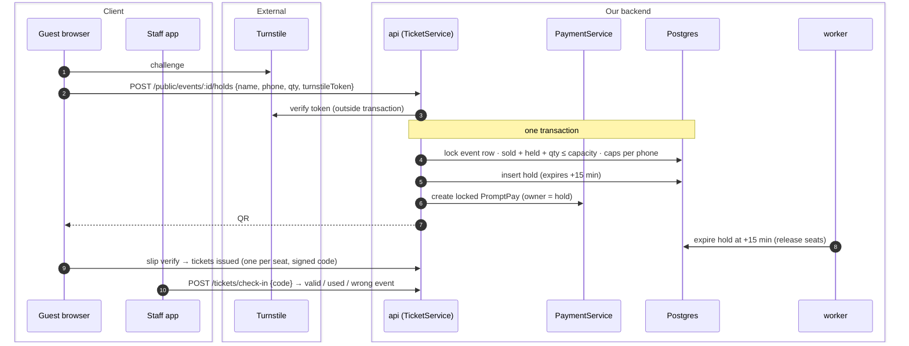

# Ticketing — design

> Spec-Anchored technical design (`docs/features/ticketing/design.md`). Shared across all briefs for this feature; each brief updates this file in its own PR.
> **Draft 2026-11-15 (Cowork).** *As-is* and *Decisions* are evidence / approved sources only. Everything under *Contracts*, *Code map* and the schema tables is a **proposal** — each `P#` in *Open questions* needs Field's OK (DR-031 lock: exact columns per feature need Field's OK) before a brief cites it.

| | |
|---|---|
| **Owner** | Field |
| **Status** | As-is mapped · To-be (Draft — proposals) |
| **Requirements** | [requirements.md](requirements.md) · **UI** not yet — CD in the design plan |
| **Changed by** | DR-031 (#9) |

## As-is

- None — new feature (Should tier). Builds on `events-reservations` (`event.ticket_price`, `capacity` — proposals).
- Payment pieces exist: amount-locked PromptPay QR + 15-min expiry job (`PaymentService.create()` / `expire()`, `payment.service.ts:71, :143`; queue registered at `app/backend/src/modules/payment/payment.module.ts:29`) and slip verify (`:119`) — all tied to a visit.
- Rate limiting exists only for guest actions (`app/backend/src/modules/customer/application/customer-throttle.ts`).
- No Turnstile / bot check anywhere.

## Decisions

| Decision | Why | Instead of | Source |
|---|---|---|---|
| Web-first: name + phone + qty → locked PromptPay → slip verify → e-ticket QR | No app install for guests | app-only | Topic 5 T1 |
| 15-min hold, capacity, one price + optional early-bird, refunds manual | Simple | refunds in system | Topic 5 T1 |
| Five anti-bot layers incl. Turnstile (new dependency → own DR) | Concert tickets attract bots | none | Topic 5 T1a · DR-031 |
| Door scan one use only; fallback search | Copies fail | multi-use | Topic 5 T2 |

## Assumed (external / runtime only)

| Assumption | Who verifies | When |
|---|---|---|
| Cloudflare Turnstile free tier covers the volume; site key works on the public host | Field | Turnstile DR |

## Flow

Transaction boundary: capacity check + hold insert in one transaction with the event row locked; Turnstile and slip API calls stay outside.

## Contracts (proposed — P1–P3)

- **P1 schema:** `ticket_hold (id, event_id, buyer_name, buyer_phone, qty, unit_price, expires_at, status 'held'|'paid'|'expired', payment_id)` · `ticket (id, event_id, hold_id, code_hash UNIQUE, checked_in_at NULL, checked_in_by NULL)`.
- **P2 endpoints:** `POST /public/events/:id/holds` · `GET /public/tickets/:token` (e-ticket page) · `POST /tickets/check-in` (`ticket:check_in` staff) · `GET /tickets/search?q` · `GET /events/:id/tickets/report`. Errors: `SOLD_OUT 409` · `HOLD_LIMIT 429` · `BOT_CHECK_FAILED 403` · `TICKET_USED 409` · `TICKET_WRONG_EVENT 409`.
- **P3 dependency:** Cloudflare Turnstile (server verify via HTTPS, no npm package needed server-side; widget script on the public page) — **own DR before the brief**.

## Code map (proposed)

| File | Owns |
|---|---|
| `modules/events/application/ticket.service.ts` | holds, issue, check-in |
| `modules/events/infrastructure/turnstile/turnstile-verify.service.ts` | vendor adapter |
| `modules/events/infrastructure/queue/hold-expiry.processor.ts` | 15-min release (`worker`) |
| `app/frontend/src/app/(public)/events/[id]/tickets/**` | buy + e-ticket |
| `app/mobile/src/app/tickets/scan.tsx` | door scan (staff app) |

Packages: none on npm (Turnstile = HTTPS call + script tag) — confirm in the DR.

## Rules

- Ticket codes are signed random tokens; only the hash is stored (like `guest_session.token_hash`, `docs/schema.sql:113`).

**Invariant enforcement**

| I | Enforced by |
|---|---|
| I-1 | `UPDATE ticket SET checked_in_at … WHERE checked_in_at IS NULL` returning 0 rows → `TICKET_USED` — e2e: second scan fails |
| I-2 | capacity check under `SELECT … FOR UPDATE` on the event — e2e: parallel holds never exceed capacity |

## Observability

Log `ticket.hold` (eventId, qty), `ticket.check_in` (eventId, result). Buyer phone masked.

## Open questions (proposals to approve)

| # | Proposal | Recommended | Blocks |
|---|---|---|---|
| P1 | Tables above | approve | ticketing brief |
| P2 | Endpoints + `ticket:check_in` | approve | ticketing brief |
| P3 | Turnstile DR (DR-034 number is taken) | raise when ticketing starts | ticketing brief |

## Not applicable

Seat maps · refunds in system.
