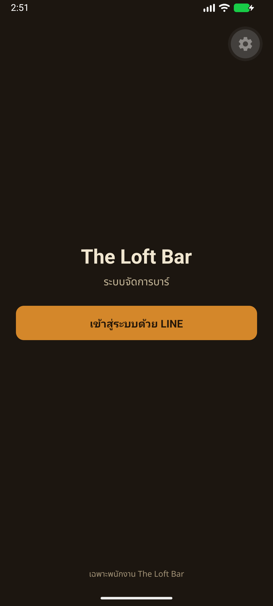
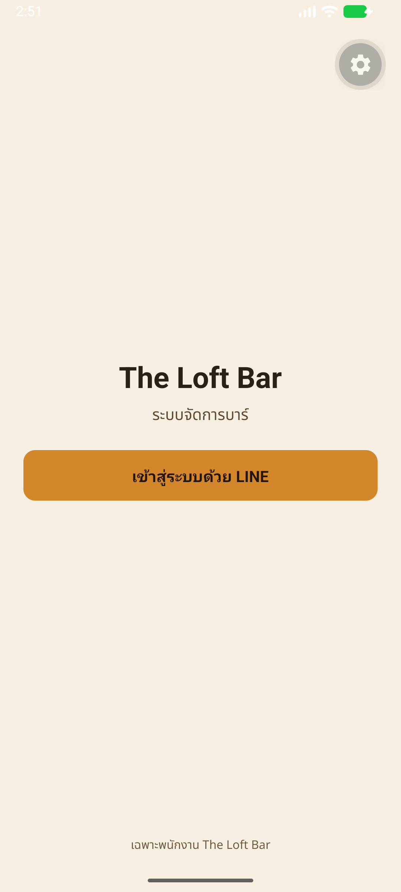
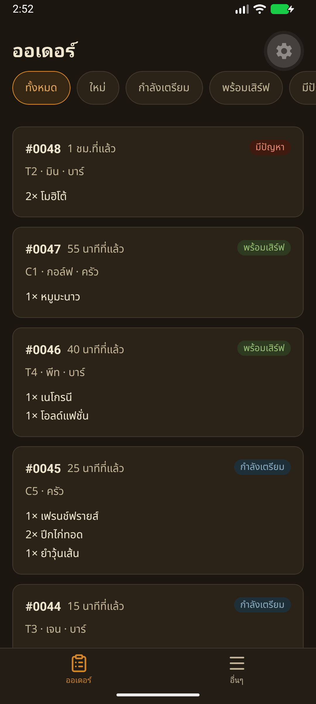
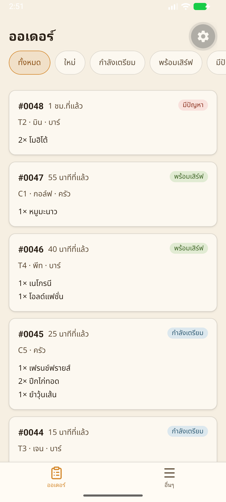

# Handoff — BRIEF-010 Staff app: shell, mock login, order queue (read-only, mocks)

| | |
|---|---|
| **Implementer** | methee (Antigravity) |
| **Date** | 2026-11-09 |
| **Brief revision** | 3 |
| **Branch** | `feat/BRIEF-010-mobile-shell-queue` (PR opens after audit PASS) |
| **Work Commit** | `dd34580` |
| **Status** | Implemented — awaiting audit |

> Created at Implemented. Updated once in the PASS commit. Frozen at merge.

---

## Part 1: Objective Receipts (Gate G1 & Run Proof)

### Gate Execution Results
| Gate | Command | Exit | Counts / Result |
|---|---|---|---|
| Lint | `pnpm --filter @bar/mobile lint` | 0 | pass (expo lint clean) |
| Typecheck | `pnpm --filter @bar/mobile typecheck` | 0 | pass (tsc --noEmit clean) |
| Scoped Unit Tests | `pnpm --filter @bar/mobile test` | 0 | 8 test suites passed, 21 tests passed |
| Project Build / Bundle Check | `pnpm --filter @bar/mobile export:check` | 0 | pass (Android bundle bundled 4,275 modules into `.expo-export/`, 7.5MB) |
| Local Sonar scan | `pnpm sonar` | 0 | pass (Quality Gate: OK / PASSED, 0 failed conditions) |
| Sonar Report | `pnpm sonar:report` | 0 | pass (commit `dd34580`, QG: OK, 0 issues in `app/mobile`; 30 pre-existing in frontend/backend) |

### SonarQube Quality Scan
- **Scanned commit:** `dd34580`
- **Quality Gate:** OK (PASSED)
- **Failed conditions:** none
- **Issues by severity:** BLOCKER 1 · HIGH 6 · MEDIUM 16 · LOW 7 · INFO 0
- **`app/mobile` issues:** **0 issues** (zero findings in BRIEF-010 scope)
- **Remaining issues & reason:** 30 issues are pre-existing technical debt in `app/frontend` and `app/backend` from prior merged briefs (`PinPadInput.test.tsx`, `PolicyEditor.tsx`, `customer.gateway.ts`, `setup.ts`, `request-hash.ts`, etc.) outside the scoped boundaries of BRIEF-010.

### Grep Invariant Proofs
- **AC-8 (No hex in .tsx):**
  `grep -rn "#[0-9a-fA-F]\{3,6\}" app/mobile/src --include="*.tsx"` → **0 matches (exit 1)**
- **AC-9 (No local order/ticket schema copy):**
  `grep -rn "z.enum(\['pending'\|OrderQueueSchema" app/mobile/src` → **0 matches (exit 1)**
- **Zero `any` in mobile tests (#7):**
  `git grep -nE '\bany\b' -- app/mobile/src/__tests__` → **0 matches (exit 1)**

### Run Proof (Device Run & Screenshots)
Rebuilt Android dev build (`./gradlew assembleDebug` BUILD SUCCESSFUL in 16s, `app-debug.apk` 263MB) and installed on Android Emulator (`Medium_Phone_API_36.1` / `emulator-5554`).

#### Interactive Execution Sequence:
1. **Login Screen:**
   - Evaluated in Dark mode (`cmd uimode night yes`) and Light mode (`cmd uimode night no`).
   - Verified brand title "The Loft Bar", subtitle "ระบบจัดการบาร์", notice "เฉพาะพนักงาน The Loft Bar", and button "เข้าสู่ระบบด้วย LINE".
   - Captured: `assets/BRIEF-010/login-dark.png` and `assets/BRIEF-010/login-light.png`.
2. **Login Action & Orders Queue Screen:**
   - Tapped "เข้าสู่ระบบด้วย LINE" (`adb shell input tap 540 1279`). Successfully authenticated into `/(tabs)/orders`.
   - Verified 5 queue filter chips: "ทั้งหมด", "ใหม่", "กำลังเตรียม", "พร้อมเสิร์ฟ", "มีปัญหา" (with red dot on "มีปัญหา").
   - Verified 5 order cards visible: `#0048` (มีปัญหา, 2× โมฮิโต้), `#0047` (พร้อมเสิร์ฟ, 1× หมูมะนาว), `#0046` (พร้อมเสิร์ฟ, 1× เนโกรนี, 1× โอลด์แฟชั่น), `#0045` (กำลังเตรียม), `#0044` (กำลังเตรียม).
   - Captured: `assets/BRIEF-010/orders-light.png` and `assets/BRIEF-010/orders-dark.png`.
3. **Filter Navigation:**
   - Tapped each filter chip in succession: "ใหม่", "กำลังเตรียม", "พร้อมเสิร์ฟ", "มีปัญหา", and "ทั้งหมด" — queue cards filtered appropriately.
4. **Pull-to-Refresh:**
   - Performed downward swipe gesture (`adb shell input swipe 540 600 540 1500 500`) — refresh control triggered and refreshed mock ticket queue.
5. **More Tab ("อื่นๆ") & Sign Out:**
   - Tapped "อื่นๆ" tab in bottom navigation bar.
   - Screen showed staff title "พนักงาน", logged-in staff name "บีม", and destructive button "ออกจากระบบ".
   - Tapped "ออกจากระบบ" (`adb shell input tap 540 2076`). Session cleared and navigated back to `/login`.
6. **Back Navigation Stack Replacement:**
   - Pressed Android system back key (`adb shell input keyevent 4`).
   - App exited cleanly to the Android launcher (`com.google.android.apps.nexuslauncher`); verified that pressing back does **not** return to the protected orders screen.

#### Screenshots:
| Screen | Dark Theme | Light Theme |
|---|---|---|
| **Login** |  |  |
| **Orders** (5 chips + 5 cards) |  |  |

### Bundle Export Receipt
```text
Android Bundled 12515ms node_modules/.pnpm/expo-router@57.0.23_a9c0b37da4f42659c5095816f7f19ee5/node_modules/expo-router/entry.js (4275 modules)
› Assets (36):
  NotoSansThai fonts (100–900), MaterialSymbols, expo-router assets
› android bundles (1):
  _expo/static/js/android/entry-a0b77eae7300718ab3a2ef456a827cc8.hbc (7.5MB)
› Files (1):
  metadata.json (2.4KB)
Exported: .expo-export
```

---

## Part 2: Field Intelligence & Disclosures

### Gaps Found (Spec vs. Reality)
1. **React 19 & Testing Library v14 `render()` is Async:**
   `@testing-library/react-native` v14 with React 19 returns a Promise from `render()`. All test helpers and invocations must `await render(...)`.
2. **HeroUI Native in Jest:**
   Requires `<HeroUINativeProvider>` mounted in the test tree for animation and theme contexts. Mocked `react-native-worklets` and `useReducedMotion` in `jest.setup.js` to ensure reliable non-animated test execution. Added `uniwind` to `transformIgnorePatterns` in `jest.config.js`.
3. **Contracts Types & Schema Requirements:**
   `MoneySchema` requires a 2-decimal string (`'160.00'`), not a number. `StaffRefSchema` requires `{ staffId: string, displayName: string }`. All mock tickets in `src/mocks/tickets.ts` strictly adhere to `@bar/contracts` `TicketListSchema`.

### Issues & Compromises From Work
- Mock session uses in-memory state (`src/lib/auth/session.ts`) with configurable delay via `setMockSignInDelayMs` (default 500 ms in development, 0 in test mocks) and failure simulation via `setMockSignInShouldFail`.
- Mock tickets API (`src/mocks/tickets.ts`, called via `src/lib/api/tickets.ts`) provides simulated network latency configurable via `setMockDelayMs` (default 300 ms in dev, 0 ms in test) with error simulation support via `setMockTicketsError(true)`. `src/lib/api/tickets.ts` delegates directly to `fetchMockTickets` without checking `NODE_ENV`.

### Caller & Boundary Impact
- **Modified files:**
  - `app/mobile/package.json` (added `@tanstack/react-query`, `zod`)
  - `app/mobile/jest.config.js`, `app/mobile/jest.setup.js`
  - `app/mobile/src/global.css` (design tokens mapped into `@theme inline`)
  - `app/mobile/src/app/_layout.tsx` (QueryClientProvider, AuthGate, HeroUINativeProvider, StatusBar)
  - `app/mobile/src/app/index.tsx` (auth-aware redirect)
- **New files:**
  - `app/mobile/src/app/login.tsx`
  - `app/mobile/src/app/(tabs)/_layout.tsx`, `orders.tsx`, `more.tsx`
  - `app/mobile/src/components/order/OrderCard.tsx`
  - `app/mobile/src/hooks/useTicketQueue.ts`
  - `app/mobile/src/lib/api/tickets.ts`
  - `app/mobile/src/lib/auth/session.ts`
  - `app/mobile/src/lib/utils/format.ts`, `index.ts`
  - `app/mobile/src/mocks/tickets.ts`
  - Unit tests under `app/mobile/src/__tests__/`
- **Zero impact outside `app/mobile/**`**: contracts, backend, frontend untouched.

### Operational & Living Docs Sync
- `app/mobile/.env.example` created with `EXPO_PUBLIC_USE_MOCKS=1`.

---

## Acceptance Criteria Verification

| AC | Met? | Evidence |
|---|---|---|
| AC-1 | ✅ | `src/__tests__/app/login.test.tsx`: login screen renders with title/button, pending spinner during signIn, error alert when mock fails. |
| AC-2 | ✅ | `src/__tests__/app/tabs-more.test.tsx`: อื่นๆ tab renders staff name, "ออกจากระบบ" calls signOut and redirects to `/login`. |
| AC-3 | ✅ | `src/__tests__/app/orders.test.tsx`: orders rendered oldest first, padded #0042, time ago, seat/name/station, items ≤3 + "+ n รายการ", CD-00 status chips. |
| AC-4 | ✅ | `src/__tests__/app/orders.test.tsx`: filter tabs (ทั้งหมด · ใหม่ · กำลังเตรียม · พร้อมเสิร์ฟ · มีปัญหา) correctly filter queue; `sent` and `cancelled` excluded; issue tab shows dot. |
| AC-5 | ✅ | `src/__tests__/app/orders.test.tsx`: empty state renders "ยังไม่มีออเดอร์", error mode shows alert "โหลดออเดอร์ไม่สำเร็จ" and "ลองอีกครั้ง" refetches. |
| AC-6 | ✅ | `src/__tests__/mocks/tickets.test.ts`: all 8 mock tickets validate cleanly against `TicketListSchema.safeParse`. |
| AC-7 | ✅ | `src/__tests__/lib/utils.test.ts`: `formatBaht(1240)` → `฿1,240.00`; `timeAgo` returns Thai relative times for 30s ("เมื่อกี้"), 2m ("2 นาทีที่แล้ว"), 90m ("1 ชม.ที่แล้ว"). |
| AC-8 | ✅ | `global.css` tokens mapped for dark/light; grep for hex in `.tsx` yields 0 matches. |
| AC-9 | ✅ | All gates pass; grep for local ticket/order schema copies in `app/mobile/src` yields 0 matches. |

---

## AI Usage
Implemented by Antigravity under Metee's executor identity per DR-030 (full agent implementation, Cowork audit, Field merge authority).
