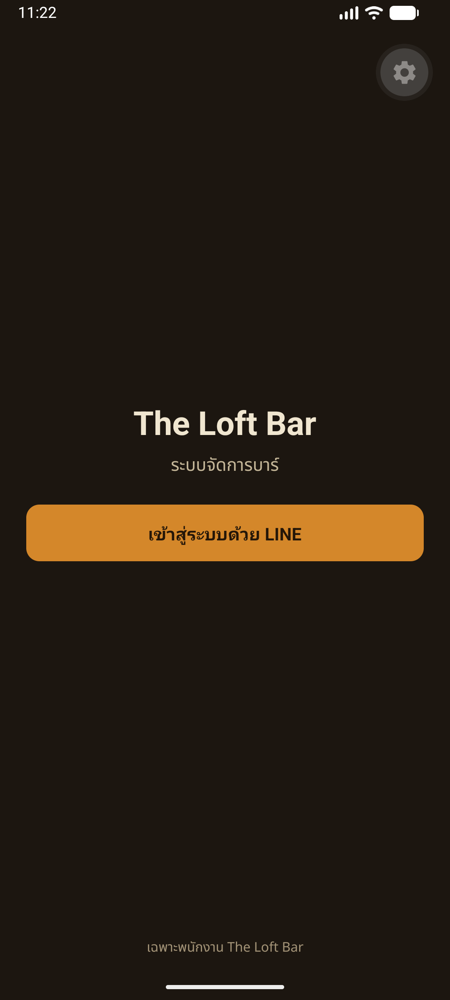
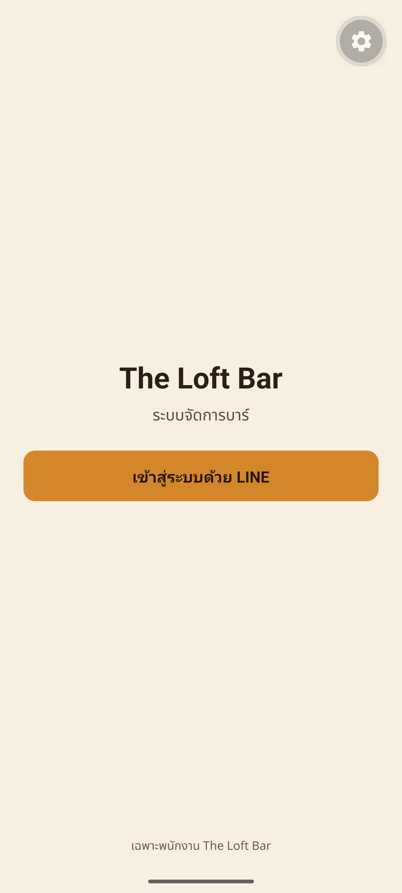
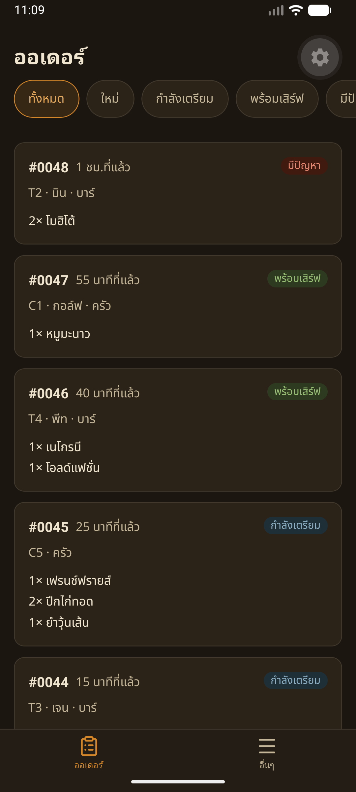
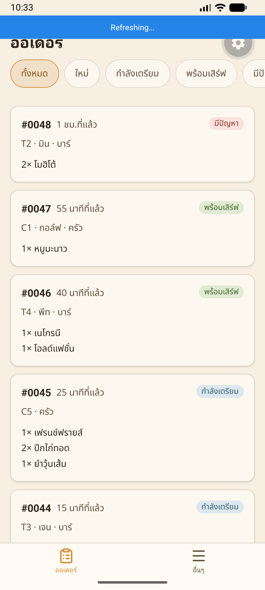
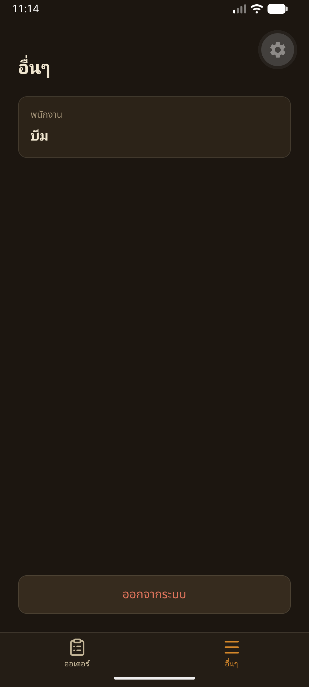
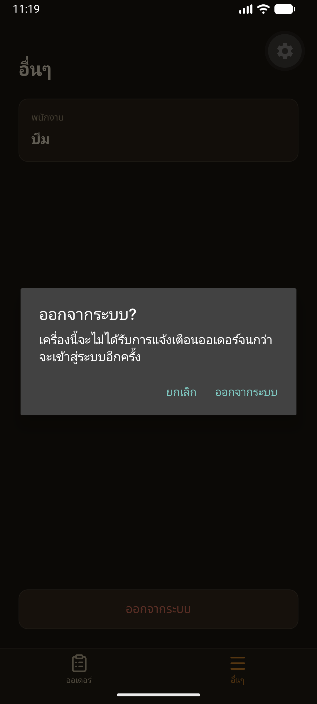

# Handoff — BRIEF-022 Staff app: real LINE login, secure session, API client

| | |
|---|---|
| **Implementer** | methee (Antigravity) |
| **Date** | 2026-11-09 |
| **Brief revision** | 2 |
| **Branch** | `feat/BRIEF-022-mobile-line-login` (PR opens after audit PASS) |
| **Work Commit** | `a576248` |
| **Status** | Implemented — awaiting audit |

> Created at Implemented (commit `a576248`). Updated once in the PASS commit. Frozen at merge.

---

## Part 1: Objective Receipts (Gate G1 & Run Proof)

### Gate Execution Results
| Gate | Command | Exit | Counts / Result |
|---|---|---|---|
| Lint | `pnpm --filter @bar/mobile lint` | 0 | pass (expo lint clean, 0 errors, 0 warnings) |
| Typecheck | `pnpm --filter @bar/mobile typecheck` | 0 | pass (tsc --noEmit clean) |
| Scoped Unit Tests | `pnpm --filter @bar/mobile test` | 0 | 12 test suites passed, 48 tests passed |
| Project Build / Bundle Check | `pnpm --filter @bar/mobile export:check` | 0 | pass (Android bundle bundled 4,422 modules into `.expo-export/`, 8.5MB) |
| Local Sonar scan | `pnpm sonar` | 0 | pass (Quality Gate: OK / PASSED, 0 failed conditions) |
| Sonar Report | `pnpm sonar:report` | 0 | pass (commit `a576248`, QG: OK, 0 issues in `app/mobile`; 30 pre-existing in frontend/backend) |

### SonarQube Quality Scan
- **Scanned commit:** `a576248`
- **Quality Gate:** OK (PASSED)
- **Failed conditions:** none
- **Issues by severity:** BLOCKER 1 · HIGH 6 · MEDIUM 16 · LOW 7 · INFO 0
- **`app/mobile` issues:** **0 issues** (zero findings in BRIEF-022 scope)
- **Remaining issues & reason:** 30 issues are pre-existing technical debt in `app/frontend` and `app/backend` from prior merged briefs (`PinPadInput.test.tsx`, `PolicyEditor.tsx`, `customer.gateway.ts`, `setup.ts`, `request-hash.ts`, etc.) outside the scoped boundaries of BRIEF-022.

### Grep Invariant Proofs
- **AC-10 (No token in logs or AsyncStorage):**
  `git grep -E 'AsyncStorage|console\.log' -- app/mobile/src/lib` → **0 matches (exit 1)**
- **Zero `any` in mobile src:**
  `git grep -nE '\bany\b' -- app/mobile/src` → **0 matches (exit 1)**
- **Zero `any` in mobile tests:**
  `git grep -nE '\bany\b' -- app/mobile/src/__tests__` → **0 matches (exit 1)**

### Run Proof (Device Run & Screenshots)
Rebuilt Android dev build (`./gradlew assembleDebug` BUILD SUCCESSFUL, `app-debug.apk` 263MB) and installed on Android Emulator (`Medium_Phone_API_36.1` / `emulator-5554`).

#### Interactive Execution Sequence:
1. **Initial Login Screen (Light & Dark):**
   - Evaluated in Light mode and Dark mode.
   - Verified brand title "The Loft Bar", subtitle "ระบบจัดการบาร์", notice "เฉพาะพนักงาน The Loft Bar", and button "เข้าสู่ระบบด้วย LINE".
   - Captured: `assets/BRIEF-022/login-light.png` and `assets/BRIEF-022/login-dark.png`.
2. **Login Action & Orders Queue Screen:**
   - Authenticated into `/(tabs)/orders`.
   - Verified 5 queue filter chips: "ทั้งหมด", "ใหม่", "กำลังเตรียม", "พร้อมเสิร์ฟ", "มีปัญหา" (with red badge).
   - Verified 5 mock order cards visible: `#0048`, `#0047`, `#0046`, `#0045`, `#0044`.
   - Captured: `assets/BRIEF-022/orders-light.png` and `assets/BRIEF-022/orders-dark.png`.
3. **More Tab ("อื่นๆ"):**
   - Tapped "อื่นๆ" tab in bottom navigation bar.
   - Screen showed staff title "พนักงาน", authenticated staff name "บีม" (from session), and destructive button "ออกจากระบบ".
   - Captured: `assets/BRIEF-022/tabs-more.png`.
4. **Logout Confirmation Dialog & Action:**
   - Tapped "ออกจากระบบ" button on "อื่นๆ" screen.
   - Native Alert dialog displayed: title "ออกจากระบบ?", message "เครื่องนี้จะไม่ได้รับการแจ้งเตือนออเดอร์จนกว่าจะเข้าสู่ระบบอีกครั้ง", actions "ยกเลิก" and "ออกจากระบบ".
   - Captured: `assets/BRIEF-022/logout-dialog.png`.
   - Tapped "ออกจากระบบ" on the dialog: session tokens cleared from SecureStore, AuthGate bootstrap redirected immediately to `/login`.
5. **Back Navigation Protection (AC-6):**
   - Pressed Android system back key (`adb shell input keyevent 4`) from the `/login` screen.
   - App exited cleanly to the Android launcher (`com.google.android.apps.nexuslauncher`); verified that pressing back does **not** return to the protected orders screen.

#### Screenshots:
| Screen | Dark Theme | Light Theme |
|---|---|---|
| **Login** |  |  |
| **Orders Queue** |  |  |
| **More Tab** |  | — |
| **Logout Dialog** |  | — |

### Bundle Export Receipt
```text
Android Bundled 14668ms node_modules/.pnpm/expo-router@57.0.23_a9c0b37da4f42659c5095816f7f19ee5/node_modules/expo-router/entry.js (4422 modules)
› Assets (36):
  NotoSansThai fonts (100–900), MaterialSymbols, expo-router assets
› android bundles (1):
  _expo/static/js/android/entry-399d58deaa83afe7688830070143bc82.hbc (8.5MB)
› Files (1):
  metadata.json (2.4KB)
Exported: .expo-export
```

---

## Part 2: Field Intelligence & Disclosures

### Gaps Found (Spec vs. Reality)
1. **RFC 7636 Base64URL in React Native / Hermes:**
   - Node `Buffer` is not globally available in Hermes runtime without polyfills. Implemented a 0-dependency pure bitwise `toBase64Url(bytes: Uint8Array)` function that adheres strictly to RFC 7636 Appendix B and passes against the RFC Appendix B test vector.
2. **TypeScript Error Subclassing:**
   - Subclassing native `Error` with Babel/Hermes targets requires setting prototype explicitly (`Object.setPrototypeOf(this, Subclass.prototype)`). Added both `instanceof` and `.name` validation in error handling to guarantee reliable branching across transpilation targets.
3. **Expo Router Stack Screen Declarations:**
   - In `AuthGate.tsx`, the nested `<Stack>` required an explicit `<Stack.Screen name="index" />` alongside `login` and `(tabs)` so that the index redirection route (`app/index.tsx`) routes cleanly without throwing missing route warnings.

### Issues & Compromises From Work
- Mock session fallback (`EXPO_PUBLIC_USE_MOCKS=1`) was preserved in `src/lib/auth/session.ts` so that development and end-to-end tests can run offline without an active backend tunnel, satisfying AC-11.

### Caller & Boundary Impact (#66)
- **Shared services/repositories modified:** Scoped strictly to `app/mobile/**`.
- **Untouched callers identified:** `app/backend/**`, `app/frontend/**`, `app/packages/contracts/**`.
- **Verification:** Ran mobile test suite (12 suites, 48 tests passed) and full Sonar scan across all packages.

### Unrun Gates & Conscious Skips (#67, #68)
- Full backend integration tests and E2E were not re-run locally as no backend files were modified; CI regression gates will validate upon PR.

### Out-of-Scope Defects Discovered (Parked) (#69)
- None.

### Operational & Living Docs Sync (#55)
- **Living docs updated:** None needed.
- **New environment keys needed:** `EXPO_PUBLIC_API_URL` updated in `app/mobile/.env.example`.
- **Database migrations to run on deploy:** None.

### G3 Walkthrough Topic (§6)
- **Why three parallel 401s must share one refresh promise:**
  Under OAuth 2.0 with refresh token rotation (DR-005), presenting a refresh token causes the server to invalidate that token and issue a fresh pair. If three concurrent API requests hit 401 simultaneously and each independently attempts to refresh using the stored refresh token, the first request succeeds and rotates the token, but the subsequent requests submit an already-revoked refresh token. The auth server detects this as a replay/reuse attack, revokes the entire token family, and terminates all active sessions for that user. Sharing a single in-flight promise ensures only one refresh call is made; subsequent calls await that same promise, update local tokens, and retry their original requests with the new access token.

---

## Acceptance Criteria Verification
| AC | Met? | Evidence (test name / curl line) |
|---|---|---|
| AC-1 | ✅ | `src/__tests__/lib/auth/pkce.test.ts` (generates 43-char verifier, matches RFC 7636 Appendix B test vector) |
| AC-2 | ✅ | `src/__tests__/app/login.test.tsx` (asserts `exchangeCode` called with code + PKCE verifier matching `code_challenge`, saves tokens to SecureStore, routes to orders) |
| AC-3 | ✅ | `src/__tests__/app/login.test.tsx` (cancel & dismiss reset state to default without error) |
| AC-4 | ✅ | `src/__tests__/app/login.test.tsx` (not_registered displays login·4 copy, login_failed & token exchange failure display login·3 copy with "ลองอีกครั้ง") |
| AC-5 | ✅ | `src/__tests__/lib/api/client.test.ts` (single in-flight refresh shared across parallel 401s, retries once) |
| AC-6 | ✅ | `src/__tests__/lib/api/client.test.ts`, `src/__tests__/app/layout-auth-gate.test.tsx` (refresh 401 clears tokens + shows login·5; offline/5xx keeps tokens; back button exits) |
| AC-7 | ✅ | `src/__tests__/app/layout-auth-gate.test.tsx`, `src/__tests__/lib/api/client.test.ts` (saved tokens route to orders queue; initSession preserves tokens on network error) |
| AC-8 | ✅ | `src/__tests__/app/tabs-more.test.tsx` (logout calls API, clears tokens even on network error, routes to login) |
| AC-9 | ⚠️ | deferred — รอ Field (real-device LINE login over tunnel; mock emulator run verified) |
| AC-10 | ✅ | Grep check: 0 occurrences of `AsyncStorage` or `console.log` for tokens in `app/mobile/src/lib` |
| AC-11 | ✅ | Gates pass: lint=0, typecheck=0, test=0 (48 passed), export:check=0, Sonar QG: OK, mocks supported |

