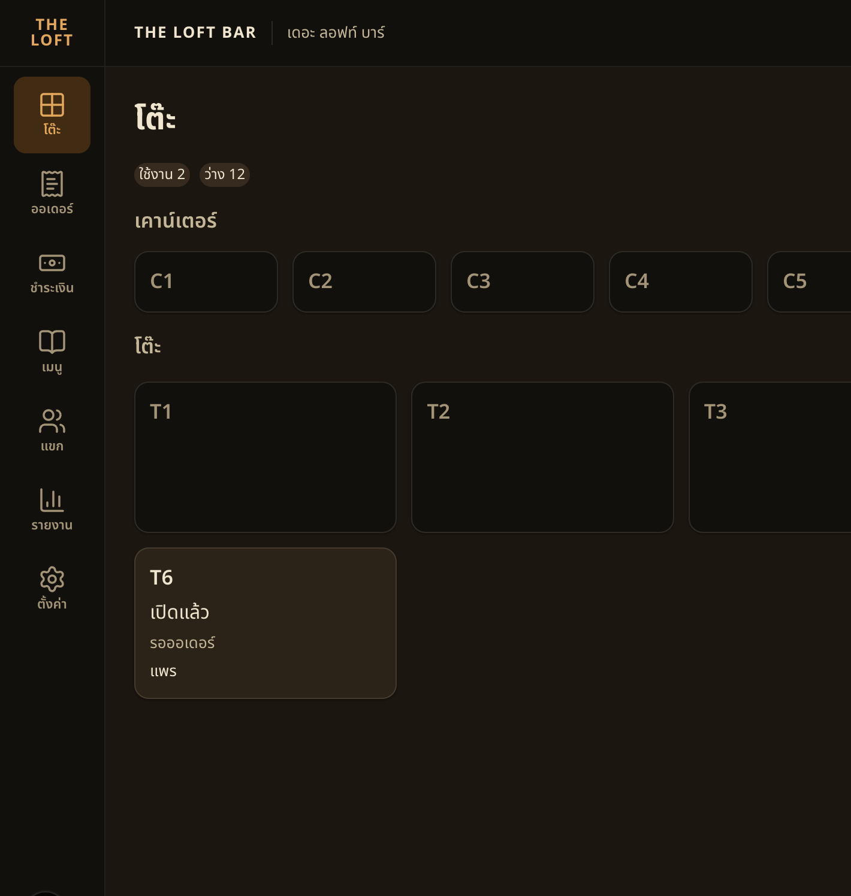

# Handoff — BRIEF-029 Web POS: table grid, open table, live updates

| | |
|---|---|
| **Implementer** | kj |
| **Date** | 2026-10-21 |
| **Brief revision** | 1 |
| **Branch** | `feat/BRIEF-029-pos-floor-open-table` (PR opens after audit PASS) |
| **Commit** | `0174ffef37767b461801b3ec2776fef20ab7e5db` |
| **Status** | Implemented — awaiting audit |

> Gate evidence below was run on the work tree that became `0174ffe`, before this docs commit. Node v24.14.0, pnpm 10.0.0.

## Summary
`/pos/tables` is the POS home. The cashier sees every seat (free / open / active / paying), opens a free seat in two taps, and is asked before joining a visit someone else already opened. The staff socket refetches the grid on visit, order, and payment events.

## Acceptance Criteria
| AC | Result | Test |
|---|---|---|
| AC-1 | ✅ | `TableGrid.test.tsx` — "shows the four card states in sort order with summary counts" |
| AC-2 | ✅ | `TableGrid.test.tsx` — "opening T6 sends one request, toasts, and turns the card open" · `e2e/tables.spec.ts` — "opens a free table for a guest" |
| AC-3 | ✅ | `TableGrid.test.tsx` — "an attached QR open asks and choosing another seat sends no second request" · "joining the existing visit sets the visit param" · `e2e/tables.spec.ts` — "asks before joining a table a guest already opened" |
| AC-4 | ✅ | `TableGrid.test.tsx` — "the seat list offers only free seats" · "no free seat disables open and the select says so" · "a failed open keeps the guest name" |
| AC-5 | ✅ | `useSocketEvent.test.ts` — "live events refetch the grid once" (`visit.opened`, `visit.state_changed`, `order.created`, `payment.status_changed`) · run proof second tab |
| AC-6 | ✅ | `useSocketEvent.test.ts` — "a socket that stays down shows the banner, then one refetch on reconnect" · "an auth error refreshes once and reconnects" |
| AC-7 | ✅ | `TableGrid.test.tsx` — "loading, empty, and error states" · "an empty floor has no settings button" · "tapping an occupied card selects it and a free card opens the form" · "a selected visit gets the ring" · `SessionGate.test.tsx` — "a non-auth failure offers a retry" |
| AC-8 | ✅ | Gate table and run proof below |

## Gate Evidence (G1)
Run on the work tree that became `0174ffe`. Node v24.14.0.

| Command | Exit | Result |
|---|---|---|
| `pnpm --filter @bar/frontend lint` | 0 | pass |
| `pnpm --filter @bar/frontend typecheck` | 0 | pass |
| `pnpm --filter @bar/frontend test` | 0 | 47 passed · 0 failed |
| `pnpm --filter @bar/frontend test:e2e` | 0 | 6 passed · 0 failed |
| `pnpm --filter @bar/frontend build` | 0 | pass (`/`, `/pos/tables`, `/pos/menu`) |
| run proof | 0 | Same work tree. Postgres + Redis already up. `migration:run` exit 0, no migrations pending. Backend `start:dev`. `curl localhost:3001/api/health` → **200** `data.status=ok`, `db=up`. Frontend `next dev` on **3000**, `NEXT_PUBLIC_API_MOCKING` unset, `NEXT_PUBLIC_API_URL=http://localhost:3001/api`. |

UI exercised on that pair, signed in as **Field**: `/pos/tables` showed 14 free seats (ใช้งาน 0 · ว่าง 14). Opening T6 with guest **แพร** turned that card to เปิดแล้ว / รอออเดอร์ / แพร (ใช้งาน 1). A second tab opened T5 with guest **ต้น**. The first tab, still on `/pos/tables` and not reloaded, showed T5 as เปิดแล้ว / รอออเดอร์ / ต้น and ใช้งาน 2 · ว่าง 12.

Those two visits are still open in the local database. Close is BRIEF-030.

The first `migration:run` failed because `@bar/contracts` `dist` was stale against this branch. `pnpm --filter @bar/contracts build` (gitignored output) then `migration:run` succeeded. That first `nest build` deleted `dist/main.js` and the already-running API process exited. It was started again with `start:dev`. An existing `next dev` on port 3000 was stopped so Playwright could boot (Next 16 allows one dev server per directory) and started again for this proof.

## Sonar (local scan)
- Not run. Optional on Field's brief.

## Decisions Raised
- none

## Deviations from Brief
- None. `socket.io-client@^4.8.4` is the pre-decided package; the lockfile resolved `4.8.4`.
- AC-2–AC-4 tests live in `TableGrid.test.tsx`. The modal is opened from the grid, so the request and the card update are one render.
- Extra files past the brief's list, to stay inside the component line limit: `OpenTableForm`, `SeatSelect`, `FloorSummary`, `SeatSection`, `TableGridSkeleton`, `table-time.ts`.
- Work commit is 1,315 insertions and 34 deletions (lockfile included) versus the ~500–600 estimate. No split: the grid, the open flow, and the socket are one outcome.

## Known Gaps / Follow-ups
- `NEXT_PUBLIC_API_MOCKING` is not in `app/frontend/.env.local`. Mocking turns on only when that value is exactly `enabled`, so this run stayed on the real API.
- Draft briefs 030–033 are untracked in the checkout and were not committed.

## AI Usage
**High** — Cursor wrote the grid, the open-table flow, the staff socket, and the tests.

## Review Routing
- Assigned auditor: Cowork
- Next command: `audit BRIEF-029`
- Work SHA: `0174ffef37767b461801b3ec2776fef20ab7e5db` · `POST /visits` body is `{ tableSeatId, guestLabel, via: 'pos' }` validated by `OpenVisitResponseSchema`. Guest over 100 characters uses the contracts message. Socket URL is the API origin + `/staff`, `withCredentials: true`. No contracts or schema change.

## Notes for Reviewer
- `Modal.Root` is a dialog trigger in HeroUI v3, so the open and ask dialogs use `Modal.Backdrop isOpen`. The dialog name comes from `Modal.Heading`.
- `Toast.Provider` is a sibling of the app inside `QueryClientProvider`. Its children are the toast renderer.
- Attach (`200`) does not send a second `POST`. "เลือกโต๊ะอื่น" clears the seat. "เข้าโต๊ะเดิม" sets `?visit=`.
- A failed refetch keeps the last grid. The disconnect banner starts after 3s down and hides on reconnect with one invalidate. The first successful connect does not refetch.
- Auth `connect_error` whose message is exactly `unauthorized` calls `apiPost("/auth/refresh")` once, then `socket.connect()`. The flag resets only after a successful connect.
