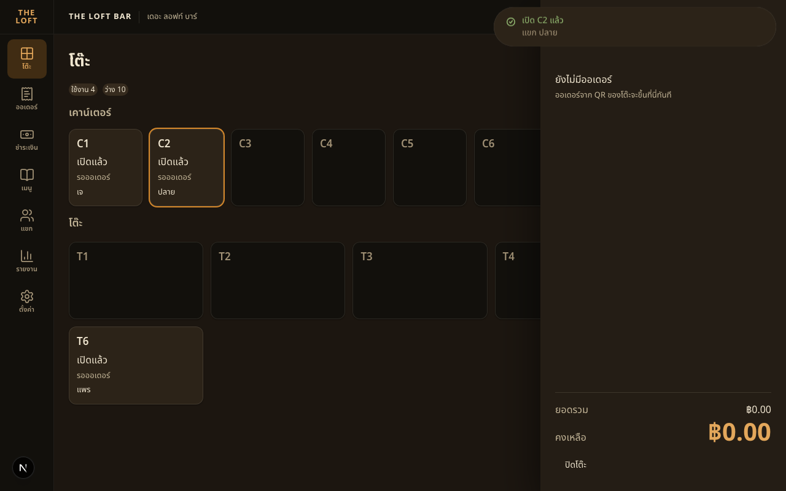
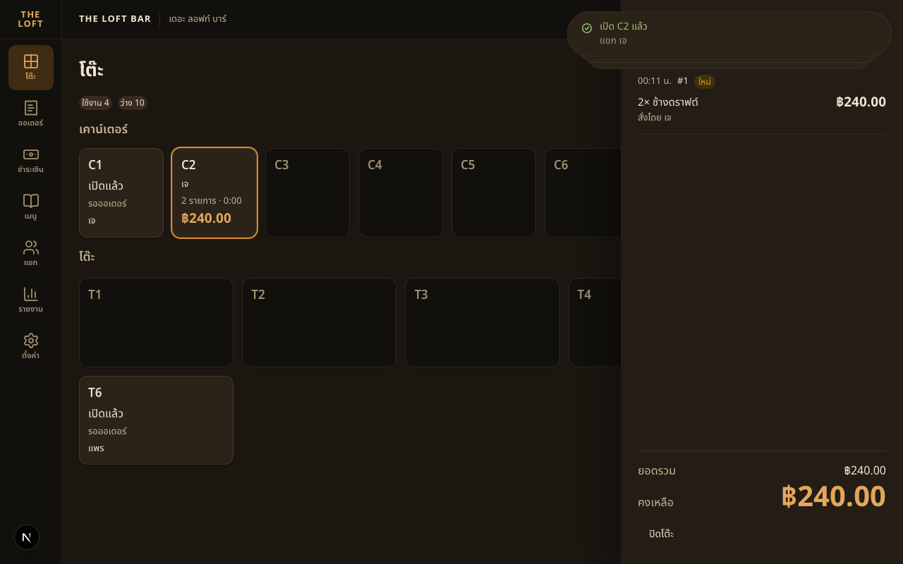

# Handoff — BRIEF-030 Web POS: session panel + close table

| | |
|---|---|
| **Implementer** | kj |
| **Date** | 2026-10-22 |
| **Brief revision** | 1 |
| **Branch** | `feat/BRIEF-030-pos-session-panel-close` (PR opens after this PASS commit) |
| **Commit** | `11569c23bad8393fa9e01fc76859e6cf1a0425cb` |
| **Status** | Implemented — awaiting audit |

> Gate evidence below was run on the work tree that became `11569c2`, before this docs commit. Node v24.14.0, pnpm 10.0.0.

## Summary
An occupied card opens a right-side panel over the floor. The cashier sees that table's orders, newest first, and the server bill. ปิดโต๊ะ is available only when nothing is owed and no payment is in flight.

## Acceptance Criteria
| AC | Result | Test |
|---|---|---|
| AC-1 | ✅ | `SessionDrawer.test.tsx` — "shows two order groups newest first with lines and the server bill" |
| AC-2 | ✅ | `SessionDrawer.test.tsx` — "splits one order into bar and kitchen groups when the kitchen screen is on" |
| AC-3 | ✅ | `SessionDrawer.test.tsx` — "strikes a cancelled line and marks a fully cancelled ticket" |
| AC-4 | ✅ | `CloseConfirmModal.test.tsx` — "close sends one request when nothing is owed" · "an outstanding balance sends no close request" · `e2e/tables.spec.ts` — "closes an empty table from the drawer" |
| AC-5 | ✅ | `SessionDrawer.test.tsx` — "a locked bill blocks close" · `CloseConfirmModal.test.tsx` — "a payment in flight closes the confirm and blocks the drawer" · "a visit closed on another screen closes this drawer" |
| AC-6 | ✅ | `SessionDrawer.test.tsx` — "refetches this visit when an order is created and ignores another visit" · "a visit closed elsewhere closes the drawer" |
| AC-7 | ✅ | `SessionDrawer.test.tsx` — "loading, error with retry, a missing visit, and escape" · "a missing visit toasts and clears the selection" |
| AC-8 | ✅ | Gate table and run proof below |

## Gate Evidence (G1)
Run on the work tree that became `11569c2`. Node v24.14.0.

| Command | Exit | Result |
|---|---|---|
| `pnpm --filter @bar/frontend lint` | 0 | pass |
| `pnpm --filter @bar/frontend typecheck` | 0 | pass |
| `pnpm --filter @bar/frontend test` | 0 | 60 passed · 0 failed |
| `pnpm --filter @bar/frontend test:e2e` | 0 | 7 passed · 0 failed |
| `pnpm --filter @bar/frontend build` | 0 | pass (`/`, `/login`, `/pos/menu`, `/pos/tables`, `/staff`) |
| run proof | 0 | Same work tree. Postgres + Redis already up. `migration:run` exit 0, no migrations pending. Backend `start:dev` started fresh. `curl localhost:3001/api/health` → **200** `data.status=ok`, `db=up`. Frontend `next dev` on **3000**. `NEXT_PUBLIC_API_MOCKING` unset. |

UI exercised on that pair, signed in as **Field**. A free seat **C2** was opened for guest **ปลาย**. Tapping the card opened the panel: “ยังไม่มีออเดอร์”, ฿0.00, ปิดโต๊ะ enabled, and the floor stayed visible. Confirming ปิดโต๊ะ toasted “ปิดโต๊ะ C2 แล้ว”, closed the panel, and the card was free again.

C2 was opened again for guest **เจ**. `POST /visits/:id/orders` placed 2× ช้างดราฟต์ (201). The panel, without a reload, showed one group `00:11 น.` · `#1` · ใหม่, the line “2× ช้างดราฟต์” / “สั่งโดย เจ” / ฿240.00, and the footer ยอดรวม ฿240.00 · คงเหลือ ฿240.00. The card showed 2 รายการ · ฿240.00.

Left open in the local database: **C1** (เจ, no order — a retry opened it before the click landed), **C2** (เจ, the ช้างดราฟต์ order), plus **T5** (ต้น) and **T6** (แพร) from the BRIEF-029 proof.

An existing `next dev` on port 3000 was stopped so Playwright could boot (Next 16 allows one dev server per directory). The API watch that was already on 3001 was stopped and started again for this proof. The dev server on 3000 was stopped again after the screenshots so the e2e gate could boot.

## Sonar (local scan)
- Not run. Optional on Field's brief.

## Decisions Raised
- none

## Deviations from Brief
- The panel is a non-modal `<aside role="dialog">` (`w-100`, 400px). HeroUI Drawer is a modal and would block taps on the floor, so another occupied card could not change `?visit=`.
- A line shows `({variantName})` only when that item name has more than one variant name in the group. A lone “ปกติ” line omits the variant.
- Extra files past the brief's list, to stay inside the component line limit: `SessionHeader`, `SessionBody`, `DrawerStatus`, `useSession.ts`, `session-groups.ts`, `session.fixture.ts` (tests). `CloseConfirmModal` keeps a private `Row` in the same file.
- The empty state includes the CD-02 helper “ออเดอร์จาก QR ของโต๊ะจะขึ้นที่นี่ทันที”.
- The footer hides ชำระแล้ว when the server paid amount is 0. The confirm dialog always shows ยอดรวม, ชำระแล้ว, and คงเหลือ.
- Work commit is 1,234 insertions and 1 deletion versus the ~400–500 estimate. No split: the panel, the bill, and close are one outcome.

## Known Gaps / Follow-ups
- `NEXT_PUBLIC_API_MOCKING` is not in `app/frontend/.env.local`. Mocking turns on only when that value is exactly `enabled`, so this run stayed on the real API.
- Draft briefs 031–033 are untracked in the checkout and were not committed.

## AI Usage
**High** — Cursor wrote the drawer, the close flow, and the tests.

## Review Routing
- Assigned auditor: Cowork
- Next: `audit BRIEF-030`
- Work SHA: `11569c23bad8393fa9e01fc76859e6cf1a0425cb`

## Notes for Reviewer
- Money is shown with `formatTHB()` from the server strings. The client does not add a total.
- `bill.locked` disables ปิดโต๊ะ and shows the paying alert. `409 PAYMENT_IN_FLIGHT` closes the confirm and shows that same alert. `409 INVALID_STATE_TRANSITION` toasts “โต๊ะนี้ถูกปิดไปแล้ว” and closes the panel.
- A close this client started does not also toast the remote-close message. A `visit.state_changed` to `closed` from elsewhere does.
- Escape closes the panel. While the confirm dialog is open, that listener is off so the modal consumes Escape.
- `GET /visits/:id` 404 toasts “ไม่พบโต๊ะนี้” and clears `?visit=`.
- Kitchen off: one group per order, chip from the first ticket, no station label. Kitchen on: one group per ticket, labelled บาร์ / ครัว.
