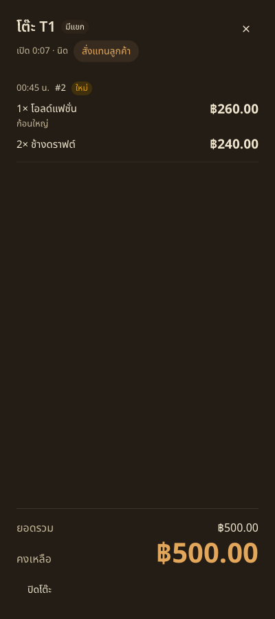
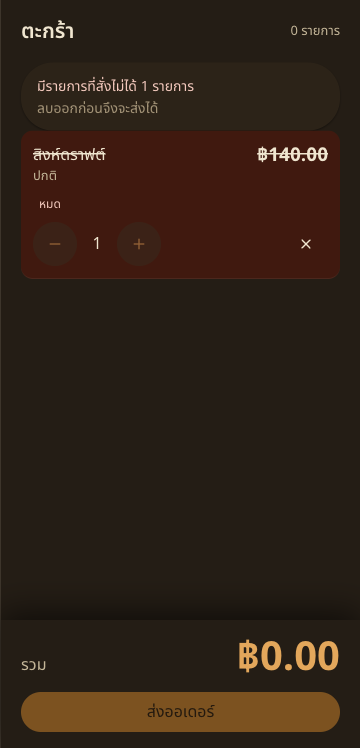
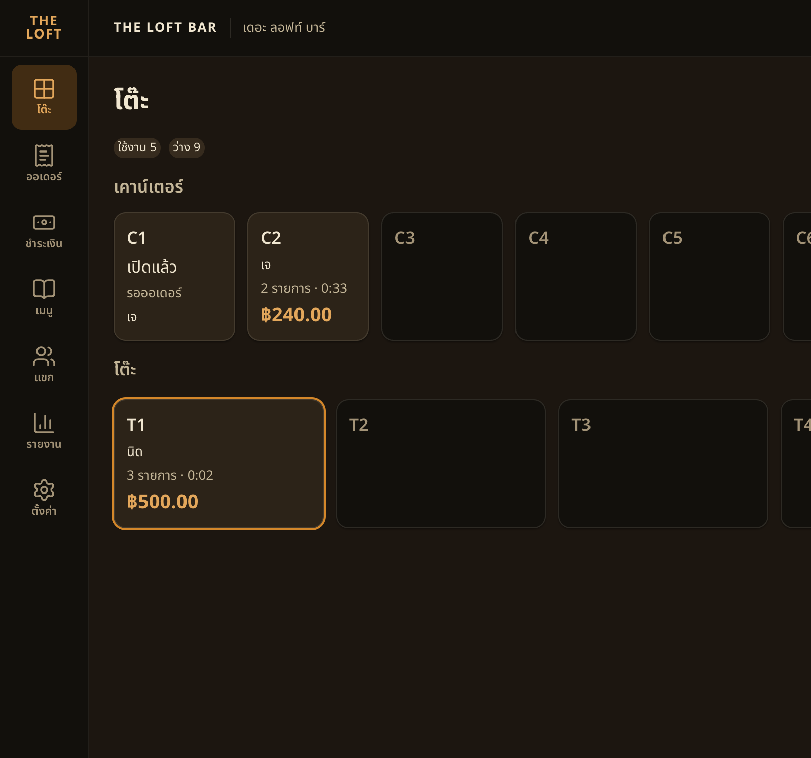

# Handoff — BRIEF-031 Web POS: order entry

| | |
|---|---|
| **Implementer** | kj |
| **Date** | 2026-10-22 |
| **Brief revision** | 1 |
| **Branch** | `feat/BRIEF-031-pos-order-entry` (PR opens after audit PASS) |
| **Commit** | `bd3778fe821d5309843491b1be809013ae027606` |
| **Status** | Implemented — audit not started |

> Gate evidence below was run on the work tree that became `bd3778f`, before this docs commit. Node v24.14.0, pnpm 10.0.0.

## Summary
The cashier opens a table and orders from menu tiles. A one-variant item with no required group adds straight into the cart; anything else opens the item sheet. One send posts the cart once, with one `Idempotency-Key`. A sold-out or out-of-window line is flagged and kept until the cashier removes it.

## Acceptance Criteria
| AC | Result | Test |
|---|---|---|
| AC-1 | ✅ | `useCart.test.ts` — "two quick adds merge, and undo removes only the last one" · `ItemSheet.test.tsx` — "keeps add disabled until a required group is met and stops at maxSelect" · `CartPanel.test.tsx` — "quick add merges a line and undo removes the last tap" |
| AC-2 | ✅ | `MenuPanel.test.tsx` — "a sold-out tile is inert and a promo shows its next window" |
| AC-3 | ✅ | `CartPanel.test.tsx` — "retries a failed send with the same idempotency key and then returns to the table" · `e2e/order-entry.spec.ts` — "sends one order and returns to the drawer" |
| AC-4 | ✅ | `CartPanel.test.tsx` — "a 409 flags only the returned lines and blocks send until they are removed" · `e2e/order-entry.spec.ts` — "a stale send flags the unavailable lines" |
| AC-5 | ✅ | `CartPanel.test.tsx` — "a closed visit locks the cart and back discards it" |
| AC-6 | ✅ | `CartPanel.test.tsx` — "back with items asks before discarding the cart" |
| AC-7 | ✅ | `useCart.test.ts` — "a preview of 3 × ฿33.33 is ฿99.99 and drops flagged lines" · `money.test.ts` |
| AC-8 | ✅ | `MenuPanel.test.tsx` — "shows a loading menu" · "error retry and the disconnected alert" · "hides charge items and shows the search miss" |
| AC-9 | ✅ | Gate table and run proof below |

## Gate Evidence (G1)
Run on the work tree that became `bd3778f`. Node v24.14.0.

| Command | Exit | Result |
|---|---|---|
| `pnpm --filter @bar/frontend lint` | 0 | pass |
| `pnpm --filter @bar/frontend typecheck` | 0 | pass |
| `pnpm --filter @bar/frontend test` | 0 | 76 passed · 0 failed |
| `pnpm --filter @bar/frontend test:e2e` | 0 | 9 passed · 0 failed |
| `pnpm --filter @bar/frontend build` | 0 | pass, including `ƒ /pos/tables/[visitId]/order` |
| run proof | 0 | Same work tree. Postgres + Redis already up. `migration:run` exit 0, no migrations pending. Backend `start:dev` started fresh. `curl localhost:3001/api/health` → **200** `data.status=ok`, `db=up`. Frontend `next dev` on **3000**. `NEXT_PUBLIC_API_MOCKING` unset. |

UI exercised on that pair, signed in as **Field**. T1 was opened for guest **นิด**. สั่งแทนลูกค้า opened the menu. Quick-add ช้างดราฟต์ ×2 merged to one line (฿240.00). โอลด์แฟชั่น opened the sheet; เพิ่มลงตะกร้า stayed disabled until น้ำแข็ง was ก้อนใหญ่, then the line was ปกติ · ก้อนใหญ่ at ฿260.00. Preview รวม ฿500.00. ส่งออเดอร์ sent one `POST /visits/:id/orders` with one UUID `Idempotency-Key` and two lines (qty 2 with no modifiers, qty 1 with one modifier). The screen returned to the drawer: group `00:45 น.` · `#2` · ใหม่, 1× โอลด์แฟชั่น ก้อนใหญ่ ฿260.00, 2× ช้างดราฟต์ ฿240.00, ยอดรวม ฿500.00, คงเหลือ ฿500.00. The card showed 3 รายการ · ฿500.00.

A second cart added สิงห์ดราฟต์ while the tile still showed ฿140.00. `menu_item.is_available` was set false in the database, without the sold-out endpoint, so the open tab did not get `menu.availability_changed`. Send returned 409. The line moved to the top, badge หมด, struck, excluded from the preview (รวม ฿0.00, 0 รายการ), alert “มีรายการที่สั่งไม่ได้ 1 รายการ / ลบออกก่อนจึงจะส่งได้”, and ส่งออเดอร์ stayed disabled. สิงห์ดราฟต์ was set available again after the screenshot.

Left open in the local database: **T1** (นิด, the ฿500.00 order), plus **C1** (เจ), **C2** (เจ, 2× ช้างดราฟต์), **T5** (ต้น) and **T6** (แพร) from earlier proofs.

The API watch that was already on 3001 was stopped and started again for this proof. It is still running. The dev server on 3000 was stopped after the screenshots so the e2e gate could boot.

## Sonar (local scan)
- Not run. Optional on Field's brief.

## Decisions Raised
- none

## Deviations from Brief
- Extra files past the brief's list, to stay inside the component line limit: `MenuResults`, `MenuTile`, `OrderHeader`, `QtyStepper`, `ModifierGroup`, `NameChips`, `catalog.ts`, `item-draft.ts`, `useOrderMenu.ts`, `useMenuSync.ts`, `usePlaceOrder.ts`. `OrderScreen`'s returned JSX is 43 lines, three past the 40-line limit, because the menu and cart prop lists sit in that return.
- `useDisconnected` is now exported from `useSocketEvent.ts` so the order screen can show the CD-04 disconnected alert.
- Menu "from" price and the session bill compare money with `lib/utils/money.ts` (integer satang). This is the BRIEF-028 S4 follow-up the brief's Q1 already decided.
- Drawer entry is สั่งแทนลูกค้า: primary lg in the empty state, secondary sm in the meta row once the table has orders.
- Work commit is 1,942 insertions and 19 deletions versus the ~650–800 estimate. No split: the tiles, the sheet, and the send are one outcome.
- The e2e item sheet still logs HeroUI's "aria-label or aria-labelledby prop is required" warning. The radios have a visible label and an `aria-label`. The suite passes.

## Known Gaps / Follow-ups
- `NEXT_PUBLIC_API_MOCKING` is not in `app/frontend/.env.local`. Mocking turns on only when that value is exactly `enabled`, so this run stayed on the real API. Backend `.env` matches `.env.example` (names only).
- Draft briefs 032 and 033 are untracked in the checkout and were not committed.

## AI Usage
**High** — Cursor wrote the order screen, the cart reducer, and the tests.

## Review Routing
- Assigned auditor: Cowork
- Next: `audit BRIEF-031`
- Work SHA: `bd3778fe821d5309843491b1be809013ae027606`

## Notes for Reviewer
- Cart state is a reducer. The preview total is display-only and is never sent.
- The idempotency key is created with the cart and reused on retry. It changes only after a successful send or `IDEMPOTENCY_KEY_REUSED`.
- A 409 maps by `variantId`. A later menu sync sets a reason only when the line is not already flagged, and it never clears a 409 flag or removes the line.
- Charge items stay hidden. The ค่าบริการ tab is still there; its tiles are not.
- Permissions stay on the server. A 403 keeps the cart and disables send.
