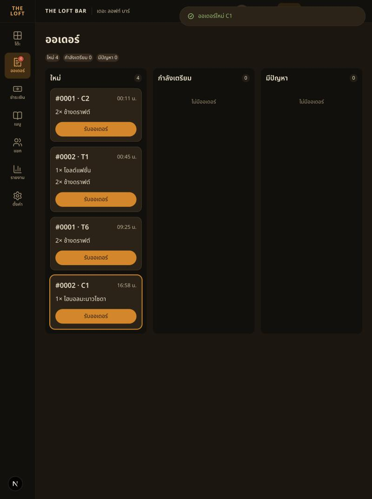
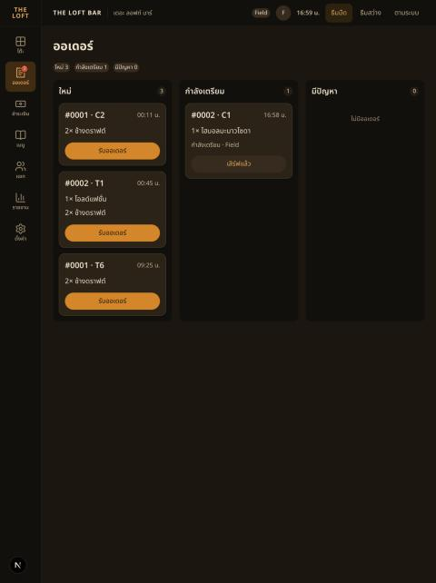
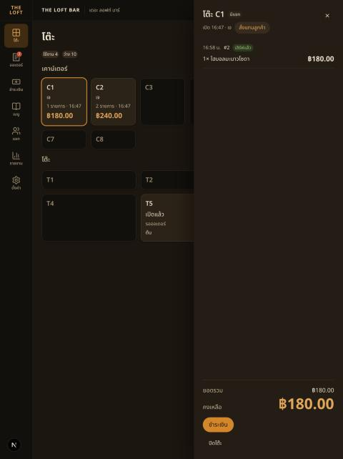

# Handoff — BRIEF-032 Web POS: orders board

| | |
|---|---|
| **Implementer** | kj (Claude Code) |
| **Date** | 2026-10-22 |
| **Brief revision** | 1 |
| **Branch** | `feat/BRIEF-032-pos-orders-board` (PR opens with this PASS commit) |
| **Work SHA** | `d13425a` |
| **Status** | Audit PASS (Cowork, `d13425a`) — merged PR determines Done |

## Summary
`/pos/orders`: columns ใหม่ / กำลังเตรียม / (พร้อมเสิร์ฟ when the kitchen screen is on) / มีปัญหา, station filter, cards with one action each, non-modal detail/issue drawer (ทำต่อ → `resolve substitute`; void/replace disabled), live via `order.created` · `ticket.status_changed` · `ticket.issue_escalated` · `menu.availability_changed`. Rail "ออเดอร์" links to the board with a pending-ticket Badge. One query `['tickets','board']` (`hooks/useTicketBoard.ts`) feeds board and rail. No contracts, packages or backend changes.

## AC evidence
| AC | Test |
|---|---|
| AC-1, AC-2, AC-7 | `OrdersBoard.test.tsx` — kitchen off/on, filter, counter skips ready, accept moves card, busy / empty / error+retry |
| AC-3 | `OrdersBoard.test.tsx` — 409 toast, refetch, button usable |
| AC-4 | `TicketDrawer.test.tsx` (issue fields, disabled void/replace, ทำต่อ) · `e2e/orders-board.spec.ts` |
| AC-5 | `OrdersBoard.test.tsx` — `order.created` highlight + toast + count; serve removes card, count right |
| AC-6 | `OrdersBoard.test.tsx` — `menu.availability_changed` toast (T2, T5), card leaves; `TicketCard.test.tsx` — struck line + "ยกเลิกอัตโนมัติ · ของหมด" |
| AC-8 | below |
Also: `PosRail.test.tsx` (3 links, Badge); stale-payload skip test.

## Gate Evidence (G1)
Node v24, pnpm 10, on `d13425a`-equivalent tree (the last commit only touched Sonar fixes; lint, typecheck and the orders tests were re-run after it).

| Command | Exit | Result |
|---|---|---|
| `pnpm --filter @bar/frontend lint` | 0 | pass |
| `pnpm --filter @bar/frontend typecheck` | 0 | pass |
| `pnpm --filter @bar/frontend test` | 0 | 112 passed (24 files) before the Sonar fix; orders tests 18 passed after |
| `pnpm --filter @bar/frontend test:e2e` | 0 | 12 passed on rerun. First run failed `order-entry.spec.ts` on a cold route compile (URL never reached `/order`); passed alone and in the full rerun |
| `pnpm --filter @bar/frontend build` | 0 | pass, `/pos/orders` listed |

Run proof on `01d0c09` (code identical to `d13425a` apart from the Sonar refactors in `BoardColumn` / `OrdersBoard`): Docker Postgres + Redis up, `migration:run` → no migrations pending; the leftover dev servers (3000, 3001) were stopped and `start:dev` + `pnpm dev` restarted → `/api/health` **200** `status=ok`, `db=up`; `NEXT_PUBLIC_API_MOCKING` unset. Field signed in with LINE in the browser pane. Tab 1: C1 → สั่งแทนลูกค้า → ไฮบอลมะนาวโซดา → ส่งออเดอร์. Tab 2 (`/pos/orders`, no reload): Toast "ออเดอร์ใหม่ C1", new card #0002 · C1 highlighted, rail Badge 3 → 4 → รับออเดอร์ → card in กำลังเตรียม "กำลังเตรียม · Field", Badge 3 → เสิร์ฟแล้ว → card left the board, Badge stayed 3. Tab 1 table drawer then showed the order's chip เสิร์ฟแล้ว.

Not exercised against the real API: issue → ทำต่อ (no escalated issue in the local DB; covered by component + e2e with MSW), kitchen-screen-on layout (venue is off), live `menu.availability_changed` (component test only).

## Sonar (local scan)
Scanned `01d0c09`, then re-scanned after the fix commit. Gate **ERROR**: `new_coverage` 0 % (no coverage path configured — known) and `new_violations` 16, all pre-existing (`test/setup.ts` ×3, backend order / idempotency / payment / seed / menu, `globals.css`, `lib/api/auth.ts`). The first scan showed 2 in my files (S3358 nested ternary in `BoardColumn`, S6819 `role="group"` in `OrdersBoard` → now `<fieldset>`); both fixed, none open in files this brief adds or changes. No exclusions, "won't fix" or gate change.

## Dependency / DR
None. No new packages, endpoints or contract changes.

## Notes for the auditor
- `ready` tickets while the kitchen screen is off are shown under กำลังเตรียม (brief silent; otherwise they would vanish).
- Board query asks `status=pending,accepted,ready,issue` as written, so `issue` tickets not yet escalated also appear in มีปัญหา (escalated time shown only when present).
- Drawer is a non-modal `aside` like the session drawer; "ไปที่โต๊ะ" is disabled when the seat has no current visit.
- MSW handler store now also receives tickets from `POST /visits/:id/orders`.
- Stale-payload skip uses `updatedAt` strictly older than the cached ticket.

## Audit follow-up
PASS, 0 Must fix. Suggestions left as is (no scope expansion): S1 card button holds a `<ul>` · S2 shared mutation moves the spinner between cards (a second tap gives an honest 409) · S3 double event subscription (rail + board) · S4 board shows unescalated `issue` tickets — revisit with `escalated=true` when the staff app flags issues.

## AI usage
n/a (Field's own brief).
