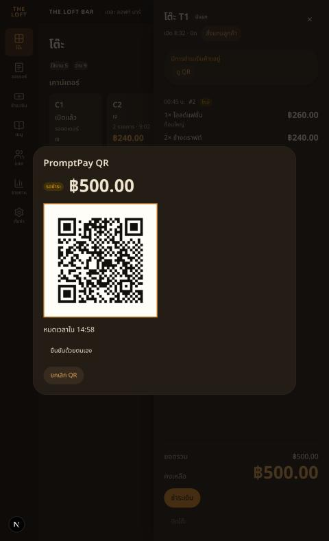
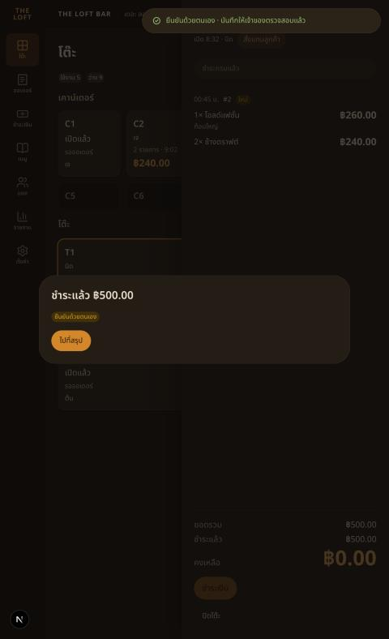
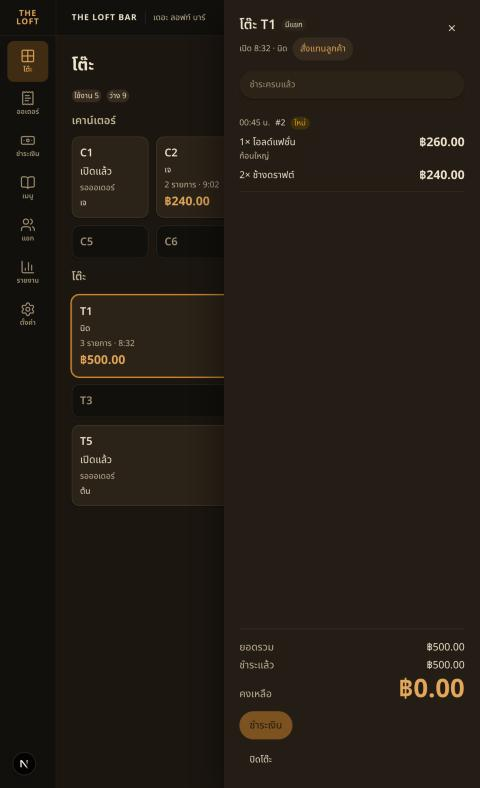
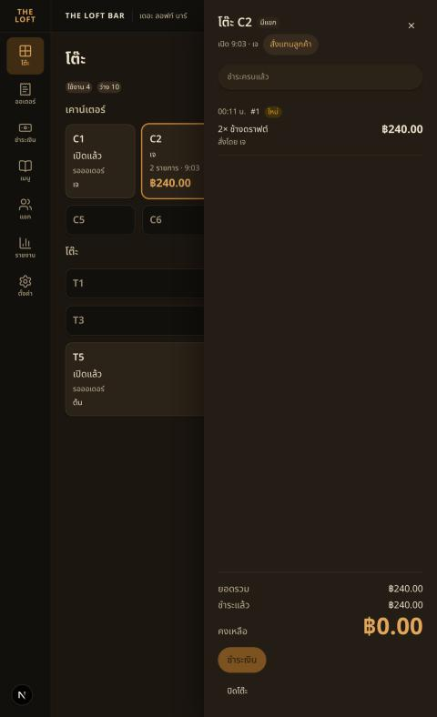
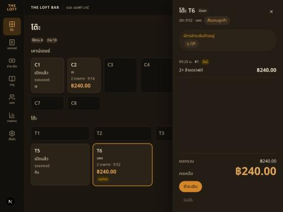
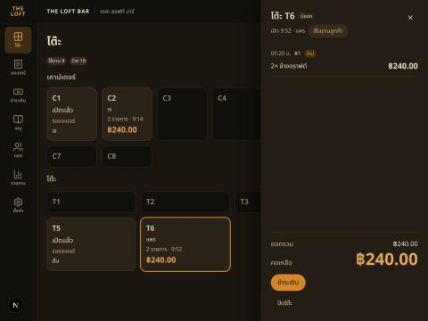

# Handoff — BRIEF-033 Web POS: checkout

| | |
|---|---|
| **Implementer** | kj (Cursor started, Claude Code finished) |
| **Date** | 2026-10-22 |
| **Brief revision** | 1 |
| **Branch** | `feat/BRIEF-033-pos-payment-checkout` (PR opens with this PASS commit) |
| **Status** | Audit PASS (Cowork, re-check of `f36352e`) — merged PR determines Done |

## Summary
Drawer footer "ชำระเงิน" and the close-confirm "ไปที่ชำระเงิน" open the checkout modal (`?pay=1`). PromptPay QR (rendered from `qrPayload` with `qrcode.react`, DR-018) and cash. Pending view with countdown, cancel, manual confirm; result by `payment.status_changed` or a 5 s poll when the socket is down. Drawer shows the in-flight state, "ดู QR", and the divider for orders placed after the QR. BRIEF-030 S1: ปิดโต๊ะ "paying" comes from `bill.locked` only.

## AC evidence
| AC | Test |
|---|---|
| AC-1, AC-2, AC-7 | `checkout/CheckoutModal.test.tsx` — one create + key + double tap · network retry same key · `PAYMENT_IN_FLIGHT` · `PROMPTPAY_NOT_SET` · cash short/empty/change |
| AC-3 | `CheckoutModal.test.tsx` — completed event · socket-down 5 s poll · `e2e/payment.spec.ts` |
| AC-4 | `CheckoutModal.test.tsx` — expired + new key |
| AC-5 | `CheckoutModal.test.tsx` — cancel, cancel 409 |
| AC-6 | `CheckoutModal.test.tsx` — manual confirm reason / other note / body · `e2e/payment.spec.ts` |
| AC-8 | `SessionDrawer.test.tsx` — "an order placed after the QR sits under the divider" |
| AC-9 | below |

Deviation from §5 file layout: manual-confirm, pending-view and status-poll tests live in `CheckoutModal.test.tsx` (the modal drives them); no separate `ManualConfirmModal.test.tsx` / `usePaymentStatus.test.ts` / `PromptPayPending.test.tsx`. Component is `ManualConfirm.tsx`.

## Gate Evidence (G1)
Node v24, pnpm 10. Run on the tree after the last fix commit.

| Command | Exit | Result |
|---|---|---|
| `pnpm --filter @bar/frontend lint` | 0 | pass |
| `pnpm --filter @bar/frontend typecheck` | 0 | pass |
| `pnpm --filter @bar/frontend test` | 0 | 93 passed (21 files) — twice in a row after `f36352e` |
| `pnpm --filter @bar/frontend test:e2e` | 0 | 10 passed · 0 failed, **three runs in a row** on `f36352e` (S2). |
| `pnpm --filter @bar/frontend build` | 0 | pass |
| run proof | 0 | On work SHA `36c5f0a`, fresh start: Postgres + Redis up, `migration:run` → no migrations pending; the backend left running from earlier was stopped and `start:dev` restarted → `/api/health` **200** `status=ok`, `db=up`; `pnpm dev` frontend on 3000, `NEXT_PUBLIC_API_MOCKING` unset. Field signed in with LINE in the browser pane. Test PromptPay ID `0800000000` (mobile) set via `PATCH /venue/payment-settings`. UI walk below. |

UI exercised on that pair (signed in as **Field**). **T1** (฿500.00, 2 lines): drawer → ชำระเงิน → checkout modal (ยอดรวม ฿500.00 · ชำระแล้ว ฿0.00 · คงเหลือ ฿500.00, PromptPay chip "ยืนยันด้วยตนเอง") → สร้าง QR → pending view with QR, ฿500.00, countdown 14:58, chip รอชำระ; the drawer behind showed "มีการชำระเงินค้างอยู่" with "ดู QR" → ยืนยันด้วยตนเอง → reason ลูกค้าโอนเข้าบัญชีร้านโดยตรง → ยืนยันว่าชำระแล้ว → "ชำระแล้ว ฿500.00" + Badge ยืนยันด้วยตนเอง + Toast "ยืนยันด้วยตนเอง · บันทึกให้เจ้าของตรวจสอบแล้ว" → auto-advance after 3 s to the drawer: "ชำระครบแล้ว", คงเหลือ ฿0.00, table still open → ปิดโต๊ะ → confirm → Toast "ปิดโต๊ะ T1 แล้ว", T1 card free. **Second run, เงินสด on C2** (฿240.00): เงินสด → รับเงินสด (no tendered amount) → back in the drawer "ชำระครบแล้ว", คงเหลือ ฿0.00, table open.

Left in the local DB (before the S1 run): T1 closed (paid manually), C2 paid by cash and still open, C1, T5, T6 open; venue PromptPay ID is the test value above. Backend (3001) and frontend (3000) dev servers started by this session are still running. S1 run left **T6** open with an order (2× ช้างดราฟต์ ฿240.00, QR cancelled). Cancel QR and the close-while-locked 409 were exercised live in the S1 run below; live expiry is covered by the component test only.

Playwright chromium 1243 was downloaded locally (Field-approved) to run e2e.

## Sonar (local scan)
Re-scanned `f36352e`. Gate **ERROR**: `new_coverage` 0 % (no coverage report path configured — known, see state) and `new_violations` 16 (was 17). **No open issue is left in any file this brief added or changed** — `SessionDrawer.tsx` S6819 is gone (S3 below); the 16 left are pre-existing (`test/setup.ts` ×3, backend order / idempotency / payment / seed / menu / openapi, `globals.css`, `lib/api/auth.ts`). No exclusions, "won't fix" or gate change.

## Audit follow-up (Field, 2026-10-22 block in `docs/audits/BRIEF-033.md`)
- **S1 — live evidence.** On a fresh `start:dev` + `pnpm dev`, signed in as Field, T6 (฿240.00): สร้าง QR → `POST /visits/:id/close` while the QR was pending → **409 `PAYMENT_IN_FLIGHT`** "มีการชำระเงินที่ยังไม่จบ", T6 still `active`. The drawer then showed "มีการชำระเงินค้างอยู่" + "ดู QR" with ปิดโต๊ะ disabled → ดู QR → **ยกเลิก QR** → back to checkout (ยอด ฿240.00, QR/เงินสด) → ยกเลิก → drawer with the lock alert gone, ชำระเงิน and ปิดโต๊ะ usable again.
  
  
  Expiry stays covered by the component test.
- **S2 — `login.spec.ts` flake.** Cause: the label lives 250 ms (`setTimeout` before `location.assign`), and once that navigation starts Playwright's own queries stall ("waiting for … navigation to finish"), so polling `toBeDisabled()` from the test can miss it. Now the label is watched from inside the page (MutationObserver via `addInitScript`, reported through `exposeFunction`) and the test waits on the URL, then asserts it was seen. Test-only; `LoginCard` unchanged. Holding the route instead did not work (queries stall during a held navigation), noted for the record. `test:e2e` ×3 green.
- **S3 — S6819.** `SessionDrawer.tsx` drops `role="dialog"`: `<aside aria-labelledby={titleId}>` (or `aria-label` while loading / error), Esc-to-close unchanged, floor still clickable. Drawer queries in `SessionDrawer.test.tsx`, `CloseConfirmModal.test.tsx` and the e2e specs now use `getByRole("complementary", { name })`; the close-confirm, checkout and open-table modals stay real dialogs.
- Also hardened `CheckoutModal.test.tsx`: one full-suite run failed once on the 1 s default `findByText` under load; the QR waits now allow 4 s.

## Dependency / DR
`qrcode.react@^4.2.0` (`app/frontend` only) — Pre-decided in the brief, DR-018.

## AI usage
n/a (Field's own brief).

## Limits
Real-bank scan not part of this brief. Orders/PromptPay ID in the local DB unchanged by me.
