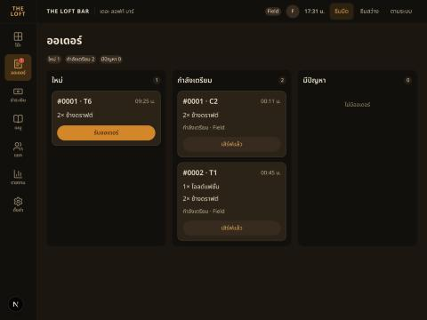

# Handoff — BRIEF-034 Web POS: orders board polish

| | |
|---|---|
| **Implementer** | kj (Claude Code) |
| **Date** | 2026-10-22 |
| **Brief revision** | 1 |
| **Branch** | `feat/BRIEF-034-pos-orders-board-polish` (PR opens with the PASS commit) |
| **Work SHA** | `63442f1` |
| **Status** | Audit PASS (Cowork, `63442f1`) — merged PR determines Done |

## Summary
Closes BRIEF-032 audit notes N1–N4. Frontend only; no contracts, packages, endpoints or backend changes.
- **N1** `TicketCard.tsx`: lines are ``s inside the open button (no `ul`/`li`); layout classes unchanged.
- **N2** `useTicketActions.ts`: `pendingIds` Set (add `onMutate`, remove `onSettled`, after the refetch) replaces `pendingId`; both mutations share it.
- **N3** `hooks/useTicketBoard.ts`: `useTicketBoard()` is the query only; socket invalidation moved to `useTicketBoardEvents()`, mounted once by `pos/_components/BoardEvents.tsx` in the POS layout (inside `SessionGate`). Stale-payload skip kept.
- **N4** `board.ts` `ticketsIn`: `issue` tickets need `issue.escalatedAt`; client-side on the same query (key unchanged), so the column and chip count agree. Rail Badge unaffected.

## AC evidence
| AC | Test |
|---|---|
| AC-1 | `TicketCard.test.tsx` — open button has no `ul/li/div/p`; screenshot below |
| AC-2 | `OrdersBoard.test.tsx` — two taps with held responses: both pending, A clears alone |
| AC-3 | `OrdersBoard.test.tsx` — one `ticket.status_changed` → exactly one extra `GET /tickets` (rail + board + events mounted) |
| AC-4 | `OrdersBoard.test.tsx` — escalated vs non-escalated issue; column and chip "มีปัญหา 1" |
| AC-5 | below; existing BRIEF-032 tests pass (test wrapper mounts `useTicketBoardEvents` like the layout) |

## Gate Evidence (G1)
Node v24, pnpm 10, on `63442f1`.

| Command | Exit | Result |
|---|---|---|
| `pnpm --filter @bar/frontend lint` | 0 | pass |
| `pnpm --filter @bar/frontend typecheck` | 0 | pass |
| `pnpm --filter @bar/frontend test` | 0 | 116 passed (24 files). First run had one timeout in `CartPanel.test.tsx` (findByRole, not touched); passed on rerun, and the `pos/tables` suite passes on the pre-change tree |
| `pnpm --filter @bar/frontend test:e2e` | 0 | 12 passed (a stale dev server on 3000 blocked Playwright's first start; stopped it, then green) |
| `pnpm --filter @bar/frontend build` | 0 | pass |

## Run proof
On `63442f1`: Docker Postgres + Redis up, `migration:run` → no migrations pending; stale dev servers stopped, `start:dev` + `pnpm dev` restarted → `/api/health` **200** `status=ok`, `db=up`; mocking off; browser pane already signed in. Tab 1 `/pos/orders` with 3 new cards: `รับออเดอร์` clicked on #0001 and #0002 in the same tick → both buttons `data-pending=true` 30 ms later, both cards moved to กำลังเตรียม (spinner per card, N2). Tab 2: รับออเดอร์ on the last card → tab 1 moved it to กำลังเตรียม without reload (socket → one board refetch path). New-order live toast not re-run (unchanged from 032; covered by the component test).

Not exercised against the real API: escalated-vs-not issue filtering (no issue tickets in the local DB; component test only).

## Sonar (local scan)
Scanned `e189bbe` + working tree. Gate ERROR: `new_coverage` 0 % (no coverage path — known) and `new_violations` 16, all pre-existing (`test/setup.ts`, backend, `globals.css`). **No open issue in any file this brief changes or adds** (queried by component). No exclusions, won't-fix or gate change.

## Dependency / DR
None.

## Notes for the auditor
- N3 relies on `BoardEvents` in the layout: a page that uses `useTicketBoard()` outside `/pos` would not auto-refresh.
- AI usage: Field's own brief (agent writes all code per project split).
