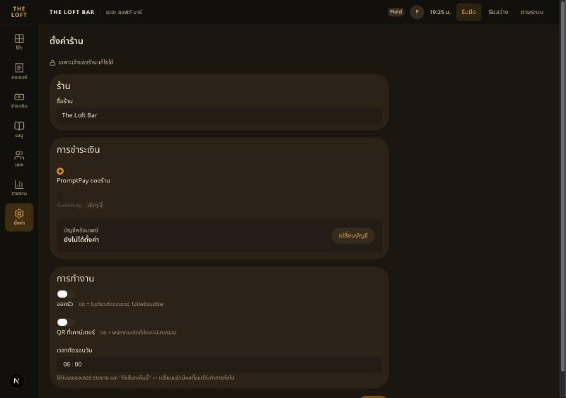
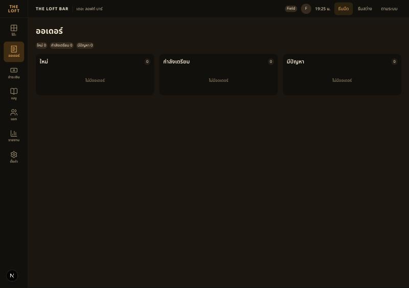
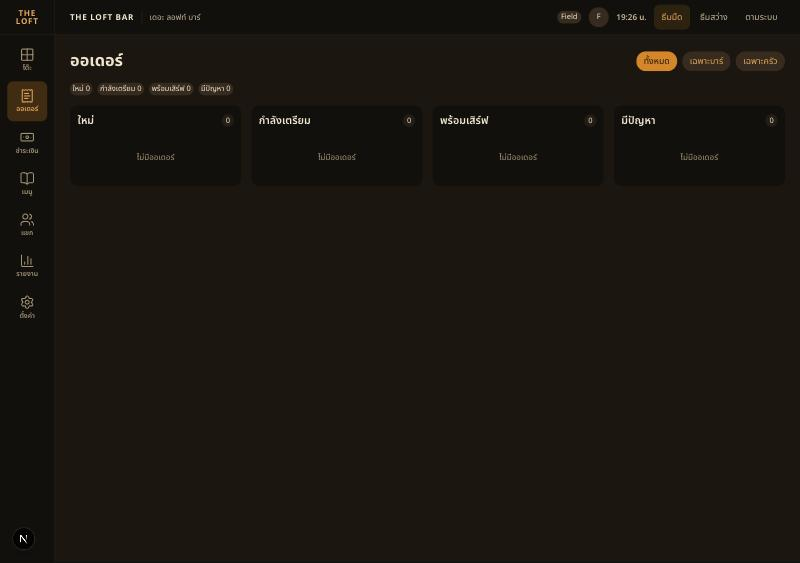
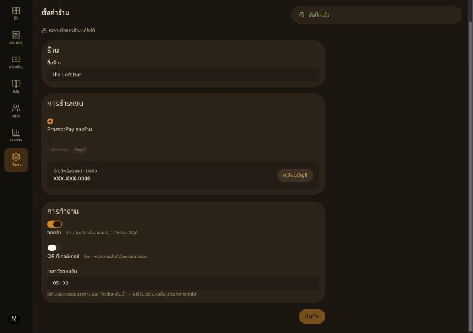
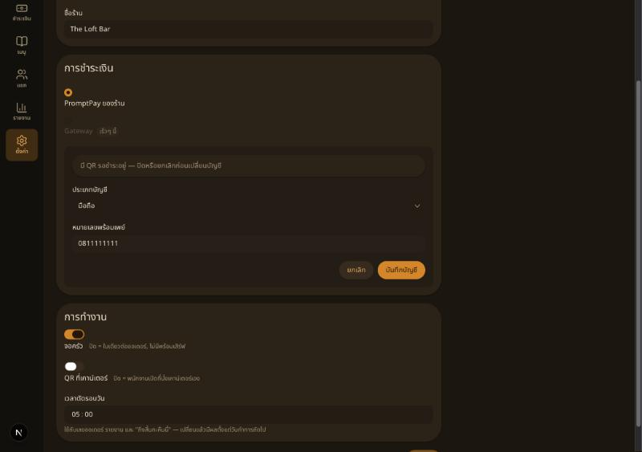

# Handoff — BRIEF-035 Venue settings: API + POS settings screen

| | |
|---|---|
| **Implementer** | kj (Claude Code) |
| **Date** | 2026-10-22 |
| **Brief revision** | 1 |
| **Branch** | `feat/BRIEF-035-venue-settings` (PR opens with the PASS commit) |
| **Work SHA** | `3fa6743` |
| **Assigned auditor** | Cowork |
| **Status** | Implemented — awaiting `audit BRIEF-035` |

## Summary
- **Contracts:** `UpdateVenueSettingsSchema` (partial; `name` trimmed 1–200, `businessDayCutoff` `^([01]\d|2[0-3]):[0-5]\d$`, booleans; empty body rejected) in `schemas/venue-settings.ts`; `VENUE_SETTINGS_CHANGED` + `VenueSettingsChangedPayloadSchema` `{ settings, updatedAt }` in `events/venue.ts`.
- **Backend `PATCH /venue/settings`** (`venue:update`, via `@RequirePermissions` only): `VenueSettingsService.updateSettings` → `@Transactional` `storeSettings`: venue row `FOR UPDATE` (`lockTheVenueSettings`) → patch of fields that really changed → `save()` (`saveSettings`) → one `AuditLogService.record` with only those columns `{ from, to }`. No change → 200, no audit row, no event. After commit: `emitToStaff('venue.settings_changed', …)` once.
- **Q1 = A (cut-off applies from the next business day), no schema change:** the service keeps `{ previous cutoff, changedAt }` in memory when the cut-off changes; `OrderService` now calls `businessDateUnder(now, rule)`. Rule: if the old cut-off still puts `now` in the business day that was open at `changedAt`, that day continues; otherwise the later of old/new dates (so a *later* cut-off never re-opens the finished day). **Limitation:** a backend restart drops the in-memory value → the new cut-off applies at once (one process today, DR-allowed "in memory" per the brief).
- **Forward-only:** kitchen mode is read per order in `groupTickets` (unchanged); existing tickets keep their station.
- **Frontend `/pos/settings`** (rail ตั้งค่า → `href`): ร้าน (name) · การชำระเงิน (RadioGroup: PromptPay ของร้าน selected, Gateway disabled + Chip "เร็วๆ นี้"; masked ID + "เปลี่ยนบัญชี" → `PromptPayForm` with type Select + ID, 409 → Alert "มี QR รอชำระอยู่ — ปิดหรือยกเลิกก่อนเปลี่ยนบัญชี") · การทำงาน (two Switches with help text, cut-off `TimeField` 24 h). Lock line "เฉพาะเจ้าของร้านแก้ไขได้". One บันทึก for ร้าน + การทำงาน sends only changed fields → Toast "บันทึกแล้ว". Loading skeleton, `LoadError` + retry, pending button.
- **Leave guard** (`useLeaveGuard`): App Router has no blocking API, so a capture-phase click listener catches in-app `<a href="/…">` while dirty → `LeaveDialog` (อยู่ต่อ / ออกโดยไม่บันทึก → `router.push`), plus `beforeunload`.
- **Live update:** `useVenueEvents` (mounted in `BoardEvents`, POS layout) invalidates `['venue']` on `venue.settings_changed`.
- **API client:** `apiPatch`; `lib/api/venue.ts` gains `updateVenueSettings`, `getPaymentSettings`, `updatePaymentSettings`. **MSW:** stateful `PATCH /venue/settings` (200/400 from the shared schema), `GET`/`PATCH /venue/payment-settings` (200 / 400 / 409 while any mock seat has `paymentPending` — T2 does by default); `resetFloor` resets both.
- **Docs:** `docs/api/README.md` Venue row; `openapi.json` regenerated.

## AC evidence
| AC | Evidence |
|---|---|
| AC-1 | `venue-settings.e2e-spec.ts` "saves a change, audits only that field…" — 200, `GET /venue` shows it, one row `{kitchen_display_enabled}`, same body again → no new row, one event. Run proof audit rows below |
| AC-1b | `business-date.spec.ts` `businessDateUnder` — 06:00 → 05:00 changed 23:00: 05:30 same night → tonight's date; next day → new cut-off; a later cut-off (07:00) does not reopen the finished day. Numbering follows `businessDate` (`nextNumber(date)`), so tonight's numbering continues |
| AC-2 | e2e `it.each`: `25:00`, `6:00`, blank name, `{}`, non-boolean → 400 `VALIDATION_ERROR`, no audit row. **Field paths: not in the envelope → DR-021 (Pending)** |
| AC-3 | e2e "splits tickets for orders placed after the kitchen screen is turned on" — before: `['bar']`; PATCH on; after: `['bar','food']`; first order still `['bar']` |
| AC-4 | e2e: exactly one `venue.settings_changed` per real change, payload = response; run proof: tab 2 board 3 → 4 columns without reload |
| AC-5 | `VenueSettingsScreen.test.tsx` (one PATCH `{ name, businessDayCutoff }` + Toast; empty name under the field, save disabled; server 400 → form Alert; leave dialog stay/leave) · `e2e/settings.spec.ts` (MSW) |
| AC-6 | component tests (masked shown; valid mobile → new mask; 409 → Alert, value unchanged) · run proof |
| AC-7 | component test (Gateway radio disabled, "เร็วๆ นี้", PromptPay checked) · screenshot |
| AC-8 | gates below; `openapi:check` exit 0; README updated |

## Gate Evidence (G1)
Node v24, pnpm 10, Docker Postgres + Redis, on `3fa6743` (working tree = commit for app code).

| Command | Exit | Result |
|---|---|---|
| `pnpm --filter @bar/contracts build` (+ `test`) | 0 | build ok · 35 tests (8 files) |
| `pnpm --filter @bar/backend lint` | 0 | oxlint + class-file check clean |
| `pnpm --filter @bar/backend typecheck` | 0 | pass |
| `pnpm --filter @bar/backend test` | 0 | 88 passed (31 files) |
| `pnpm --filter @bar/backend test:e2e` | 0 | 103 passed (18 files; new file 8 tests). Logged `QueryFailedError … brief027_cancel_fail` / `Error: boom` are existing negative-path tests |
| `pnpm --filter @bar/backend openapi:check` | 0 | no diff after commit |
| `pnpm --filter @bar/frontend lint` | 0 | pass |
| `pnpm --filter @bar/frontend typecheck` | 0 | pass |
| `pnpm --filter @bar/frontend test` | 0 | 123 passed (`PosRail.test.tsx` updated: 4 links, ตั้งค่า → `/pos/settings`) |
| `pnpm --filter @bar/frontend test:e2e` | 0 | 13 passed (new `settings.spec.ts`) |
| `pnpm --filter @bar/frontend build` | 0 | `/pos/settings` static route |

## Run proof
On `3fa6743`: the backend left from an earlier session (old `dist/main`) was stopped; `migration:run` → no migrations pending; fresh `start:dev` → `/api/health` **200** `status=ok`, `db=up`; `pnpm dev` on 3000, mocking unset. The backend e2e run had wiped staff/venue in the shared local DB, so Field's first LINE sign-in returned `not_registered` → re-ran `seed:staff` (Field's LINE sub, name Field), `seed:venue`, `seed:menu`; Field signed in again. Viewport 1280×900.

1. `/pos/settings` loaded from the real API — 
2. Tab 2 `/pos/orders`: 3 columns — 
3. Tab 1: จอครัว on → บันทึก → `PATCH /venue/settings` 200 → tab 2 refetched `/venue` and switched to **4 columns** (ใหม่ · กำลังเตรียม · พร้อมเสิร์ฟ · มีปัญหา + station chips) without reload — 
4. Cut-off 06:00 → 05:00 → Toast "บันทึกแล้ว" — 
5. เปลี่ยนบัญชี → มือถือ + test ID → card shows "XXX-XXX-0000 · มือถือ" — 
6. T1 opened, 1 × ช้างดราฟต์ (order #1, ticket `bar`), PromptPay QR created via the API from tab 2's signed-in session (checkout UI proven in BRIEF-033) → `pending`; QR payload carries the new ID.
7. Tab 1: เปลี่ยนบัญชี → another test number → บันทึกบัญชี → **409 Alert** "มี QR รอชำระอยู่ — ปิดหรือยกเลิกก่อนเปลี่ยนบัญชี"; DB still `…0000` — 
8. Proof QR cancelled afterwards (`POST /payments/:id/cancel` 200); T1 left open.

`audit_log` for the venue (time UTC, actor joined from `staff_user`):
```
12:25:49|UPDATE|Field|{"kitchen_display_enabled": {"to": "true", "from": "false"}}
12:26:16|UPDATE|Field|{"business_day_cutoff": {"to": "05:00", "from": "06:00"}}
12:26:32|UPDATE|Field|{"promptpay_id": {"to": "XXX-XXX-0000", "from": null}, "promptpay_id_type": {"to": "mobile", "from": null}}
```
No row for the blocked change. Not exercised live: the leave dialog (component + Playwright only) and the next-business-day cut-off switch (unit test with a fixed clock — needs a night).

## Sonar (local scan)
Scanned `15f8acd` + working tree (= `3fa6743`). Gate ERROR: `new_coverage` 0 % (no coverage path — known) and `new_violations` 16 — HIGH 5 · MEDIUM 5 · LOW 6 · INFO 1, all pre-existing (`test/setup.ts`, backend order/payment/menu/seed, `globals.css`, `openapi/document.ts`). **No open issue in any file this brief changes or adds** (17 open in the project, none matching). No exclusions, won't-fix or gate change.

## Dependency / DR
- No new packages (`@internationalized/date` already a frontend dependency, used for the `TimeField` value).
- **DR-021 (Pending)** — field paths on 400 `VALIDATION_ERROR`. Implemented option B meanwhile (client-side validation with the shared contracts schema; server 400 → form Alert). If Field picks A, it is a small follow-up across contracts + `HttpExceptionFilter`.

## Notes for the auditor
- **Size:** ~1,119 net-new lines excl. `openapi.json` (≈ 410 tests / 709 source) vs the ~500 estimate — over the §2 target, in line with the UI ≈ 1.6× pattern.
- `PATCH /venue/settings` emits after the transaction commits (outside `storeSettings`), so a rolled-back save never broadcasts.
- `useSettingsForm` keeps the draft across a socket refresh from another tab (draft may then show as dirty against the new server values) — acceptable for a one-owner screen.
- The cut-off grace is per process and in memory (see Summary).
- Local DB caveat for future run proofs: backend `test:e2e` shares the dev database and clears staff/venue → re-seed before a signed-in proof.
- AI usage: Field's own brief (agent writes all code per project split).
