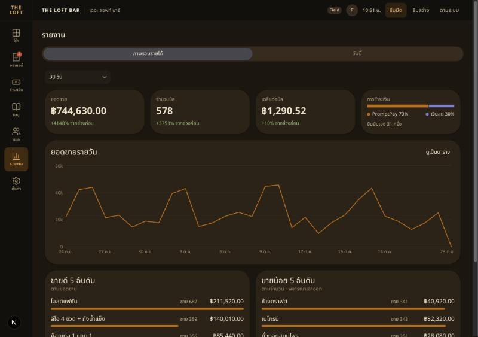
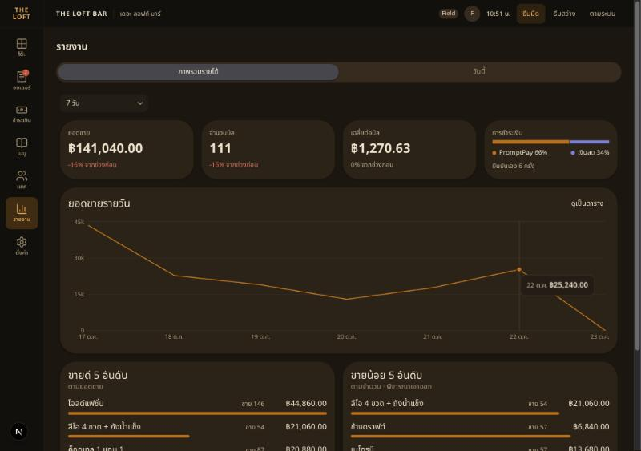
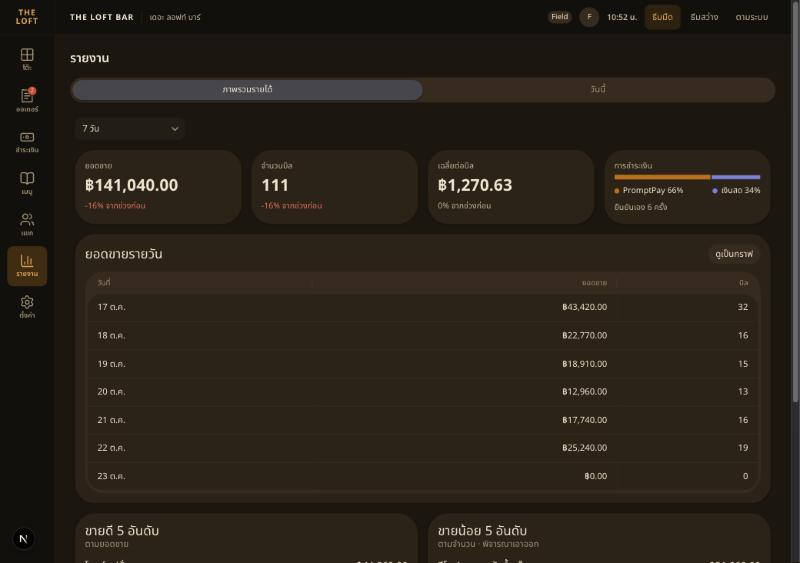
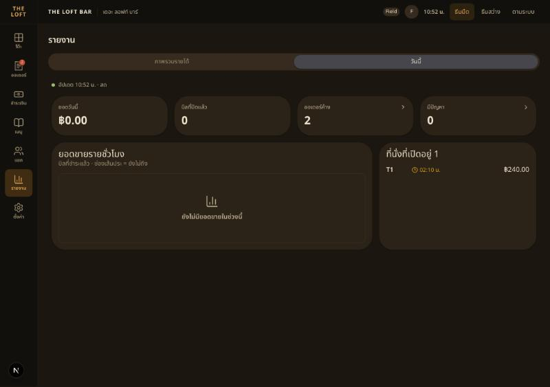
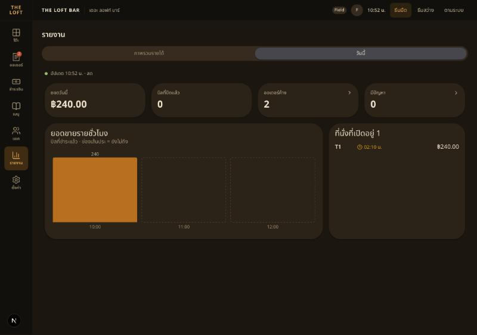
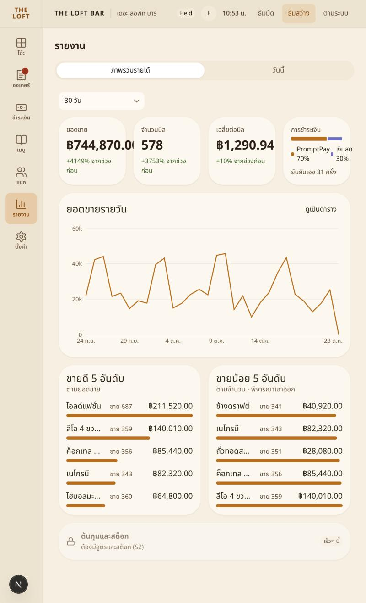
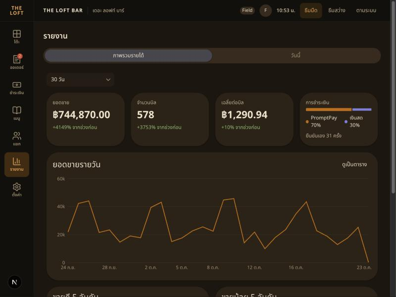

# Handoff — BRIEF-037 Web POS: owner dashboard (ภาพรวมรายได้ + วันนี้)

| | |
|---|---|
| **Implementer** | kj (Claude Code) |
| **Date** | 2026-10-23 |
| **Brief revision** | 1 |
| **Branch** | `feat/BRIEF-037-dashboard-ui` (seed `13dbaef`; `main` merged in at `5480281` after BRIEF-036 #78; PR opens after audit PASS) |
| **Commit** | Work SHA `536b24b` (work `3c3dd32` + fix `536b24b`) |
| **Assigned auditor** | Cowork |
| **Status** | Implemented — awaiting audit |

## Summary
- **`/pos/reports`** (rail รายงาน now links there): title + Tabs **ภาพรวมรายได้ · วันนี้**. Default ภาพรวมรายได้, last tab kept in `localStorage` (`reports.tab`, every access in try/catch — Q1 = A). The POS renders only after the client session check, so reading storage on first render is safe (no SSR mismatch).
- **ภาพรวมรายได้:** period Select วันนี้ · 7 วัน · **30 วัน** · กำหนดเอง (DateRangePicker in `en-GB` = d/m/y with Gregorian years, `maxValue` today, > 92 days → FieldError and no request). Dates = business dates from `GET /venue` cut-off (`period.ts` `businessToday`: Bangkok +7 h fixed − cut-off, same rule as backend `businessDate()`). 4 Card tiles (ยอดขาย · จำนวนบิล · เฉลี่ยต่อบิล with whole-% delta vs `previous`, none when previous = 0; การชำระเงิน = 8 px SVG split bar with legend + direct % labels + "ยืนยันเอง n ครั้ง"). Daily `LineChart` (2 px `--chart-1`, hairline grid, tooltip "10 ต.ค. ฿24,440.00") + "ดูเป็นตาราง" HeroUI Table. ขายดี / ขายน้อย 5 อันดับ (`<ol>`, name truncates, 6 px bars scaled to the list max — top by revenue, bottom by quantity as CD-05 §6). Disabled "ต้นทุนและสต็อก — เร็วๆ นี้" card.
- **วันนี้:** tiles ยอดวันนี้ · บิลที่ปิดแล้ว · **ออเดอร์ค้าง** · มีปัญหา (last two link `/pos/orders`); hourly `BarChart` (rounded tops, value labels on filled bars, dashed outline for hours after now; window = earliest of 18:00 / first sale / now → now + 2, capped at the last bucket); open seats oldest first (server order) with open time + bill. "อัปเดต HH:MM น. · สด" (`<output>`): `refetchInterval` 60 s + refetch on `order.created` and on `payment.status_changed` with `status = completed`; socket down (3 s, existing `useDisconnected`) or a failed refetch → grey dot "ไม่ได้อัปเดต", last data stays.
- **Tokens / dependency:** `--chart-1` #B87020 (both) and `--chart-2` #7E80D8 dark / #6E6FC8 light in `globals.css` + `--color-chart-*` mapping (CD-05 R2). `recharts@^3.9.0` → 3.10.1 (DR-015). Chart code reads colours only via `var(--…)` / token classes.
- **States:** Skeleton tiles + chart (`aria-busy`), empty "ยังไม่มียอดขายในช่วงนี้" (overview when bills = 0 and revenue = 0; today's hourly card when revenue = 0), `LoadError` "โหลดรายงานไม่สำเร็จ" + ลองอีกครั้ง (refetches only the failed queries).
- `lib/api/reports.ts` (contracts schemas from BRIEF-036), query keys `['reports', 'summary'|'daily'|'top'|'bottom', from, to]` and `['reports', 'today']`. MSW `mocks/reports.ts`: CD-05 §6 sample (30 days ฿440,660.00 · 600 bills · ฿734.43 · PromptPay 72 % · today ฿18,420.00, 8 open seats, ออเดอร์ค้าง 3, มีปัญหา 1).

## Acceptance Criteria
| AC | Result | Test |
|---|---|---|
| AC-1 | ✅ | `Overview.test.tsx` "30 วัน by default …" (tiles, `+12% จากช่วงก่อน`, split `PromptPay 72% เงินสด 28%`, first request `from=2026-09-23&to=2026-10-22` at 05:30 BKK 23 Oct = business day 22 Oct, 7 วัน → `from=2026-10-16&to=2026-10-22`) · `period.test.ts` (cut-off edges, presets, 92-day limit, delta) · `e2e/reports.spec.ts` overview (30 → 7 days, same `to`) · run proof 1–2 |
| AC-2 | ✅ | `RevenueChart.test.tsx` (summary `aria-label`, table rows = same numbers, toggle back) · run proof 2–3 (tooltip, table) |
| AC-3 | ✅ | `Overview.test.tsx` "top and bottom lists …" (5 + 5 rows, `ขาย 212`, `฿63,600.00`, long name has `truncate`) |
| AC-4 | ✅ | `Today.test.tsx` (tiles + links, hourly label, seats T4…C3 with "เปิดนาน" on the long-open ones; `pending` payment → no refetch, `completed` → refetch, time 21:14 → 21:20; 60 s timer refetch; `disconnect` → "ไม่ได้อัปเดต" with data kept) · e2e today (tab remembered across reload, มีปัญหา → `/pos/orders`) · run proof 4–5 |
| AC-5 | ✅ | `Overview.test.tsx` skeleton → empty, error → retry · `Today.test.tsx` skeleton → error → retry |
| AC-6 | ✅ | `grep -rnE "#[0-9A-Fa-f]{3,6}"` over `pos/reports` + `mocks/reports.ts` → none; tokens in `.dark`/`:root` and `.light` blocks · run proof 6 (light) |
| AC-7 | ✅ | gates below + run proof |

## Gate Evidence (G1)
Node v24, pnpm 10, macOS; on `536b24b` (working tree = commit for app code).

| Command | Exit | Result |
|---|---|---|
| `pnpm --filter @bar/frontend lint` | 0 | pass |
| `pnpm --filter @bar/frontend typecheck` | 0 | pass |
| `pnpm --filter @bar/frontend test` | 0 | 138 passed (29 files; new: `Overview` 4, `RevenueChart` 1, `Today` 4, `period` 4; `PosRail` updated for the new link) |
| `pnpm --filter @bar/frontend test:e2e` | 0 | 15 passed (new `reports.spec.ts` 2) |
| `pnpm --filter @bar/frontend build` | 0 | pass, `/pos/reports` static |
| run proof (below) | 0 | `/api/health` 200 on the branch's backend, UI exercised |

## Run proof
Backend: the server left from BRIEF-036 (`dist/main.js`, started 02:15) was stopped; `migration:run` → no migrations pending; fresh `node --env-file=.env dist/main.js` → `/api/health` **200** `status=ok`, `db=up`. `seed:demo-history` re-run → *30 days, 592 bills, 591 payments* (22 Sep–22 Oct). Web `next dev` on 3000, mocking unset. Field signed in with LINE after `seed:staff` with his LINE sub (his first try was recorded as `not_registered`, then registered). Built-in browser, 1280×900 unless noted. Business day at proof time = **23 Oct** (10:5x BKK).

1. 30 วัน → `GET /reports/summary?from=2026-09-24&to=2026-10-23` 200: ฿744,630.00 · 578 bills · ฿1,290.52 · PromptPay 70 % / เงินสด 30 % · ยืนยันเอง 31 ครั้ง; line ends at 0 on 23 Oct (nothing paid yet today) — 
   Delta shows **+4148 %**: the previous 30 days (25 Aug–23 Sep) hold only the first seeded day (23 Sep) — correct for the formula, a demo-data artefact.
2. 7 วัน → `from=2026-10-17&to=2026-10-23`: ฿141,040.00 · 111 bills · **−16 %** in `--text-danger`; tooltip "22 ต.ค. ฿25,240.00" — 
3. ดูเป็นตาราง: 7 rows; Σ 43,420 + 22,770 + 18,910 + 12,960 + 17,740 + 25,240 + 0 = ฿141,040.00, bills Σ 111 = tiles; 17 ต.ค. ฿43,420.00 / 32 = BRIEF-036 hand SQL — 
4. วันนี้: ฿0.00 · 0 · ออเดอร์ค้าง 2 · มีปัญหา 0; empty hourly; T1 open since 02:10 น. (warning colour, ≥ 3 h) ฿240.00 — 
5. Second tab `/pos/tables` → T1 → ชำระเงิน → เงินสด → รับเงินสด (`POST /visits/:id/payments` 201). First tab, **no reload**: ยอดวันนี้ ฿240.00, a 10:00 bar "240", dashed 11:00 / 12:00 — . Only two `/reports/today` requests in that tab (load + the one after the payment, within 3 s of the click). บิลที่ปิดแล้ว stays 0 — T1 is paid but not closed (bills = closed visits, BRIEF-036).
6. Light theme, 30 วัน (after the payment: ฿744,870.00) —  · 1024×768 — 
7. Found in the proof → fixed in `536b24b`: in a pane narrower than 1024 px the 4-column tiles clipped "฿744,870.0…". Tiles are now 2 × 2 below `lg` (1024) and 4 across from 1024 (CD-05 overview·2); gates re-run on `536b24b`.

**Local data touched:** `seed:demo-history` (rewrites its own tagged rows) · staff "Field" added via `seed:staff` · T1 paid ฿240 cash and **left open** (not closed).

## Sonar (local scan)
Scanned `536b24b`. Gate ERROR on `new_coverage` 0 % (no coverage path — known) and `new_violations` 16 (HIGH 5 · MEDIUM 5 · LOW 6 · INFO 1). **17 open issues in the project, none in a file this brief adds**; the only one in a touched file is the pre-existing `css:S4666` duplicate `:root` in `globals.css` (two `:root` blocks predate this brief). The first scan flagged two in new files — `S4624` nested template literal (`HourlyChart`) and `S6819` `role="status"` (`LiveStatus` → `<output>`) — both fixed before the work commit. No exclusions, won't-fix or gate change.

## Decisions Raised
- None. Dependency covered by DR-015 (Approved); chart tokens by CD-05 R2 (Field 17 Oct).

## Deviations from Brief
- **Tile label ออเดอร์ค้าง instead of ออเดอร์รอทำ** — BRIEF-036 audit Finding 2 (Cowork), carried in KJ state: the count includes `ready` tickets, so "waiting to be made" would be wrong. UI copy only.
- **`react-is`** not added to `package.json`: pnpm resolved recharts' peer automatically (`react-is@19.3.0`), install and build need nothing more — DR-015 allows it only "if the install requires it".

## Interpretations (no DR — inside brief wording; auditor please check)
- **Long-open seat = open ≥ 3 h** (`LONG_OPEN_MS`, visual only): CD-05 R3 says "warning colour as CD-02 idle" but gives no threshold, and `/reports/today` has no visit state. Shown with a clock icon + sr-only "เปิดนาน" (no colour-only meaning).
- Payment split % from the two method amounts (PromptPay rounded, cash = 100 − PromptPay); quantity label "ขาย n".
- Overview empty = `bills === 0 && revenue === "0.00"`; today empty applies to the hourly card only (tiles and open seats still matter).
- `formatThaiTime` imported from `tables/_components/table-time` — same cross-route import `/pos/orders` already uses; promoting it to `lib/utils` would touch other routes.

## Known Gaps / Follow-ups
- Size: **~1,575 net lines** (excl. lockfile; tests ≈ 380, MSW sample ≈ 150) vs the 550–650 estimate — UI ≈ 1.6× pattern again, plus the mock sample.
- Phone 390 layout out of scope (menu UI brief); below 1024 the tiles go 2 × 2 but lists / today grid are not tuned.
- Previous-period delta on demo data is huge while the seed covers only 30 days (point 1) — optional: seed 60 days for the 10 Nov demo (seed change, not this brief).
- Recharts animation is off (`isAnimationActive={false}`) for stable tests and screenshots.

## AI Usage
High — Claude Code implemented the whole brief (Field = reviewer mode; Field signed in with LINE for the run proof).

## Review Routing
- Assigned auditor: Cowork
- Next command: `audit BRIEF-037`
- Work SHA: `536b24b` · self-check: brief §2–§6 ↔ contracts `schemas/reports.ts` ↔ `lib/api/reports.ts` ↔ components ↔ tests compared; no contract change.

## Notes for Reviewer
- Start with `reports/period.ts` + `hourly.ts` (date / hour window logic, unit-tested), then `_hooks/useOverviewReports.ts` and `_hooks/useTodayReport.ts` (query keys, live refetch, stale rule).
- Dynamic bar widths are SVG `rect width="n%"` (no `style={{}}`, no arbitrary classes — `frontend.md`).
- `mocks/reports.ts` indexes the 30-day sample back from `to`, so any 30-day request returns exactly the CD-05 totals.
