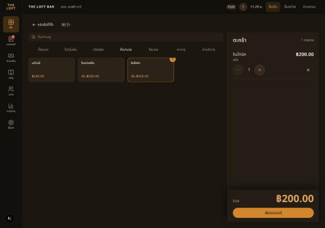
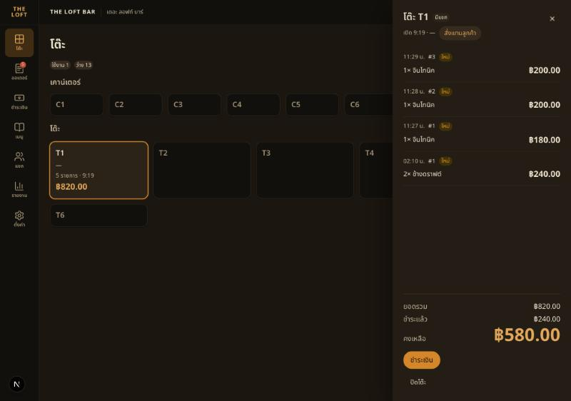

# Handoff — BRIEF-038 Backend: menu write API (items, variants, categories)

| | |
|---|---|
| **Implementer** | kj (Claude Code) |
| **Date** | 2026-10-23 |
| **Brief revision** | 1 |
| **Branch** | `feat/BRIEF-038-menu-write-api` (seed `3c8be95`; `main` merged in at `8d642f9` after #78/#79; PR opens after audit PASS) |
| **Commit** | Work SHA `5e29d80` |
| **Assigned auditor** | Cowork |
| **Status** | Implemented — awaiting audit |

## Summary
- **Items** (`MenuItemWriteController` → `MenuWriteService` → `MenuWriteTypeormRepository`, all on `txHost.tx`, `save()` only): `POST /menu/items` (optional `Idempotency-Key`, scope `menu-item`, same gate as orders/payments) and `PATCH /menu/items/:id` (whole form + `updatedAt`).
  - Stale check under `SELECT … FOR UPDATE`: `Date.parse(input.updatedAt) < stored` → 409 `MENU_ITEM_STALE`, `data.details` = current `MenuItem` (Q1 = A). Every PATCH sets `menu_item.updated_at` to `clock.now()` by hand, so a variant-only or link-only edit still moves the stamp.
  - Variants = new active set: listed ids updated + re-activated, new ones inserted, dropped ones `is_available = false` (never deleted). An id from another item → 400. `modifierGroupIds` linked to every active variant; omitted on PATCH → current links kept. `basePrice` = lowest listed price.
  - Category held `FOR KEY SHARE` on item writes, so a concurrent category delete waits and then sees the item (409) instead of an FK 500.
- **Categories** (in `MenuController`): `POST /menu/categories` (last in order), `PATCH /menu/categories/:id` `{ name?, isActive? }`, `PUT /menu/categories/order` (every visible category once; hidden ones may be left out and keep their order after the listed ones), `DELETE /menu/categories/:id` (409 `CATEGORY_NOT_EMPTY` while it holds any item, counted under `FOR UPDATE`).
- **Event:** `menu.changed` `{ itemIds?, categoryIds? }` to room `staff`, once per write, after the commit (an idempotent replay emits nothing).
- **Contracts:** `menu-write.ts` (`CreateMenuItemSchema`, `UpdateMenuItemSchema`, category schemas, `OkSchema`, `MenuPriceSchema` ≤ `DECIMAL(10,2)`), DR-012 / recipe / duplicate-id rules in `superRefine`; `MenuItem.updatedAt`; error codes; `MENU_CHANGED` + payload; `ApiErrorData` gains `{ details: MenuItem }`. OpenAPI regenerated (export stub lists the new controller), `docs/api/README.md` Menu table + WS events.

## Acceptance Criteria
| AC | Result | Test |
|---|---|---|
| AC-1 | ✅ | `menu-write.e2e-spec.ts` "creates a bar item with two variants, replays the same key…" (201, in `GET /menu/items`, replay = same body, 1 row) · run proof 1 |
| AC-2 | ✅ | `contracts/src/schemas/menu-write.test.ts` (charge+station, simple−station, recipe, no variants, prices, duplicate ids) · e2e "rejects the DR-012 station rule…" (400 ×5, unknown category 404, charge without station 201) |
| AC-3 | ✅ | e2e "answers a stale updatedAt with 409 MENU_ITEM_STALE…" (fresh 200, stale 409 + `details` = saved item, variant-only edit moves the stamp, unknown id 404) · run proof 4 |
| AC-4 | ✅ | e2e "deactivates a dropped variant…" (dropped `ดับเบิล` → `isAvailable: false`, 3 rows kept, old line keeps name/variant/price, new order on it → 409 `ITEM_UNAVAILABLE`, foreign variant id → 400) |
| AC-5 | ✅ | same e2e (bill unchanged, old lines 180/260, new order 200) · run proof 2–3, 5–6 |
| AC-6 | ✅ | e2e "creates, renames, reorders, hides and deletes categories" (hidden → items + category gone from POS reads, reorder without the hidden one, delete non-empty 409, empty ok, again 404, reorder missing a visible one 400, unknown 404) |
| AC-7 | ✅ | e2e: exactly `[{ itemIds:[id] }]` after create + replay; six writes → six payloads in order |
| AC-8 | ✅ | gates below, `openapi:check`, README |

`menu:write` declared on all six handlers (e2e reflector test); enforcement → IAM brief.

## Gate Evidence (G1)
Run on `5e29d80` (dev backend stopped first, as the e2e note requires).

| Command | Exit | Result |
|---|---|---|
| `pnpm --filter @bar/contracts build` | 0 | pass |
| `pnpm --filter @bar/contracts lint && typecheck && test` | 0 | 10 files · 58 passed (new `menu-write.test.ts` 16) |
| `pnpm --filter @bar/backend lint` | 0 | pass |
| `pnpm --filter @bar/backend typecheck` | 0 | pass |
| `pnpm --filter @bar/backend test` | 0 | 34 files · 102 passed |
| `pnpm --filter @bar/backend test:e2e` | 0 | 21 files · 126 passed (new `menu-write.e2e-spec.ts` 6) |
| `pnpm --filter @bar/backend openapi:check` | 0 | no diff |
| `pnpm --filter @bar/frontend typecheck` (not in brief — fixtures changed) | 0 | pass |
| `pnpm --filter @bar/frontend test` (not in brief) | 1 | 133/138 — 5 × "timed out in 5000ms", **different tests each run**, none touching menu; load average 22–36 (a game running). Re-run alone: CartPanel 8/8 ×2, settings + tables 46/46, login/reports/order 32/33 → passes. CI runs it on H |
| run proof (below) | 0 | `/api/health` 200 on the work SHA, POS order exercised |

## Run proof
Backend from another session (`dist/main.js`, started 10:58, old `dist`) stopped · `nest build` on `5e29d80` · `migration:run` → no migrations pending · fresh `node --env-file=.env dist/main.js` → `/api/health` **200** `status=ok`, `db=up`. `curl` as Field: session from `TokenService.createSession(<"Field" staff row>)` in a local script (no LINE). Web: Field signed in with LINE in the built-in browser, `next dev` on 3000, 1280×900.

1. `POST /menu/items` + `Idempotency-Key` — จินโทนิค, ค็อกเทล, bar, แก้ว 180.00 / ดับเบิล 260.00 → **201**, `basePrice 180.00`; replay same key → 201, `SELECT count(*)` = 1.
2. T1 (open, bill ฿240 paid) → order แก้ว → 201, line ฿180.00; bill ฿420.00.
3. PATCH fresh `updatedAt`, แก้ว → 200.00 → **200**; bill still ฿420.00; order #1 line still แก้ว ฿180.00. New API order → line ฿200.00 (bill ฿620.00).
4. PATCH with the first `updatedAt` → **409 `MENU_ITEM_STALE`** "มีคนบันทึกเมนูนี้ก่อน โหลดใหม่แล้วแก้อีกครั้ง", `details` = item at 200.00 / 260.00 with the new `updatedAt`.
5. **POS (web)** `/pos/tables/<T1>/order` → ค็อกเทล: tile "จินโทนิค เริ่ม ฿200.00", sheet แก้ว ฿200.00 / ดับเบิล ฿260.00 → cart ฿200.00 —  → ส่งออเดอร์ → toast "ส่งออเดอร์ T1 แล้ว"; drawer #3 ฿200 · #2 ฿200 · #1 **฿180** · ช้างดราฟต์ ฿240, ยอดรวม ฿820.00 — 
6. PATCH แก้ว → 220.00 → 200; bill still ฿820.00; POS reloaded: drawer lines unchanged (200 / 200 / 180 / 240), menu tile "เริ่ม ฿220.00". DB: `order_item.unit_price_snapshot` 180.00 / 200.00 / 200.00.

**Local data touched:** dev DB `bar` — item จินโทนิค (ค็อกเทล, แก้ว 220.00 / ดับเบิล 260.00) · T1 got 3 orders (฿180 + ฿200 + ฿200), still open, remaining ฿580.00. Backend left running on :3001 from `5e29d80`.

## Sonar (local scan)
Scanned the working tree of `5e29d80` (before the commit). Gate ERROR on `new_coverage` 0 % (no coverage path — known) and `new_violations` 16 (HIGH 5 · MEDIUM 5 · LOW 6 · INFO 1). **17 open issues in the project, none in a file this brief adds**; the two in touched folders are pre-existing (`seed-menu-catalog.ts:299` S6959, `menu-availability.ts:50` S3358 — files not changed here). No exclusions, won't-fix or gate change.

## Decisions Raised
- None.

## Deviations from Brief
- None needing a DR. Interpretations below.

## Interpretations (no DR — inside brief wording; auditor please check)
- **`MenuItem.updatedAt` (new response field).** Q1 = A has the client send "the `updatedAt` it loaded", so the item must carry it. Two frontend fixtures (`mocks/handlers.ts`, `ItemSheet.test.tsx`) and one contracts fixture gained one line each.
- **PATCH = whole form** ("`{ updatedAt, …same fields }`"): omitted `description` → null. Exception: omitted `modifierGroupIds` keeps the current links (group editing is BRIEF-039; a form without the group picker must not wipe them).
- **Variant ids on PATCH** (`{ id?, name, price }`): the brief's `[{ name, price }]` can't express "kept". Sending a deactivated id re-activates it.
- **Deactivated variants stay in menu reads** with `isAvailable: false` (BRIEF-016 shape unchanged; the POS already disables them in the sheet). "Can't pick" is enforced by the order API (AC-4).
- **Reorder** needs every *visible* category; hidden ones may be omitted (the POS list can't show them) and go last in their old order. Unknown id → 404, missing visible → 400.
- **Errors:** unknown category on item write / category routes → 404 `NOT_FOUND` "ไม่พบหมวด"; unknown modifier group or foreign variant id → 400 `VALIDATION_ERROR`.
- `menu.changed` payload per write: item writes `{ itemIds:[id] }`; category writes `{ categoryIds:[id] }`, reorder `{ categoryIds: ids }` (as sent). Item create/update into a hidden category is allowed.
- A mark-(un)available also moves `updatedAt` (TypeORM `@UpdateDateColumn`), so an editor open across an 86 gets 409 → reload. Documented in README.

## Known Gaps / Follow-ups
- **Size:** ~1,200 net lines (excl. `openapi.json`; tests ≈ 460) vs the 550–650 estimate — backend ≈ 1.9× (tests ≈ 38 %).
- **Renaming an item renames past order lines** on screen: `order_item` has no name snapshot (prices are safe). Schema change → own DR if wanted.
- **Hidden categories are not listed anywhere** (`GET /menu/categories` = active only) → the menu UI brief (040/041) needs a manager read (e.g. `?includeHidden`) to un-hide.
- POS doesn't listen to `menu.changed` yet (UI briefs) — a tile shows the new price after reload/refetch.
- `sort_order` max+1 is not race-proof (two creates may share a value; harmless, no unique constraint).
- Frontend unit tests flaky only under heavy machine load (gate table).

## AI Usage
**High** — Claude Code wrote all code, tests and docs (Field 0 % coding, reviewer mode).

## Review Routing
- Assigned auditor: Cowork
- Next command: `audit BRIEF-038`
- Work SHA: `5e29d80` · self-check: brief §2–§4 ↔ `menu-write.ts` ↔ `menu-write.service.ts` / repository ↔ e2e; no schema/migration change (all columns exist, `chk_menu_item_station` mirrored in the contract)

## Notes for Reviewer
- Start at `menu-write.service.ts` (`saveItem`: lock → stale → own-variant check → references → write) and `menu-write.typeorm-repository.ts` (`saveVariantSet`, `replaceLinks`, `updatedAt` set by hand).
- `@Transactional()` sits on private methods, events go out in the public wrappers after commit (same pattern as `VenueSettingsService`).
- The 409 body is read through `MenuCatalogService.getItem` on another connection while the row lock is held — a plain SELECT is not blocked by `FOR UPDATE`.
