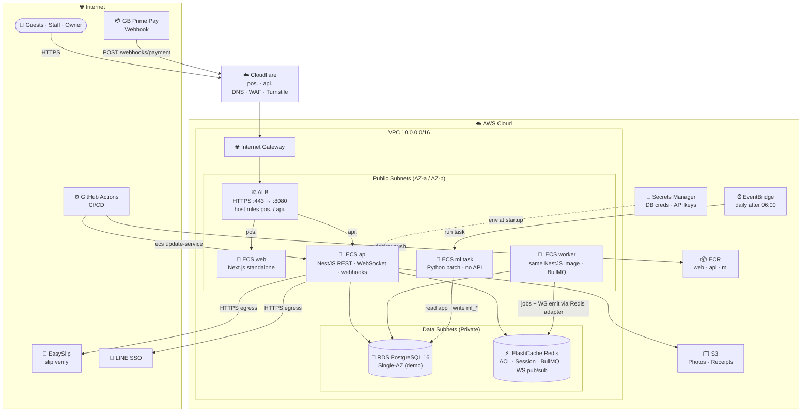

# Infrastructure Design — AI-Powered Bar Management System

**Last updated:** 2026-11-15 — DR-033 (all workloads on ECS, Vercel dropped) + DR-032 (Python ML batch task, no LLM API)
**Status:** Architecture locked. Implement 9–20 Nov via Terraform (DR-001 — AWS + Cloudflare only). Files: `infra/terraform/`.

## Workloads (DR-033)
One ECS cluster, one ALB, four workloads — still one NestJS codebase (modular monolith), not microservices.

| Workload | What | ECS type | Size |
|---|---|---|---|
| `web` | Next.js `output: "standalone"` image | service | 0.25 vCPU / 0.5 GB |
| `api` | NestJS — REST + WebSocket Gateway + webhooks | service | 0.25 vCPU / 0.5 GB |
| `worker` | same NestJS image, BullMQ processors only (`WORKER=1`, no HTTP) | service | 0.25 vCPU / 0.5 GB |
| `ml` | Python image (`app/ml/`, DR-032) | scheduled task — EventBridge, daily after the 06:00 business-day cut-off | 0.5 vCPU / 1 GB, minutes per day |

- **Routing:** host rules on one ALB — `pos.<domain>` → `web`, `api.<domain>` → `api`. Cloudflare proxies both (DNS + free WAF / DDoS); TLS Full (strict) to an ACM cert on the ALB. Same site → `lax` host-only cookies work.
- **`worker` → POS events:** `worker` emits through the existing `@socket.io/redis-adapter`; `api` delivers to sockets. Check this first in the worker-split brief — if it cannot emit without an HTTP server, raise a small DR (`@socket.io/redis-emitter`).
- **`ml` DB role:** read app tables, write `ml_*` tables only.
- **Rollout (smallest first):** `api` alone → `web` + host routing + Cloudflare → `worker` split → `ml` stub task (writes one `ml_model_run` row) until the models exist. Short on time → `worker` stays inside `api` behind a flag.

---

## Architecture Decision: Public Subnet Fargate (No NAT)

### Final choice
Fargate tasks run in **public subnet** with `assignPublicIp: ENABLED`.

### Defense

**Why assign public IP to Fargate:**
1. **Cost** — NAT Gateway costs ~$32/month base + $0.045/GB transfer. Overkill for a senior project.
2. **No IP whitelisting required** — LINE SSO, the slip-verification API, the payment gateway and any external API used do not require a fixed outbound IP.
3. **Inbound controlled by Security Group** — only ALB security group can reach Fargate on port 8080. The public IP is never directly reachable.
4. **Outbound routes through IGW natively** — public subnet route table handles egress directly. No extra component needed.
5. **ECR image pull** — Fargate pulls images from ECR via IGW on task startup. Same region = no data transfer cost.

> "I assign a public IP to Fargate for outbound internet access — calling LINE SSO and the slip / payment APIs, and pulling ECR images. For inbound, all traffic enters through ALB and the security group locks Fargate to only accept connections from ALB on port 8080. The public IP is never directly exposed or reachable. NAT Gateway adds $32/month to solve a problem I don't have — none of those APIs require IP whitelisting, and my security boundary is already enforced at the SG level."

### When NAT would be justified
- Containers must run in private subnet (compliance / enterprise policy)
- External API requires fixed outbound IP (whitelisting)
- Need centralized egress logging

None of these apply to this project.

---

## Traffic Flows

### Inbound (API calls, webhook)
```
User / GB Prime Pay
  → Cloudflare (pos.<domain> · api.<domain>)
  → Internet Gateway
  → ALB (HTTPS :443 → HTTP :8080, host rules)
  → Fargate `web` (Next.js) or `api` (NestJS) — SG: port 8080 from ALB only
```

### Outbound (external APIs)
```
Fargate → Internet Gateway → LINE SSO / EasySlip / payment gateway / ECR
```
Direct via route table. ALB is not in this path.

### Data
```
api / worker → RDS PostgreSQL    (TypeORM)
api / worker → ElastiCache Redis (ioredis) — ACL · Session · BullMQ · WS pub/sub
ml (daily)   → RDS PostgreSQL    (read app tables, write ml_* only)
Fargate → S3                (via S3 Gateway Endpoint — free, stays in AWS backbone)
```

### CI/CD
```
GitHub Actions → docker push → ECR (web · api · ml images; worker = api image)
GitHub Actions → ecs update-service → ECS (on release tags only — merging never deploys)
ECS → pull image from ECR (on task start)
```

---

## Infrastructure Diagram



---

## Component Breakdown

| Component | Service | Cost/mo | Notes |
|---|---|---|---|
| Web | ECS Fargate `web` (0.25 vCPU / 0.5 GB) | ~$9 | Next.js standalone (DR-033 — no Vercel, no PR preview deploys) |
| Backend | ECS Fargate `api` + `worker` (2 × 0.25 vCPU / 0.5 GB) | ~$18 | same NestJS image, two entrypoints |
| ML | ECS scheduled task `ml` (0.5 vCPU / 1 GB) | < $1 | daily batch, minutes per run (DR-032) |
| Database | RDS PostgreSQL 16 db.t3.micro | ~$15 | Single-AZ for demo, multi-AZ for prod |
| Cache/Queue | ElastiCache cache.t4g.micro | ~$13 | ACL · Session · BullMQ · WS pub/sub |
| Load Balancer | ALB (one, host rules) | ~$16 | `pos.` → web · `api.` → api · ACM cert |
| Storage | S3 | ~$1 | Photos, receipts |
| DNS / edge | Cloudflare | Free | DNS + WAF / DDoS (+ Turnstile for ticketing) · Route 53 rejected |
| IaC | Terraform (`infra/terraform/`) | ~$0 | AWS + Cloudflare in one tool · state in S3 (native lock) |
| CI/CD | GitHub Actions | Free | Build → push ECR → deploy ECS |
| **Total** | | **~$73/mo** (while running) | |

### Demo / Presentation strategy
`terraform apply` → present (~2 hrs) → `terraform destroy`.
Cost per session (~2 h): **~$0.20**. Use `skip_final_snapshot = true` on `aws_db_instance` to avoid lingering snapshot charges.

---

## Route Table Summary

**Public subnet route table:**
```
Destination     Target
10.0.0.0/16 →  local       (VPC internal)
0.0.0.0/0   →  IGW         (internet — inbound + outbound)
pl-xxxxxxxx →  S3 Endpoint  (S3 Gateway Endpoint — free)
```

**Data subnet route table:**
```
Destination     Target
10.0.0.0/16 →  local       (VPC internal only — no internet route)
```

---

## Terraform Rollout Plan
**Timeline:** 9–20 Nov. **Files:** `infra/terraform/`.

0. Bootstrap (once, outside the demo stack): S3 state bucket (versioned) — never destroyed by `terraform destroy`

Resources to provision (in order):
1. VPC + subnets + IGW + route tables
2. Security groups (ALB SG, Fargate SG, RDS SG, Redis SG)
3. S3 bucket + S3 Gateway Endpoint
4. RDS PostgreSQL
5. ElastiCache Redis
6. ECR repositories (`web`, `api`, `ml`)
7. ECS cluster + task definitions + services (`web`, `api`, `worker`)
8. ALB + two target groups (`web`, `api`) + HTTPS listener with host rules
8a. EventBridge rule + ECS scheduled task (`ml`) + ML DB role (read app, write `ml_*`)
9. Secrets Manager entries
10. GitHub Actions OIDC role (for CI/CD — no long-lived keys)
11. Cloudflare DNS records → ALB (`cloudflare` provider)
